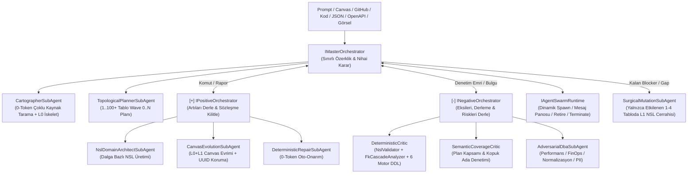

# Namines.AI v2 — Otonom Diyalektik Orkestrasyon & NSL-First Bağlam Mimarisi

> **Durum:** Eski tek-turlu / yamalı AI altyapısı (`GroqAIService`, `OllamaAIService`, `SchemaAgentPipeline`,
> `GroqSchemaDraftSource`, `ProgrammaticSchemaOptimizer`, `SchemaScopePartitioner`, `AgentQuotaReservation`, `AgentTools`)
> tamamen kaldırılarak `Namines.AI` modülü sıfırdan **arayüz (interface) güdümlü, sınırlı özerkliğe sahip
> 3 katmanlı diyalektik orkestrasyon motoru** olarak yeniden inşa edilmiştir.

---

## 1. Eski Altyapı Neden Tamamen Silindi?

Eski sistem organik büyümüş 6 farklı yamalı kattan oluşuyordu ve şu yapısal kusurlara sahipti:

| Eski Bileşen | Kök Problem | Yeni v2 Karşılığı |
|---|---|---|
| `GroqAIService` + `OllamaAIService` (~800 satır monolit) | Tek sınıf HTTP retry, header okuma, DBA analizi, Vision ERD, Migration, SmartSeed ve Streamlit işlerini karışık tutuyordu. | `ILlmCompletionEngine` (`OpenAiCompatibleLlmEngine`) + `UnifiedAiService` + uzman sub-agent'lar |
| JSON-tabanlı chunking (`SchemaScopePartitioner`) | 50-60+ tablolarda JSON çıktısı 4-5× fazla token tüketiyor, dalgalar arası PK/FK tipleri (`uuid` vs `int`) çatışıyordu. | NSL-First L0/L1 Bağlam Motoru + Topolojik Wave (0..N) + `TableSignatureContract` kilitleme |
| Tek doğrusal `SchemaAgentPipeline` | Kazanımları kilitleyen ve eksikleri eleştiren ayrı yapılar yoktu; hata onarımı körlemesine tüm şemayı yeniden üretebiliyordu. | `IMasterOrchestrator` + `[+]` `IPositiveOrchestrator` + `[-]` `INegativeOrchestrator` |
| Sabit `Free=6000 / Pro=16000` çıktı kesme tavanları | Kapsamlı şemalarda `finish_reason="length"` hatasına ve gereksiz tur tekrarına yol açıyordu. | Plan bazlı yapay kesme kaldırıldı; `AiAdvancedSettings.MaxTokens = 65536`, yenilenmiş `PlanQuotas` ve `AiQuotaService` havuzları |
| Parçalı veri kaynakları | GitHub, Prisma/EF Kod, JSON şekil çıkarımı, OpenAPI/GraphQL, DBA ve Canvas revizyonu farklı akışlarda kopuktu. | Tek birleşik `IAiWorkspaceToolRegistry` & `CartographerSubAgent` |

---

## 2. 3 Katmanlı Diyalektik Orkestrasyon Mimarisi

### Roller ve Sorumluluklar

1. **Ana Baş Orkestratör (`IMasterOrchestrator` -> `MasterOrchestrator`):**
   - Oturum başında kendi izole `IAgentSwarmRuntime` sürüsünü başlatır.
   - Haritacı (`Cartographer`) ve Planlayıcı (`TopologicalPlanner`) alt-ajanlarını doğurur, çıktıyı alıp emekliye ayırır.
   - `[+]` Yapıcı ve `[-]` Eleştirel orkestratörler arasındaki diyalektik döngüyü yönetir.
   - Kalan bulgular `IsDeterministicAutoFixable == true` ise **0 LLM token** harcayarak `DeterministicRepairSubAgent` ile çözer; anlamsal/derleme eksikleri kalırsa **yalnızca etkilenen alt grafiğe** `SurgicalMutationSubAgent` gönderir.
   - `MaxAutonomyWaves` sınırı içinde yakınsadığında (`IsCleanOfBlockers` + `QualityScore`) nihai `MasterVerdict` kararını verir ve sürüdeki ajanları temiz şekilde emekliye ayırır.

2. **`[+]` Yapıcı Alt-Orkestratör (`IPositiveOrchestrator` -> `PositiveOrchestrator`):**
   - Dalga sırasıyla (`Wave 0..N`) `NslDomainArchitectSubAgent` veya mevcut Canvas revizyonlarında `CanvasEvolutionSubAgent` alt-ajanlarını dinamik olarak doğurur.
   - Üretilen NSL çıktısını `ISchemaContextEngine.MergeNslIntoSchema` ile mevcut şemaya birleştirir.
   - Doğrulanan tabloların PK / Unique / FK imzalarını **`TableSignatureContract`** olarak kilitler — sonraki dalgalar ve revizyonlar bu sözleşmelere uymak zorundadır.
   - Baş Orkestratöre `PlusReport` (kazanımlar, kilitli sözleşmeler, tamamlanan alanlar, kapsama oranı) sunar.

3. **`[-]` Eleştirel Alt-Orkestratör (`INegativeOrchestrator` -> `NegativeOrchestrator`):**
   - Her faz/tur sonunda 3 uzman eleştirmen doğurur:
     - **DeterministicCritic:** `NslValidator` + `FkCascadeAnalyzer` + 6 veritabanı motoru (`PostgreSQL`, `MySQL`, `MSSQL`, `Oracle`, `SQLite`, `MariaDB`) için `IDdlGeneratorFactory` derleme testi.
     - **SemanticCoverageCritic:** Planlanan tabloların kapsanıp kapsanmadığı (`SEM-COVERAGE`) ve izole adacıkların (`SEM-ISOLATED`) kontrolü.
     - **DbaFinOpsSecurityCritic (`AdversarialDbaSubAgent`):** 0-token yerel DBA kontrolleri (eksik PK, indekssiz FK, boyutsuz `VARCHAR`, ham `password` kolonu) + NSL-sıkıştırılmış AI derin Performans/FinOps/Güvenlik denetimi.
   - Tekrarları temizlenmiş, eyleme dönük `ActionableDirective` içeren `MinusReport` üretir.

4. **Dinamik Sürü & Mesaj Panosu (`IAgentSwarmRuntime` -> `AgentSwarmRuntime`):**
   - Orkestratörler ihtiyaç anında `SpawnAgent(kind, name, purpose, modelTier)` ile alt-ajan oluşturur, `SendMessage(from, to, topic, content)` üzerinden haberleşir, işi biteni `RetireAgent` veya `TerminateAgent` ile sonlandırır.

---

## 3. Token Optimizasyonu: NSL-First L0 / L1 / L2 Bağlam Mühendisliği

Ham `DatabaseSchema` JSON'u 60-100 tabloda 30.000+ karaktere ulaşarak hem bağlam penceresini doldurur hem de modelleri halüsinasyona iter. `ISchemaContextEngine` (`SchemaContextEngine`) üç katmanlı bellek hiyerarşisi uygular:

| Katman | Adı | Maliyet | İçerik & İşlev |
|---|---|---|---|
| **L0** | `SchemaTopologicalSkeleton` | **0 LLM Token** (milisaniye) | Tüm şemanın grafik rolü (`Root`, `Hub`, `Bridge`, `Leaf`, `Standalone`), PK imzası ve `->`/`<-` komşuluk özetini çıkaran `CompactTextMap` (~100 tablo ≈ 1.200 token). |
| **L1** | `ScopedNslSubgraph` | ~%80–85 tasarruf | Yalnızca odaklanılan tabloları canonical `NSL 1.0` formatında (`NslWriter`) yazar + 1. derece FK komşularının **kilitli PK sözleşmelerini** ekler. |
| **L2** | `TableSignatureContract` + `MergeNslIntoSchema` | 0 LLM Token | Önceki dalgalarda üretilen tabloları hafif NSL saplamaları olarak `NslParser.Parse` öncesine enjekte eder; dalgalar arası FK çözümünü garanti eder, yanlışlıkla JSON gelirse `JsonSanitizerPreprocessor` ile kurtarır ve Canvas üzerindeki **`StableUuid`** değerlerini her zaman korur. |

### Neden NSL-First?
- `table users { id uuid pk not null ... }` satırı aynı tablonun JSON karşılığına kıyasla **~%80 daha az çıktı tokenı** tüketir.
- `DeterministicRepairSubAgent` her dalga sonrası 0 token ile:
  1. Eksik PK varsa `id UUID PK NOT NULL` ekler,
  2. Para/tutar/bakiye alanlarındaki `FLOAT`/`DOUBLE` tiplerini `DECIMAL(19,4)`'e yükseltir,
  3. Boyutsuz `VARCHAR` kolonlarını sınırlar,
  4. `password` adını `password_hash VARCHAR(255)` olarak sertleştirir,
  5. FK tip uyumsuzluğunu (`NSL004`) hedef PK ile eşitler,
  6. Eksik FK indeksini (`NSL010`) otomatik açar,
  7. Çoklu cascade yolları / döngüleri (`FkCascadeAnalyzer` / MSSQL Msg 1785) için güvenli `ReferentialAction.NoAction` uygular.

---

## 4. Çoklu Kaynak Araçları (`IAiWorkspaceToolRegistry`)

Tüm dış ve iç veri kaynakları tek standart araç sözleşmesinde (`IAiWorkspaceTool`) birleştirilmiştir:

1. `code_schema_extract` — Prisma (`.prisma`), EF Core (`DbSet<>` `.cs`) ve ham `.sql` dosyalarından `CodeSchemaExtractor` ile deterministik şema çıkarımı.
2. `json_shape_infer` — Gözlemlenen JSON API yanıtlarından `JsonShapeInferencer` ile değerleri saklamadan varlık, tip, FK ilişkisi ve `IsUncertain` (nullable) alan çıkarımı.
3. `openapi_extract` — `IApiSpecExtractor` (OpenAPI/Swagger ve GraphQL introspection) üzerinden varlık adayları.
4. `github_extract` — `GithubRepositoryUrl` SSRF-güvenli URL doğrulaması + `IRepositoryScanner` ile depo taraması.
5. `deterministic_validate_compile` — `NslValidator` + `FkCascadeAnalyzer` + 6 motor (`PostgreSQL`, `MySQL`, `MSSQL`, `Oracle`, `SQLite`, `MariaDB`) `IDdlGeneratorFactory` derleme doğrulaması.
6. `subgraph_inspect` — İstenen alt küme için L1 `ScopedNslSubgraph` incelemesi.

Canvas içi prompt (`POST /api/schema/revise`), DBA Analizi (`AIDbaService` -> `IDbaSchemaAnalyzer` -> `AdversarialDbaSubAgent`) ve NL→SQL / Migration / SmartSeed / Vision ERD / Impact Explainer (`UnifiedAiService` -> `LifecycleTaskSubAgent`) aynı birleşik sözleşme üzerinden çalışır.

---

## 5. Kısıt Kaldırma & Yeni Token Bütçe Mimarisi

Eski AI kota sınırları sıfırdan yeniden kurgulandı:

- **`AiAdvancedSettings`:**
  - Yapay plan-bazlı çıktı kesme (`Free=6000`, `Pro=16000`) kaldırıldı.
  - `MaxTokens` varsayılanı ve üst tavanı `65_536` olarak belirlendi; `MaxTokensFor(PlanTier)` tüm planlarda kullanıcının isteğini yapay olarak budamaz.
- **`PlanQuotas`:**
  - `Free`: `100_000` günlük token / `4` otonomi dalgası
  - `Pro` & `Team`: `1_000_000` günlük token (koltuk başı) / `8` otonomi dalgası (`Team` = 3M havuz)
  - `Enterprise`: `25_000_000` günlük token / `12` otonomi dalgası
  - `Dev`: Sınırsız (`int.MaxValue`) / `16` otonomi dalgası
- **`AiQuotaService`:**
  - Paylaşımlı ücretsiz havuz varsayılanı `2_500_000`, yönetici sınırı `10_000_000`, adil taban garanti tokenı `25_000` olarak güncellendi.

---

## 6. Modül Sınırları & Sağlayıcı Soyutlaması

- `Namines.AI.Application` katmanı **hiçbir** `Namines.*.Infrastructure` sınıfına bağımlı değildir; yalnızca `ILlmCompletionEngine` ve `Namines.Core.Interfaces` üzerinden çalışır (`Phase14_2D1ModuleArchitectureTests` ile IL seviyesinde doğrulanır).
- Sağlayıcı URL'leri (`Groq`, `DeepSeek`, `Ollama`) yalnızca `Namines.AI.Infrastructure.Providers` altında yaşar ve çalışma zamanında `ProviderHint` ile dinamik olarak değiştirilebilir.
- Birincil orkestrasyon API uçları (`POST /api/schema/generate`, `POST /api/schema/revise`, `SchemaController`) mevcut HTTP ve SSE olay akışı (`step`, `result`, `error`) sözleşmelerini bozmadan `IMasterOrchestrator` ve `UnifiedAiService` ile bütünleştirilmiştir.
