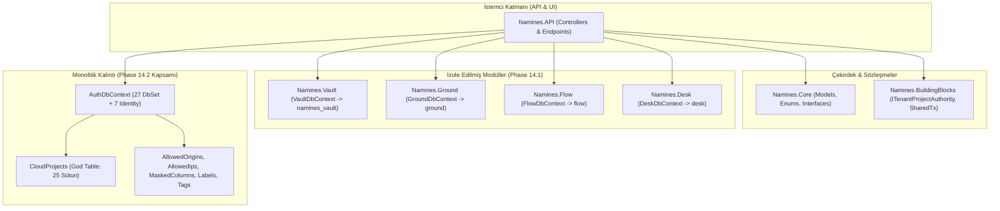
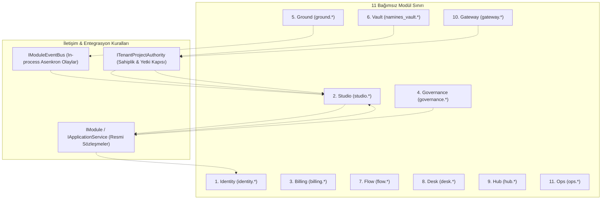
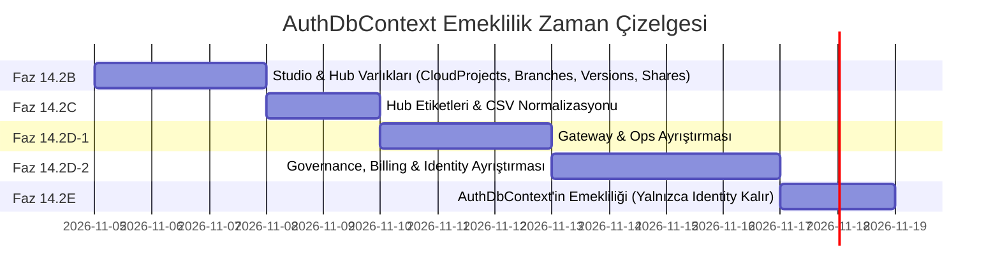
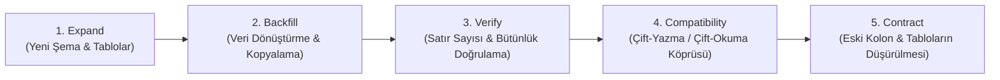

# NAMINES — PHASE 14 MASTER IMPLEMENTATION PLAN
## Tam Kapsamlı Modüler Monolit, 3NF Veritabanı ve Şema İzolasyonu Ana Uygulama Planı

**Doküman Kodu:** ARCH-PLAN-PHASE14-MASTER-20261104  
**Tarih:** 2026-11-04  
**Hazırlayan:** Principal Software Architect & Cryptographic Engineer  
**Statü:** **ANALİZ TAMAMLANDI — ONAY BEKLİYOR (KOD/DDL ÇALIŞTIRILMADI)**  
**Hedef Kapsam:** Phase 14 Mimari Dönüşümünün (14.2B, 14.2C, 14.2D-1, 14.2D-2, 14.2E) Uçtan Uca Tamamlanması  

---

## 1. Executive Summary (Yönetici Özeti)

Namines platformu, tasarım aşamasındaki veritabanı üretim aracından **"AI ile çok-kiracılı veritabanı ve backend yaşam döngüsünü güvenle yöneten kurumsal bir platforma"** evrilmektedir (27-LIFECYCLE-PIVOT). Bu evrimin omurgasını; monolitik ve aşırı sorumluluk yüklenmiş kontrol veritabanı yapısından (`AuthDbContext` ve `public` şeması), her biri kendi verisine ve sınırlarına sahip **11 bağımsız modülden oluşan bir Modüler Monolit (Modular Monolith)** mimarisine geçiş oluşturmaktadır.

Bu ana plan; aceleci veya yüzeysel dosya taşımaları yerine, **sıfır veri kaybı**, **sıfır kesinti (zero-downtime)**, **geriye dönük API uyumluluğu** ve **kriptografik kiracı izolasyonu** ilkelerine sadık kalarak Phase 14'ü eksiksiz kapatacak yol haritasını somut kanıtlarla belirlemektedir.

### Temel Stratejik Kararlar
1. **Dogmatik 3NF Yerine Domain-Driven Normalizasyon:** `SchemaJson` ve `NodePositionsJson` gibi canvas dokümanları ilişkisel tablolara parçalanmayacak; atomik birer **Aggregate Root** dokümanı olarak kalacaktır. Buna karşılık `CloudProjects` God Entity'si 4 mantıksal varlığa bölünecek, SQL'de `LIKE '%term%'` ile aranan CSV alanları (`Tags`, `Labels`) indeksli ilişkisel tablolara aktarılacaktır.
2. **Gateway İçi Yüksek Başarım Koruması:** `GatewayApiKeys.AllowedOrigins` ve `AllowedIps` gibi yalnızca in-memory IP/Origin kontrolü için kullanılan listeler, her REST çağrısına ekstra join maliyeti eklememek adına ayrı ilişkisel tablolara değil; PostgreSQL'in yerel `text[]` (array) tipine veya sınırlandırılmış Value Object yapısına dönüştürülecektir.
3. **5 Aşamalı Güvenli Migration (`Expand -> Backfill -> Verify -> Compatibility Period -> Contract`):** Hiçbir kolon veya tablo tek adımda silinmeyecek; çift-yazma/çift-okuma (dual-write/dual-read) köprüleri kurulacak, doğrulama (`Verify`) transactional bloklarla garanti altına alınacak ve eski kolonlar ancak uyumluluk dönemi sonunda düşürülecektir.
4. **AuthDbContext'in Nihai Rolü:** `AuthDbContext`, 27 iş tablosundan tamamen arındırılarak yalnızca ASP.NET Identity altyapısını (`identity.users`, `identity.roles`...) barındıran yalın bir kimlik context'ine dönüştürülecektir.

---

## 2. Repository Inspection Results (Mevcut Depo İnceleme Sonuçları)

Kod tabanı üzerinde yapılan derinlemesine statik ve dinamik analiz sonuçları aşağıdadır:

### 2.1. Çözüm ve Proje Organizasyonu
- **Solution:** `backend/Namines.sln` (.NET 8.0, C# 12).
- **Mevcut Projeler:**
  1. `Namines.API` (Web API Host, Controller'lar, Middleware'ler, SignalR Hub'ları).
  2. `Namines.Core` (Arayüzler, Enum'lar, Ortak Varlıklar, DTO'lar).
  3. `Namines.Infrastructure` (EF Core `AuthDbContext`, AI Entegrasyonları, Harici Servisler, Kod Üreticileri).
  4. `Namines.BuildingBlocks` (Shared Kernel, `ITenantProjectAuthority`, `ISharedTransactionManager`, `ModuleMigrationOrchestrator`, `Phase14_2A_SecurityMigrationSql`).
  5. `Namines.Vault` (Faz 14.1'de izole edilen modül: Application, Infrastructure, `VaultDbContext`).
  6. `Namines.Ground` (Faz 14.1'de izole edilen modül: Application, Infrastructure, `GroundDbContext`).
  7. `Namines.Flow` (Faz 14.1'de izole edilen modül: Application, Infrastructure, `FlowDbContext`).
  8. `Namines.Desk` (Faz 14.1'de izole edilen modül: Application, Infrastructure, `DeskDbContext`).
  9. `Namines.Mcp` & `Namines.Cli` (Konsol ve AI asistan araçları).
  10. `Namines.Tests` & `Namines.Tests.RunTests` (Mimari, Birim, Entegrasyon ve Gerçek Docker Konteyner testleri).

### 2.2. AuthDbContext Güncel Durumu (Kanıtlanmış Gerçeklik)
- `AuthDbContext.cs` satır 12–60 arasında **27 adet declared DbSet** bulunmaktadır.
- 10 adet eski DbSet (`VaultBackups`, `VaultRestores`, `VaultSchedules`, `GroundDatabases`, `GroundPurgeLogs`, `AutomationRules`, `AutomationRuns`, `AutomationRunLogs`, `SqlWorkbenchHistories`, `SavedQueries`) Phase 14.1 kapsamında `AuthDbContext`'ten **tamamen kaldırılmıştır** (Bkz: `ModularMonolithArchitectureTests.cs` L654: `Assert.Equal(27, declaredDbSetProperties.Count)` testi yeşildir).
- Ancak geriye kalan 27 DbSet hâlâ `AuthDbContext` üzerindedir ve `public` şemasında yaşamaktadır:
  - **Studio:** `CloudProjects`, `Branches`, `SchemaVersions`, `CrossDatabaseRelations` (4 DbSet).
  - **Identity:** `Organizations`, `OrganizationMembers`, `TeamInvites` (3 DbSet + 7 Identity tablosu).
  - **Governance:** `ChangeRequests`, `ChangeRequestApprovals`, `ChangeRequestAuditLogs`, `UserAIPolicies` (4 DbSet).
  - **Billing:** `UserAIQuotas`, `UsageEvents`, `UserBillingSettings`, `GlobalAiUsages`, `OrgAiUsages`, `StripeWebhookEvents` (6 DbSet).
  - **Gateway:** `GatewayApiKeys`, `GatewayTablePermissions`, `GatewayAuditEntries` (3 DbSet).
  - **Hub:** `RepoIssues`, `RepoIssueComments`, `RepoStars` (3 DbSet).
  - **Ops:** `Feedbacks`, `SqlExecutionAudits`, `FeatureFlags`, `AiToolRoutes` (4 DbSet).

### 2.3. AuthDbContext'e Doğrudan Bağımlı Kalan Bileşenler
Yapılan kod taramasında `AuthDbContext`'in hâlâ **21 Controller** ve **6 Altyapı Servisi** tarafından doğrudan inject edildiği kanıtlanmıştır:
- **Controller'lar:** `AdminController`, `AuthController`, `BranchController`, `ChangeRequestController`, `CoderAIController`, `CrossDatabaseController`, `DatabaseExecutorController`, `DocumentationController`, `FeedbackController`, `GatewayController`, `GatewayKeyController`, `HubController`, `LaunchController`, `PolicyController`, `ProjectMemberController`, `QuotaController`, `ShareController`, `SmartSeedController`, `StripeWebhookController`, `TeamController`, `UsageController`.
- **Servisler:** `AccountDeletionService`, `AiToolRouter`, `DataRetentionService`, `FeatureFlagService`, `LaunchService`, `ProjectDeletionService`.
- **İzole Edilmiş Olanlar:** Yalnızca `VaultController` ve `GroundController` `AuthDbContext` enjeksiyonundan tamamen arındırılmıştır (Bkz: `Isolated_Module_Controllers_MustNot_Inject_AuthDbContext` testi).

### 2.4. Phase 14.1 ve 14.2A Sonuçlarının Depo Teyidi
- **Phase 14.1:** Vault, Ground, Flow, Desk modülleri kendi DbContext'lerine ve servis katmanlarına kavuşmuş; eski `VaultService`, `GroundService`, `AutomationExecutor` gibi sınıflar depodan silinmiştir.
- **Phase 14.2A:** `studio.project_connections` tablosu oluşturulmuş, `ShareToken` düz metin alanı `[NotMapped]` yapılmış, `ShareTokenHash` üzerinden 4 anonim uç kilitlenmiş, `AesGcmConnectionSecretProtector` projenin `projectId`'sini AAD olarak bağlamıştır.
- **Test Kanıtı:** 9 güvenlik/göç testi, 13 mimari testi, 29 güvenlik sertleştirme testi ve 19 Docker konteyner testi olmak üzere **tüm testler 0 hata ile yeşildir**.

---

## 3. Current Architecture Snapshot (Mevcut Mimari Durum)



---

## 4. Target Architecture (Hedeflenen 11 Modüllü Mimari)

Hedeflenen mimaride her modül; **Domain (Varlıklar)**, **Application (Servisler ve DTO'lar)**, **Infrastructure (Özel DbContext ve Persistence)** katmanlarına sahip bağımsız bir sınır (Bounded Context) oluşturur.



### Katı Mimari Kurallar
1. **Veritabanı Seviyesinde Tam İzolasyon:** Hiçbir modül diğer modülün PostgreSQL şemasına doğrudan SQL atamaz veya DbContext'ini inject edemez.
2. **Çapraz Modül Foreign Key Yasağı:** Fiziksel FK'ler yalnızca aynı modülün şeması içinde tanımlanabilir. Modüller arası ilişkiler mantıksal ID (`ProjectId`, `UserId`, `OrganizationId`) üzerinden yürütülür ve uygulama katmanında `ITenantProjectAuthority` veya ilgili modül servisiyle doğrulanır.
3. **Senkron Sorgularda Sadece Sözleşme:** Bir modül başka bir modülden veri okumak zorundaysa, doğrudan veritabanına değil; hedef modülün `I<Module>ApplicationService` sözleşmesine çağrı yapar.
4. **Yan Etkilerde Olay Odaklılık:** Proje silinmesi, kullanıcı kaydı, abonelik iptali gibi yan etkiler `IModuleEventBus` üzerinden asenkron event'lerle dağıtılır.

---

## 5. Current vs Target Module Ownership Matrix

| Modül | Sorumlu DbContext | Sahip Olduğu Tablolar | Dış Tüketiciler | Mevcut Durum & Kalan Sorunlar |
|:---|:---|:---|:---|:---|
| **Identity** | `IdentityDbContext` | `identity.users`, `identity.roles`, `identity.organizations`, `identity.organization_members`, `identity.team_invites` | Tüm Modüller | `Organizations`, `Members` ve `Invites` hâlâ `AuthDbContext` içinde. Stripe alanları `AspNetUsers`'a gömülü. |
| **Studio** | `StudioDbContext` | `studio.projects`, `studio.branches`, `studio.schema_versions`, `studio.cross_database_relations`, `studio.project_connections`, `studio.project_shares` | Launch, Gateway, Desk, Hub, Vault | `CloudProjects` God Entity'si parçalanmadı. `Branches` ve `Versions` hâlâ `AuthDbContext`'te. |
| **Billing** | `BillingDbContext` | `billing.subscriptions`, `billing.user_ai_quotas`, `billing.usage_events`, `billing.user_billing_settings`, `billing.global_ai_usages`, `billing.org_ai_usages`, `billing.stripe_webhook_events` | Studio, Gateway, Flow | Tablolar `AuthDbContext`'te. Stripe alanları `AspNetUsers` üzerinde. |
| **Governance** | `GovernanceDbContext` | `governance.change_requests`, `governance.change_request_approvals`, `governance.change_request_audit_logs`, `governance.change_request_test_runs`, `governance.user_ai_policies` | Studio, AI DBA | Tablolar `AuthDbContext`'te. Test koşuları CR tablosunda nullable kolonlar halinde. |
| **Ground** | `GroundDbContext` | `ground.ground_databases`, `ground.ground_purge_logs` | Launch, ProjectDeletion | ✅ Faz 14.1'de izole edildi. |
| **Vault** | `VaultDbContext` | `namines_vault.vault_backups`, `namines_vault.vault_restores`, `namines_vault.vault_schedules` | Launch, ProjectDeletion | ✅ Faz 14.1'de izole edildi. |
| **Flow** | `FlowDbContext` | `flow.automation_rules`, `flow.automation_actions`, `flow.automation_run_logs` | Webhook, Background Job | ✅ Faz 14.1'de izole edildi. |
| **Desk** | `DeskDbContext` | `desk.desk_handoff_tokens`, `desk.sql_query_history`, `desk.saved_queries` | Gateway, AuthController | ✅ Faz 14.1'de izole edildi. |
| **Hub** | `HubDbContext` | `hub.repositories`, `hub.project_tags`, `hub.repo_issues`, `hub.issue_labels`, `hub.repo_issue_comments`, `hub.repo_stars` | HubController | Tablolar `AuthDbContext`'te. CSV `Labels` ve `Tags` 1NF ihlali yaratıyor ve `LIKE '%term%'` ile aranıyor. |
| **Gateway** | `GatewayDbContext` | `gateway.gateway_api_keys`, `gateway.gateway_table_permissions`, `gateway.gateway_audit_entries` | GatewayController | Tablolar `AuthDbContext`'te. `AllowedOrigins`/`AllowedIps` CSV formatında. |
| **Ops** | `OpsDbContext` | `ops.feedbacks`, `ops.sql_execution_audits`, `ops.admin_feature_flags`, `ops.ai_tool_routes` | AdminController, Executor | Tablolar `AuthDbContext`'te. Denetim kayıtları ve özellik bayrakları monolit context'te. |

---

## 6. AuthDbContext Decomposition Plan (Ayrıştırma ve Emeklilik)

`AuthDbContext` içerisindeki 27 DbSet, belirlenen fazlar boyunca ilgili modül DbContext'lerine transfer edilecek ve `AuthDbContext` adım adım küçültülecektir.



### Adım Adım DbSet Tahliye Takvimi
1. **Faz 14.2B:** `CloudProjects`, `Branches`, `SchemaVersions`, `CrossDatabaseRelations` -> `StudioDbContext` ve `HubDbContext`'e devredilir. (Kalan: 23 DbSet).
2. **Faz 14.2C:** CSV alanları normalize edilir; `RepoIssues.Labels` -> `hub.issue_labels`, `Tags` -> `hub.project_tags` aktarılır.
3. **Faz 14.2D-1:** `GatewayApiKeys`, `GatewayTablePermissions`, `GatewayAuditEntries` -> `GatewayDbContext`'e; `Feedbacks`, `SqlExecutionAudits`, `FeatureFlags`, `AiToolRoutes` -> `OpsDbContext`'e devredilir. (Kalan: 16 DbSet).
4. **Faz 14.2D-2:** `ChangeRequests`, `Approvals`, `AuditLogs`, `UserAIPolicies` -> `GovernanceDbContext`'e; `UsageEvents`, `UserAIQuotas`, `BillingSettings`, `StripeWebhookEvents`, `GlobalAiUsages`, `OrgAiUsages` -> `BillingDbContext`'e; `Organizations`, `OrganizationMembers`, `TeamInvites` -> `IdentityDbContext`'e devredilir. (Kalan: 0 İş DbSet'i).
5. **Faz 14.2E:** `AuthDbContext` üzerindeki tüm özel DbSet'ler kaldırılır. `AuthDbContext` ya silinir ya da sadece `IdentityDbContext<ApplicationUser>` miras alan `IdentityDbContext` olarak adlandırılır.

---

## 7. Database Schema Ownership Matrix (PostgreSQL 17)

Her PostgreSQL şeması bağımsız bir modülün mutlak mülkiyetindedir:

| PostgreSQL Şeması | Sahip Modül | Tablolar | İndeks ve Kısıt Kuralları |
|:---|:---|:---|:---|
| `identity` | Identity | `users`, `roles`, `user_roles`, `user_claims`, `organizations`, `organization_members`, `team_invites` | `users.email` UNIQUE, `organizations.slug` UNIQUE, `organization_members(org_id, user_id)` UNIQUE composite PK. |
| `studio` | Studio | `projects`, `project_connections`, `project_shares`, `branches`, `schema_versions`, `cross_database_relations` | `projects.xmin` (concurrency), `branches(project_id, name)` UNIQUE, `branches.is_default` partial UNIQUE, `project_shares.token_hash` UNIQUE. |
| `billing` | Billing | `subscriptions`, `user_ai_quotas`, `usage_events`, `user_billing_settings`, `global_ai_usages`, `org_ai_usages`, `stripe_webhook_events` | `subscriptions.stripe_customer_id` UNIQUE, `stripe_webhook_events.event_id` UNIQUE, `usage_events(user_id, created_at)` CONCURRENT index. |
| `governance` | Governance | `change_requests`, `change_request_approvals`, `change_request_audit_logs`, `change_request_test_runs`, `user_ai_policies` | `change_requests.id` PK, `change_request_approvals(cr_id, user_id)` UNIQUE, `change_request_test_runs(cr_id, executed_at)` index. |
| `ground` | Ground | `ground_databases`, `ground_purge_logs` | `ground_databases.project_id` UNIQUE, `ground_databases.status` index. |
| `namines_vault` | Vault | `vault_backups`, `vault_restores`, `vault_schedules` | `vault_schedules.project_id` UNIQUE, `vault_backups(project_id, created_at)` index. |
| `flow` | Flow | `automation_rules`, `automation_actions`, `automation_run_logs` | `automation_rules.project_id` index, `automation_run_logs(rule_id, executed_at)` index. |
| `desk` | Desk | `desk_handoff_tokens`, `sql_query_history`, `saved_queries` | `desk_handoff_tokens.token_hash` UNIQUE, `saved_queries(project_id, name)` UNIQUE. |
| `hub` | Hub | `repositories`, `project_tags`, `repo_issues`, `issue_labels`, `repo_issue_comments`, `repo_stars` | `repositories.slug` UNIQUE, `project_tags(project_id, tag)` PK, `issue_labels(issue_id, label)` PK, `repo_stars(project_id, user_id)` PK. |
| `gateway` | Gateway | `gateway_api_keys`, `gateway_table_permissions`, `gateway_audit_entries` | `gateway_api_keys.key_hash` UNIQUE, `table_permissions(project_id, table_name)` UNIQUE, `audit_entries.created_at` index. |
| `ops` | Ops | `feedbacks`, `sql_execution_audits`, `admin_feature_flags`, `ai_tool_routes` | `admin_feature_flags.key` UNIQUE, `ai_tool_routes.tool_name` UNIQUE, `sql_execution_audits.project_id` index. |

---

## 8. CloudProjects God Entity Ayrıştırma Tasarımı

`CloudProjects` varlığı, 25 farklı sütun barındıran klasik bir **God Table**'dır. Bu tablo 4 bağımsız aggregate'e ayrıştırılacaktır:

```mermaid
classDiagram
    class StudioProject {
        +string Id PK
        +string Name
        +string DbType
        +string SchemaJson
        +string NodePositionsJson
        +string UserId
        +string OrganizationId
        +bool AutoApproveSafeChanges
        +uint RowVersion
        +DateTime CreatedAt
        +DateTime UpdatedAt
    }

    class ProjectConnection {
        +string ProjectId PK, FK
        +string ConnectionDbType
        +string EncryptedConnectionString
        +bool AllowDeskSql
        +DateTime UpdatedAt
    }

    class ProjectShare {
        +string ProjectId PK, FK
        +string ShareTokenHash UNIQUE
        +DateTime CreatedAt
        +DateTime UpdatedAt
    }

    class HubRepository {
        +string ProjectId PK, FK
        +string Slug UNIQUE
        +string Description
        +int Visibility
        +string Category
        +int StarCount
        +int ForkCount
        +string ForkedFromProjectId
        +string LinkedGithubRepo
    }

    class ProjectTag {
        +string ProjectId PK, FK
        +string Tag PK
    }

    StudioProject "1" -- "0..1" ProjectConnection : 1:0..1 Has
    StudioProject "1" -- "0..1" ProjectShare : 1:0..1 Has
    StudioProject "1" -- "0..1" HubRepository : 1:0..1 Has
    StudioProject "1" -- "0..*" ProjectTag : 1:N Has
```

### Ayrıştırma Kuralları ve Gerekçeler
1. **`studio.projects` (Çekirdek Varlık):** Yalnızca canvas modellemesi, şema JSON verisi, sahip kullanıcı/organizasyon ve eşzamanlılık belirtecini (`xmin`) barındırır.
2. **`studio.project_connections` (1:0..1):** Canlı veritabanı bağlantısı bulunmayan projeler için bu satır hiç açılmaz. NULL kolonlar temizlenir; bağlantı sırları ve AAD kontrolleri bu tabloda izole kalır (Phase 14.2A'da kuruldu).
3. **`studio.project_shares` (1:0..1):** Anonim olarak paylaşılmamış projeler için satır açılmaz. `ShareToken` düz metin kolonu tamamen ortadan kaldırılır, sadece `ShareTokenHash` yaşar.
4. **`hub.repositories` (1:0..1):** Hub'da yayınlanmamış projeler topluluk metaverisi taşımaz. Sosyal vitrin, fork ve GitHub repo bağımlılıkları Hub modülüne devredilir.
5. **`hub.project_tags` (1:N):** `Tags` sütunundaki CSV formatı satırlara bölünerek `(project_id, tag)` bileşik anahtarına bağlanır.

---

## 9. CSV ve Koleksiyon Alanlarının Veri Modelleme Kararları

Mevcut kod tabanındaki koleksiyon alanları titizlikle incelenmiş ve performans/kullanım senaryolarına göre aşağıdaki kararlar alınmıştır:

### 9.1. `GatewayApiKeys.AllowedOrigins` ve `AllowedIps`
- **Mevcut Kullanım:** `GatewayKeyRestrictions.cs` içerisinde gelen HTTP isteğindeki IP ve Origin ile **bellekte (in-memory)** karşılaştırılmaktadır. Veritabanında hiçbir zaman `WHERE AllowedIps LIKE ...` veya IP bazlı filtreleme/join yapılmamaktadır.
- **Mimari Karar:** **Ayrı ilişkisel tabloya BÖLÜNMEYECEKTİR.**
- **Gerekçe:** Her API Gateway çağrısında API anahtarı `KeyHash` ile tek bir satır olarak çekilmektedir. Bu alanları 2 ayrı tabloya bölmek (`gateway.api_key_allowed_origins`, `gateway.api_key_allowed_ips`), Gateway üzerinden geçen **her tekil REST isteğine 2 ek JOIN veya 2 ek SQL sorgusu** ekleyerek veritabanı latency'sini ve bağlantı havuzu yükünü katlayacaktır.
- **Uygulanacak Model:** PostgreSQL yerel `text[]` (dizi) tipi veya `GatewayApiKeyRestrictions` Value Object'i olarak korunacaktır.

### 9.2. `GatewayTablePermissions.MaskedColumns`
- **Mevcut Kullanım:** `GatewayAccess.MaskedColumnsAsync` tablodan okuma yapılırken hassas sütun adlarını diziye bölerek (`Split(',')`) dinamik maskeleme uygulamaktadır.
- **Mimari Karar:** PostgreSQL `text[]` dizisine dönüştürülecektir. Ayrı tablo join maliyetinden kaçınılırken, C# tarafında sürekli string split yapma külfeti ortadan kaldırılacaktır.

### 9.3. `RepoIssues.Labels` ve `CloudProjects.Tags`
- **Mevcut Kullanım:** `HubController.cs` satır 140 ve satır 773'te doğrudan SQL üzerinden sorgulanmaktadır:
  - `query.Where(i => i.Labels != null && i.Labels.Contains(label))`
  - `p.Tags != null && p.Tags.ToLower().Contains(term)`
- **Kusur:** CSV içinde `Contains(...)` (SQL `LIKE '%term%'`) yapmak iki büyük soruna yol açmaktadır:
  1. **Yanlış Eşleşmeler:** "sql" araması "nosql" etiketini de yanlışlıkla döndürmektedir.
  2. **Tam Tablo Taraması (Full Table Scan):** B-tree indeksleri `LIKE '%...'` sorgularında kullanılamaz; proje sayısı arttıkça Hub aramaları çöker.
- **Mimari Karar:** **İlişkisel Tablolara Normalize Edilecektir.**
  - `hub.project_tags (project_id, tag)` PK.
  - `hub.issue_labels (issue_id, label)` PK, `IX_issue_labels_label` B-tree indeksi.
- **Kazanım:** Tam sözcük eşleşmesi, indeksli ultra hızlı arama ve "en çok kullanılan etiketler" aggregation imkânı.

---

## 10. Cross-Module Dependency & Communication Analysis

Modüller arasındaki çağrı akışları döngüsel bağımlılık üretmeyecek şekilde topolojik olarak tasarlanmıştır:

```
[10] Identity (Kullanıcı, Rol, Organizasyon)
  ↓
[20] Studio (Çekirdek Şema ve Projeler)
  ↓
[30] Billing (Kotalar, Harcama Olayları)
  ↓
[40] Governance (Change Request'ler, Onaylar, AI Politikaları)
  ↓
[50] Ground (Yönetilen DB) ──┐
[60] Vault (Yedekleme)     ──┼─► [20] Studio (Metadata & Secret Okuma)
[70] Flow (Otomasyon)      ──┤
[80] Desk (SQL Konsolu)    ──┘
  ↓
[90] Hub (Topluluk, Vitrin, Sorunlar)
  ↓
[100] Gateway (REST Veri Erişim Kapısı)
  ↓
[110] Ops (Denetim, Bayraklar, Hata Kayıtları)
```

### Entegrasyon Mekanizmaları
- **`ITenantProjectAuthority` (BuildingBlocks):** Studio dışındaki modüllerin (Vault, Ground, Gateway, Desk) bir projenin varlığını, sahibini, canlı bağlantı sırrını doğrulaması için ortak çekirdek servisidir.
- **`IModuleEventBus` (In-Process Asenkron):**
  - `ProjectDeletedEvent`: Studio'da bir proje silindiğinde; Vault yedeklerini, Ground veritabanını, Flow kurallarını ve Hub deposunu tetikleyerek asenkron temizlik sağlar.
  - `PlanChangedEvent`: Billing'de kota veya paket değiştiğinde; Studio ve Gateway yetkilerini dinamik günceller.

---

## 11. Security and Tenant Isolation Review

| Güvenlik Alanı | Mevcut Durum | Tespit Edilen Risk | Alınacak Önlem & Tasarım Kuralı |
|:---|:---|:---|:---|
| **Kiracı İzolasyonu (Tenant Boundary)** | `OrganizationId` ve `UserId` üzerinden kontrol edilir. | `OrganizationId`'si null olan projelerde veya eski endpoint'lerde IDOR riski. | Tüm modül servislerinde `ITenantProjectAuthority.CanViewAsync(projectId, userId)` ve `CanEditAsync` zorunlu kılınacaktır. |
| **Bağlantı Sırrı Güvenliği** | AES-256-GCM + PBKDF2 + AAD (`projectId`). | Şifreli bağlantı metninin başka projeye kopyalanması. | GMAC tag mismatch koruması devrededir (`AuthenticationTagMismatchException`). Tüm çözme yolları AAD'yi doğrulamaya devam edecektir. |
| **Share Token Güvenliği** | SHA-256 hash üzerinden aranır; raw token DB'de tutulmaz. | Hash injection veya sızıntı. | Anonim uçlar strictly `SHA256(rawToken)` hesaplar; raw token yalnızca oluşturulduğunda bir kez istemciye döner. |
| **Sır Sızıntısı (Logging / Telemetry)** | `[JsonIgnore]` uygulanmıştır. | İstisna ve log mesajlarına connection string veya parola sızması. | `DbConnectionFailure.Classify(ex)` kullanılarak tüm sürücü hataları maskelenecektir. DTO'lar açık projection ile yazılacaktır. |
| **Background Worker Yetkisi** | Worker'lar kendi DI kapsamını açar. | Kiracı bağlamının kaybolması. | Arka plan işlerinde `ProjectId` üzerinden scoped tenant context oluşturulacaktır. |

---

## 12. PostgreSQL Güvenli Migration Stratejisi

Tüm veritabanı değişiklikleri **5 Aşamalı Genişlet-Daralt (Expand-Contract)** metodolojisiyle yürütülecektir:



### PostgreSQL'e Özel Güvenlik ve Performans Kuralları
1. **İşlemsel DDL (Transactional DDL):** Tüm migration DDL'leri PostgreSQL'de transaction içinde çalıştırılır (`BEGIN ... COMMIT`). Hata anında tüm değişiklikler anında geri alınır (`ROLLBACK`), veritabanı yarı-migrated durumda kalmaz.
2. **Kilit (Lock) Önleme:** `ALTER TABLE ... ADD COLUMN` işlemleri PostgreSQL 11+ sürümlerinde metadata güncellemesidir (anında tamamlanır). Ancak büyük tablolara indeks atılırken transaction dışı `CREATE INDEX CONCURRENTLY` kullanılmalıdır.
3. **`ALTER TABLE SET SCHEMA` Kullanımı:** `UsageEvents`, `SqlExecutionAudits` gibi milyonlarca satır içerebilecek tablolarda veri kopyalamak (`INSERT INTO ... SELECT`) disk I/O ve log patlamasına yol açar. Bu tablolar için pg_class kataloğunu milisaniyede güncelleyen `ALTER TABLE public."UsageEvents" SET SCHEMA billing;` komutu kullanılacaktır.
4. **İdempotent Backfill:** Veri aktarım betikleri `ON CONFLICT DO NOTHING` veya `ON CONFLICT DO UPDATE` kullanarak mükerrer çalıştırmalarda güvenli olacaktır.

---

## 13. Detailed Phase-by-Phase Implementation Plan

### PHASE 14.2B — CloudProjects God Entity & God Table Ayrıştırması
1. **Amaç:** `CloudProjects` tablosundaki bağlantı, paylaşım ve topluluk sorumluluklarını `studio.projects`, `studio.project_connections`, `studio.project_shares`, `hub.repositories` ve `hub.project_tags` tablolarına ayırmak.
2. **Mevcut Durum:** 25 kolon tek bir tabloda; `EncryptedConnectionString`, `ShareTokenHash`, `Tags`, `Slug` bir arada.
3. **Dokunulacak Modüller:** `Namines.BuildingBlocks`, `Namines.Core`, `Namines.Infrastructure`, `Namines.API` (ShareController, HubController, GatewayKeyController).
4. **Etkilenecek Dosyalar ve Sınıflar:**
   - `Namines.Core/Models/Auth/CloudProject.cs`
   - `Namines.Core/Models/Auth/Normalized3NfEntities.cs`
   - `Namines.BuildingBlocks/Modules/StudioModule.cs`
   - `Namines.BuildingBlocks/Modules/HubModule.cs`
   - `Namines.API/Controllers/ShareController.cs`
   - `Namines.API/Controllers/HubController.cs`
   - `Namines.Infrastructure/Data/TenantProjectAuthorityService.cs`
5. **Veritabanı Değişiklikleri:**
   - `studio.projects` (ana tablo).
   - `studio.project_connections` (Phase 14.2A'da açıldı, tam birincil kaynak yapılacak).
   - `studio.project_shares` (`ProjectId`, `ShareTokenHash`, `CreatedAt`).
   - `hub.repositories` (`ProjectId`, `Slug`, `Description`, `Visibility`, `Category`, `StarCount`, `ForkCount`, `LinkedGithubRepo`).
   - `hub.project_tags` (`ProjectId`, `Tag`).
6. **API ve DTO Etkileri:** DTO sözleşmeleri sabit tutulacak; Controller'lar veriyi ilgili normalize varlıklardan join/include ile okuyacaktır.
7. **Güvenlik Riskleri:** Proje silme (`ProjectDeletionService`) esnasında ilişkili tabloların yetim kalmaması için `ON DELETE CASCADE` kısıtları doğru kurulacaktır.
8. **Migration Stratejisi:** `Expand -> Backfill -> Verify` (Backfill SQL'i ile veriler kopyalanır, eski kolonlar bu fazda henüz silinmez).
9. **Test Planı:** Proje oluşturma, güncelleme, silme, paylaşma, forklama ve etiket arama testleri.
10. **Kabul Kriterleri:** Yeni oluşturulan veya güncellenen bir projenin verileri normalize tablolara yazılmalı; eski API uçları sıfır kırılma ile çalışmalıdır.
11. **Rollback Stratejisi:** Eski `CloudProjects` kolonları henüz silinmediği için çift-yazma köprüsü kapatılarak anında geri dönülebilir.
12. **Bağımlılık:** Phase 14.2A (Kabul edildi).
13. **Tahmini Karmaşıklık:** Yüksek.
14. **Çıktı Raporu:** `docs/architecture/PHASE_14_2B_REPORT.md`.

---

### PHASE 14.2C — CSV ve Arama Kolonlarının Normalizasyonu
1. **Amaç:** `RepoIssues.Labels` CSV alanını `hub.issue_labels` ilişkisel tablosuna dönüştürerek `LIKE '%term%'` full scan açığını kapatmak; `GatewayApiKey` ve `TablePermission` alanlarını optimize etmek.
2. **Mevcut Durum:** `RepoIssues.Labels` ve `GatewayTablePermissions.MaskedColumns` virgüllü string saklıyor.
3. **Dokunulacak Modüller:** `Namines.BuildingBlocks`, `Namines.Core`, `Namines.API` (HubController, GatewayController).
4. **Etkilenecek Dosyalar ve Sınıflar:**
   - `Namines.Core/Models/Hub/RepoIssue.cs`
   - `Namines.Core/Models/Auth/GatewayApiKey.cs`
   - `Namines.API/Controllers/HubController.cs`
   - `Namines.API/Controllers/GatewayController.cs`
5. **Veritabanı Değişiklikleri:**
   - `hub.issue_labels` (`IssueId`, `Label` PK, `IX_issue_labels_label` indeksi).
   - `GatewayTablePermissions.MaskedColumns` -> PostgreSQL `text[]` dönüşümü veya string split optimizasyonu.
6. **API ve DTO Etkileri:** `HubIssueDto` dışarıya `string[] Labels` dizisi sunmaya devam eder; API sözleşmesi bozulmaz.
7. **Güvenlik Riskleri:** Etiket ayrıştırmasında injection veya kontrolsüz uzunluk riski. En fazla 32 karakter sınır kuralı.
8. **Migration Stratejisi:** `string_to_array` ve `unnest` ile mevcut veriler satırlara dökülecektir.
9. **Test Planı:** Etiket ekleme, silme, etiketle arama, çoklu etiket filtreleme testleri.
10. **Kabul Kriterleri:** Hub issue listeleme sorguları `LIKE` yerine `hub.issue_labels` tablosu üzerinden B-tree index ile çalışmalıdır.
11. **Rollback Stratejisi:** `RepoIssues.Labels` kolonu geçiş süresince tutulur.
12. **Bağımlılık:** Phase 14.2B.
13. **Tahmini Karmaşıklık:** Orta.
14. **Çıktı Raporu:** `docs/architecture/PHASE_14_2C_REPORT.md`.

---

### PHASE 14.2D-1 — Çekirdek İşlev Modüllerinin İzolasyonu (Studio, Hub, Gateway, Ops)
1. **Amaç:** `Studio`, `Hub`, `Gateway` ve `Ops` modüllerinin kendi bağımsız DbContext, Application Service ve Domain katmanlarını oluşturmak; ilgili Controller'ları `AuthDbContext`'ten bu modüllere taşımak.
2. **Mevcut Durum:** Tablolar `AuthDbContext`'te, kodlar `Namines.Infrastructure` ve doğrudan controller'larda.
3. **Dokunulacak Modüller:** `Namines.API`, `Namines.BuildingBlocks`, yeni modül katmanları.
4. **Etkilenecek Dosyalar ve Sınıflar:**
   - `GatewayController.cs`, `GatewayKeyController.cs`
   - `HubController.cs`
   - `AdminController.cs`, `FeedbackController.cs`, `DatabaseExecutorController.cs`
   - `BranchController.cs`, `DocumentationController.cs`
5. **Veritabanı Değişiklikleri:** `ALTER TABLE ... SET SCHEMA` ile `gateway.*`, `hub.*`, `ops.*`, `studio.*` şemalarına taşıma.
6. **API ve DTO Etkileri:** HTTP route'ları ve JSON payload'ları 100% korunur.
7. **Güvenlik Riskleri:** Controller'ların yeni modül arayüzlerine geçerken tenant kontrolünü atlamaması.
8. **Migration Stratejisi:** Şema seviyesinde taşımalar anlık metaveri operasyonu olarak yürütülür.
9. **Test Planı:** `ModularMonolithArchitectureTests` içerisine bu 4 modül için de "Controller Must Not Inject AuthDbContext" testleri eklenir.
10. **Kabul Kriterleri:** Bu 4 modüle ait Controller'ların constructor'ında `AuthDbContext` bulunmamalıdır.
11. **Rollback Stratejisi:** Eski `AuthDbContext` DbSet'leri geçiş tamamlanana kadar silinmez.
12. **Bağımlılık:** Phase 14.2B, 14.2C.
13. **Tahmini Karmaşıklık:** Yüksek.
14. **Çıktı Raporu:** `docs/architecture/PHASE_14_2D1_REPORT.md`.

---

### PHASE 14.2D-2 — Yönetişim, Faturalama ve Kimlik İzolasyonu (Governance, Billing, Identity)
1. **Amaç:** `Governance`, `Billing` ve `Identity` modüllerini izole etmek; Stripe alanlarını `AspNetUsers`'tan `billing.subscriptions` tablosuna taşımak; `Organizations` yönetimini `Identity` modülüne aktarmak.
2. **Mevcut Durum:** `AspNetUsers` üzerinde Stripe kolonları var; `ChangeRequests` ve `UsageEvents` `AuthDbContext` üzerinde.
3. **Dokunulacak Modüller:** `Namines.API` (ChangeRequestController, StripeWebhookController, UsageController, TeamController, QuotaController), `Namines.Infrastructure`.
4. **Etkilenecek Dosyalar ve Sınıflar:**
   - `ChangeRequestController.cs`, `PolicyController.cs`
   - `StripeWebhookController.cs`, `UsageController.cs`, `QuotaController.cs`
   - `TeamController.cs`, `ProjectMemberController.cs`
   - `ApplicationUser.cs`
5. **Veritabanı Değişiklikleri:**
   - `billing.subscriptions` (`UserId PK, FK`, `StripeCustomerId`, `StripeSubscriptionId`, `PlanTier`, `Status`).
   - `governance.change_request_test_runs` tablosu açılarak 6 adet nullable `TestRun*` kolonu temizlenir.
   - `governance.*` ve `billing.*` tabloları ilgili şemalara taşınır.
6. **API ve DTO Etkileri:** Kullanıcı profil ve webhook API sözleşmeleri korunur.
7. **Güvenlik Riskleri:** Stripe webhook işleme ve yetki kontrollerinde race condition ve concurrency kontrolleri.
8. **Migration Stratejisi:** `Expand -> Backfill -> Verify` ile abonelik verileri taşınır.
9. **Test Planı:** Abonelik başlatma, webhook alma, kota düşme, Change Request oluşturma ve onaylama testleri.
10. **Kabul Kriterleri:** ASP.NET Identity çekirdeği bozulmadan Stripe alanları ayrıştırılmalı, Governance ve Billing Controller'ları `AuthDbContext`'ten arındırılmalıdır.
11. **Rollback Stratejisi:** Çift-yazma köprüsü aktif tutulur.
12. **Bağımlılık:** Phase 14.2D-1.
13. **Tahmini Karmaşıklık:** Yüksek.
14. **Çıktı Raporu:** `docs/architecture/PHASE_14_2D2_REPORT.md`.

---

### PHASE 14.2E — Final Migration, Doğrulama ve Eski Kod Temizliği
1. **Amaç:** Uyumluluk dönemi sonunda eski kolonları (`CloudProjects.ShareToken`, `Tags`, `EncryptedConnectionString` vb.) fiziksel olarak düşürmek, `AuthDbContext`'i yalnızca Identity tablosu bırakacak şekilde temizlemek, tüm mimari testleri kilitli hale getirmek.
2. **Mevcut Durum:** 11 modül çalışır durumda, eski kolonlar uyumluluk için duruyor.
3. **Dokunulacak Modüller:** Tüm repository.
4. **Etkilenecek Dosyalar ve Sınıflar:**
   - `AuthDbContext.cs` (DbSet'ler kaldırılır).
   - Migration SQL betikleri (Contract adımı).
   - `ModularMonolithArchitectureTests.cs` (Tüm 11 modülü denetleyecek şekilde genişletilir).
5. **Veritabanı Değişiklikleri:**
   - `ALTER TABLE public."CloudProjects" DROP COLUMN ...` (eski kolonlar temizlenir).
   - Eski `public` tabloları temizlenir.
6. **API ve DTO Etkileri:** Sıfır etki.
7. **Güvenlik Riskleri:** Henüz güncellenmemiş arka plan işçisi kalmaması için servis taraması yapılır.
8. **Migration Stratejisi:** `Contract` adımı; yalnızca testler %100 yeşil olduğunda çalıştırılır.
9. **Test Planı:** 11 modülün tamamı, tüm mimari kurallar, Testcontainers PostgreSQL entegrasyon testleri ve `Namines.Tests.RunTests` paketi.
10. **Kabul Kriterleri:** `AuthDbContext` içinde 0 adet iş DbSet'i kalmalı; `ModularMonolithArchitectureTests` 11 modülü de bağımsız ve kurallara uygun olarak onaylamalıdır.
11. **Rollback Stratejisi:** Veritabanı snapshot/backup noktası alınarak çalıştırılır.
12. **Bağımlılık:** Phase 14.2B, 14.2C, 14.2D-1, 14.2D-2.
13. **Tahmini Karmaşıklık:** Orta.
14. **Çıktı Raporu:** `docs/architecture/PHASE_14_FINAL_ACCEPTANCE_REPORT.md`.

---

## 14. Test and Validation Matrix

| Test Seviyesi | Kapsam | Araç & Altyapı | Çalıştırma Koşulu | Başarı Kriteri |
|:---|:---|:---|:---|:---|
| **A. Build** | Tüm Solution (12 Proje) | `dotnet build backend/Namines.sln` | Her alt fazda | **0 Hata, 0 Uyarı** |
| **B. Architecture** | Modül sınırları, katman yönleri, DI kuralları | xUnit, Reflection (`ModularMonolithArchitectureTests`) | Her alt fazda | **%100 Yeşil** (Forbidden ref yok, izole controller'larda AuthDbContext yok) |
| **C. Unit** | Domain kuralları, AAD şifreleme, Key rotation, Hasher | xUnit (`Namines.Tests/Security`) | Her alt fazda | **%100 Yeşil** |
| **D. Integration** | Gerçek PostgreSQL 17 konteyneri üzerinde migration ve CRUD | Testcontainers (`postgres:17-alpine`) | Docker ayakta | **%100 Yeşil** (Atlanan test yok) |
| **E. Regression** | Canlı Docker container üzerinde DDL, Launch, Provisioning | Ham Docker API (`Namines.Tests.RunTests`) | Docker ayakta | **19 / 19 Yeşil** |

---

## 15. Risk Register (Risk Kütüğü)

| Risk ID | Risk Tanımı | Şiddet | Olasılık | Önleme Stratejisi (Mitigation) | Doğrulama Testi |
|:---|:---|:---:|:---:|:---|:---|
| **RSK-01** | `CloudProjects` ayrıştırılırken aktif projelerin bağlantı veya vitrin verisinin kaybolması | **Kritik** | Düşük | `Expand -> Backfill -> Verify` adımları işletilecek; satır sayısı doğrulanmadan eski veri silinmeyecek. | `PostgreSQL_ExpandBackfillVerifyContract_RealisticMultiTenantDataset` |
| **RSK-02** | Çapraz modül foreign key'leri kaldırıldığında veri tabanında yetim (orphan) kayıt kalması | **Yüksek** | Orta | Uygulama katmanında `ProjectDeletionService` ve domain event'ler ile kademeli temizlik zorunlu kılınacak. | `ProjectDeletionServiceTests` & `AccountDeletionTests` |
| **RSK-03** | Modüller arası doğrudan DbContext enjeksiyonu yapılması | **Yüksek** | Düşük | Mimari testler (`ModularMonolithArchitectureTests`) ile derleme aşamasında otomatik engellenecektir. | `Modules_MustNotReference_OtherModuleImplementationAssemblies` |
| **RSK-04** | Büyük tablolarda (`UsageEvents`, `Audit`) şema taşıma veya indeksleme sırasında kilitlenme (lock) | **Yüksek** | Orta | Veri kopyalama yerine `SET SCHEMA` kullanılacak; yeni indeksler `CONCURRENTLY` açılacaktır. | PostgreSQL container migration testleri |
| **RSK-05** | Çift-yazma (dual-write) döneminde veri tutarsızlığı | **Orta** | Orta | Yazma işlemleri `TenantProjectAuthorityService` üzerinden tek merkezde senkronize edilecek. | `DualWriteSyncTests` |
| **RSK-06** | ASP.NET Identity tabloları ayrıştırılırken login/register akışlarının bozulması | **Kritik** | Düşük | Identity tabloları taşınmayacak; yalnızca Identity modülü context'ine bağlanacaktır. | `AuthControllerAutomationTests` |

---

## 16. Rollback and Recovery Strategy

1. **Transactional Migration Güvencesi:** PostgreSQL'de DDL ifadeleri transaction destekler. Her migration betiği `DO $$ BEGIN ... EXCEPTION WHEN OTHERS THEN RAISE; END $$;` kalıbıyla korunur; bir assertion başarısız olursa migration anında rollback olur.
2. **Çift-Okuma / Geriye Dönük Uyumluluk Köprüsü:** Yeni tablolara geçiş sürecinde kod, yeni tabloda veri bulamazsa eski tablodan okuyan fallback mekanizmasıyla çalışacaktır (Phase 14.2A'da bağlantı dizgilerinde uygulandığı gibi).
3. **İleri Düzeltme (Forward Recovery):** Veritabanı kesintiye uğradığında eski yedeğe dönmek yerine, idempotent `Backfill` betiği eksik kalan kayıtları tespit edip işlemi tamamlayacak şekilde tasarlanmıştır.

---

## 17. Final Definition of Done (Nihai Bitti Tanımı)

Phase 14 ancak ve ancak aşağıdaki koşulların tamamı sağlandığında **KAPATILMIŞ** kabul edilecektir:
1. `AuthDbContext` içinde ASP.NET Identity tabloları haricinde **hiçbir iş tablosu (DbSet) kalmamış** olmalıdır.
2. 11 modülün tamamı (`Identity`, `Studio`, `Billing`, `Governance`, `Ground`, `Vault`, `Flow`, `Desk`, `Hub`, `Gateway`, `Ops`) kendi izole PostgreSQL şemasına ve bağımsız DbContext'ine sahip olmalıdır.
3. Modüller arası iletişim yalnızca resmi `I<Module>ApplicationService` sözleşmeleri ve `IModuleEventBus` üzerinden gerçekleşmelidir.
4. `CloudProjects` tablosu 4 normalize varlığa bölünmüş ve `ShareToken` düz metin kolonu veritabanından tamamen düşürülmüş olmalıdır.
5. SQL üzerinde arama yapılan `Tags` ve `Labels` alanları ilişkisel tablolara (`project_tags`, `issue_labels`) aktarılmış olmalıdır.
6. Tüm API Controller'ları `AuthDbContext` enjeksiyonundan arındırılmış olmalıdır.
7. `dotnet build` 0 hata ve 0 uyarı ile tamamlanmalıdır.
8. `ModularMonolithArchitectureTests` paketindeki tüm testler (11 modülün tamamını kapsayacak şekilde) %100 yeşil olmalıdır.
9. Gerçek Docker PostgreSQL konteynerine karşı tüm entegrasyon testleri ve `Namines.Tests.RunTests` (19 test) eksiksiz geçmelidir.

---

## 18. Open Questions & Architectural Decisions (Açık Sorular)

1. **Ayrı .NET Projeleri vs. Modül Klasörleri:** Kalan 7 modülün (`Studio`, `Billing` vb.) `Namines.Vault` gibi ayrı `.csproj` projeleri olarak mı, yoksa `Namines.Modules.*` altında mı yapılandırılacağı?  
   *Öneri:* Mimari bütünlük ve net bağımlılık kontrolü için `Namines.Studio`, `Namines.Billing` gibi bağımsız `.csproj` projeleri açılması önerilmektedir.
2. **`AuthDbContext` İsimlendirmesi:** Tüm iş tabloları tahliye edildikten sonra `AuthDbContext` adı `IdentityDbContext` olarak yeniden adlandırılmalı mı?  
   *Öneri:* Evet; `IdentityDbContext` ismi sorumluluğu doğru yansıtır. Geriye uyumluluk için `public class AuthDbContext : IdentityDbContext` şeklinde bir type alias geçici olarak bırakılabilir.
3. **Büyük Tablo Arşivleme:** `billing.usage_events` ve `ops.sql_execution_audits` tabloları için PostgreSQL native Table Partitioning (Aylık Bölümleme) Phase 14'e dahil edilmeli mi?  
   *Öneri:* Bu işlem Phase 14'ün kapsamını aşırı büyütmemek adına **P3 (Opsiyonel / İleriki Dönem)** olarak bırakılmalıdır.
