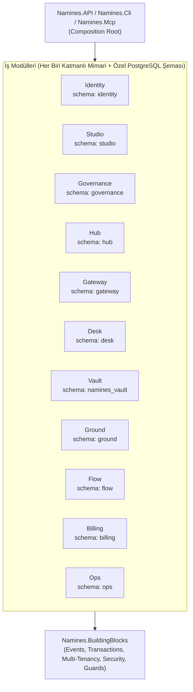

# TARGET ARCHITECTURE — .NET 8 Modular Monolith & Katmanlı Mimari Tasarımı

> Tarih: 2026-11-02 · Hedef Mimari Standardı

---

## 1. Mimari İlkeler

1. **Gerçek Modüler Monolit (Physical & Logical Isolation):**
   - Tek dağıtım birimi (`Namines.API`), tek fiziksel PostgreSQL veritabanı; ancak **derleyici ve NetArchTest tarafından zorlanan** katı modül sınırları.
   - Hiçbir modül başka bir modülün `Domain`, `Application` veya `Infrastructure` (`DbContext`/`DbSet`) katmanına erişemez.
   - Modüller arası iletişim yalnızca **`Namines.BuildingBlocks`** veya hedef modülün **`.Contracts`** arayüzleri ve **`IModuleEventBus`** üzerinden gerçekleşir.
2. **Modül İçi Katmanlı Mimari (Clean / Layered Architecture per Module):**
   - Her modül kendi içinde 4 katmana ayrılır:
     - **`Domain`**: Entity'ler, ValueObject'ler, Enum'lar, Domain kuralları. Hiçbir dış katmana bağımlı değildir.
     - **`Application`**: Use-case servisleri, komut/sorgu işleyicileri, port arayüzleri (`IRepository`, dış servis portları), olay işleyicileri (`IModuleEventHandler<T>`). Yalnızca `Domain`, `BuildingBlocks` ve `.Contracts` katmanlarına bağımlıdır.
     - **`Infrastructure`**: Modüle özel `<Module>DbContext`, EF Core `IEntityTypeConfiguration` sınıfları, dış sağlayıcı implementasyonları (S3, Docker, Neon, Supabase, GitHub, Stripe), modüle ait `BackgroundService` işçileri. Tüm sınıflar `internal` görünürlüktedir.
     - **`Presentation`**: Modüle ait HTTP Controller / Endpoint sınıfları. Yalnızca modülün `Application` / `Contracts` arayüzlerini çağırır; asla doğrudan `DbContext` kullanmaz.
3. **Veritabanı Şema ve DbContext İzolasyonu:**
   - Her modül kendi PostgreSQL şemasına (`namines_vault`, `ground`, `flow`, `desk`, `hub`, `gateway`, `governance`, `studio`, `identity`, `billing`, `ops`) ve kendi `DbContext`'ine sahiptir.
   - Her `DbContext` kendi şemasındaki `__EFMigrationsHistory` tablosunu (`<schema>.__EFMigrationsHistory`) kullanır.

---

## 2. Hedef Çözüm ve Modül Haritası

---

## 3. 7 Kritik Kontrolün Mimari Karşılığı

### 3.1. Kiracı İzolasyonu (Tenant Isolation)
- `Namines.BuildingBlocks.Security.ITenantProjectAuthority` tüm modüller için tek yetki doğrulama kapısıdır:
  - `GetRoleAsync(projectId, userId, ct)`
  - `CanViewAsync(projectId, userId, ct)`
  - `CanEditAsync(projectId, userId, ct)`
  - `IsOwnerAsync(projectId, userId, ct)`
- Önbellek anahtarları `TenantCacheKey.ForUser(...)` ve `TenantCacheKey.ForProject(...)` ile kiracı bağlamına kilitlenir.

### 3.2. Bağlantı Sırrı Yönetimi (Secret Management)
- Müşteri veritabanı bağlantı dizeleri (`EncryptedConnectionString`) `studio.project_connections` tablosunda izole edilir.
- Diğer modüller (`Vault`, `Ground`, `Desk`, `Gateway`) bu sırra doğrudan tablo okuyarak değil, `IProjectConnectionSecretProvider` sözleşmesi üzerinden erişir; bu sözleşme hem AES-256-GCM şifre çözmeyi/şifrelemeyi hem de SSRF (`IDbHostAccessPolicy`) doğrulamasını merkezi olarak uygular.

### 3.3. Modüller Arası İşlem Sınırları (Transaction Boundaries)
- `Namines.BuildingBlocks.Persistence.ISharedTransactionManager`:
  - Birden fazla modül DbContext'inin aynı HTTP isteğinde atomik olarak yazması gerektiğinde (ör. `Ground` provizyon kaydı + `Studio` proje bağlantısı güncellemesi, veya `ProjectDeletion` akışı), aynı fiziksel `NpgsqlConnection` ve `DbTransaction` örneklerini tüm ilgili `DbContext`'lere (`db.Database.UseTransactionAsync`) bağlar.

### 3.4. EF Core Migration İzolasyonu ve Sıralı Orkestrasyon
- Çalışan düzen (14.2D-1): `ModuleMigrationOrchestrator` + her bağlamın `ModuleMigrationDescriptor` kaydı (`OwnsChain` ya da `DdlInAuthChain`, gerekçesiyle).
  - `--migrate` ve başlangıç bekleyen-migration kontrolü aynı yoldan geçer; Auth önce, modüller `Order` sırasıyla (Studio 20, Hub 90, Gateway 100, Ops 110); danışma kilidi çakışmayı önler.
  - Modül bağlamı internal; dışarıya Application sözleşmesi çıkar. Servisler modülün `I*Data` arayüzünden veri görür, Infrastructure ad alanına başvurmaz (mimari test IL düzeyinde).
- Hedef: Identity, Billing, Governance 14.2D-2'de aynı düzene girer.

### 3.5. Arka Plan İşçilerinin Sahipliği (Background Worker Ownership)
- Her `BackgroundService` ait olduğu modülün `Infrastructure/Workers/` klasöründe `internal sealed` olarak yaşar ve modülün `Add<Module>Module()` metodu tarafından kaydedilir:
  - `Vault`: `VaultBackupWorker`, `VaultScheduleBackgroundService`
  - `Ground`: `GroundPurgeBackgroundService`
  - `Flow`: `AutomationExecutorWorker`, `AutomationRunLogRetentionService`
  - `Studio`: `DockerSweeperBackgroundService`, `SandboxOutputRetentionService`
  - `Ops`: `DataRetentionService`
