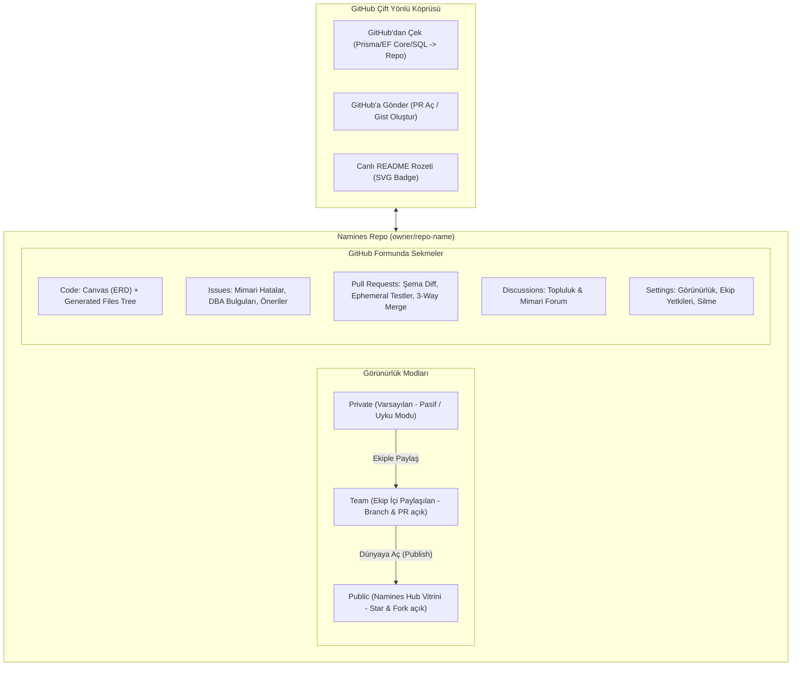

# Namines Hub (GitHub Formunda Veritabanı ve Mimari Platformu) — Faz Planı

> **Vizyon:** Veritabanı ve sistem mimarisi için birebir **GitHub Deneyimi**.
> Her projenin bir mimari reposu (`owner/repo`), branch'leri, commit/revizyonları,
> görsel tuval + dosya ağacı görünümü, Issue takipçisi, Pull Request (ChangeRequest)
> entegrasyonu, Fork/Star sistemi ve GitHub ile çift yönlü köprüsü bulunur.

---

## 1. Mimari Prensipler

---

## 2. GitHub Görünümü ve Deneyimi (UX & Sayfa Mimarisi)

### 2.1. Repo Başlığı (Header)
- **Sol Taraf:** `[Kullanıcı/Ekip İkonu] owner / repo-name` + `Public / Private` rozeti.
- **Sağ Taraf:**
  - `👁️ Watch (Takip Et)`
  - `⭐ Star (Yıldızla) [Sayı]`
  - `🍴 Fork (Kendi Çalışma Alanına Klonla) [Sayı]`
  - `🚀 Open in Studio (Tuvalde Aç)` butonu

### 2.2. Sekmeler (Tabs)
1. **Code (Şema + Dosyalar):**
   - **Üst Şerit:** Branch seçici dropdown (`main`, `feature/x`), Commit/Revizyon sayısı, "Add Table" butonu, "Code / Export" dropdown'u.
   - **Sol / Merkez (Büyük Alan):** İnteraktif Canlı ERD Tuvali (zoom/pan, tablo detayları, FK ilişkileri).
   - **Sağ Panel (Dosya Ağacı):**
     - `schema.sql` (Hedef SQL DDL)
     - `DbContext.cs` / `schema.prisma` / `drizzle.ts` (ORM çıktıları)
     - `openapi.json` (Minimal Gateway REST API spesifikasyonu)
     - `seed.json` / `seed.sql` (Mock test verileri)
     - `README.md` (Otomatik mimari dokümantasyonu)
     - `migrations/` (Sürüm DDL betikleri)
     *Bir dosyaya tıklandığında tuval yerine kod önizleyici açılır.*
2. **Issues:**
   - Mimari ve şema problemlerinin listesi.
   - Otomatik DBA bulguları Issue olarak dönüştürülebilir (*ör. "Orders tablosunda customer_id üzerinde indeks eksik"*).
   - Topluluk ve ekip üyeleri issue açabilir, etiketleyebilir (`bug`, `dba-performance`, `enhancement`, `breaking-risk`), yorum yazabilir.
3. **Pull Requests (Change Requests):**
   - **Mevcut `/review` ve `ChangeRequestController` altyapımızla 1-e-1 entegre!**
   - Kaynak dal ile hedef dal arasındaki fark:
     - Görsel Şema Diff'i (Eklenen/Değiştirilen/Silinen Tablolar ve Kolonlar).
     - Deterministik Risk Analizi (`Safe`, `Risky`, `Breaking`).
     - Docker ephemeral container testi doğrulaması (`TestRunResult`).
     - Yorumlar, onaylar (`Approve`, `Request Changes`).
     - "Merge Pull Request" butonu (3-yollu AST birleştirme).
4. **Discussions (Forum):**
   - Genel mimari tartışmalar, RFC'ler, fikir alışverişleri.
5. **Settings:**
   - Repo adı, açıklaması, etiketleri.
   - Görünürlük değiştirme: `Make Public` / `Make Private`.
   - Ekip üyeleri ve izinler (Admin, Writer, Reader).
   - Danger Zone: Depoyu silme.

---

## 3. Otomatik Uyku Modu (Passive Repo Lifecycle)

- Kullanıcı `/canvas`'ta yeni bir proje oluşturduğunda ya da bir prompt girdiğinde, sistem arka planda bunu **pasif, uyku modunda bir Private Repo** olarak başlatır.
- Başlangıçta dış dünyaya kapalıdır, kota tüketmez.
- Ekip davet edildiğinde otomatik olarak **Team** erişimine açılır; ekip üyeleri branch açabilir ve PR gönderebilir.
- Kullanıcı tek tıkla **"Publish to Hub (Make Public)"** dediğinde anında **Namines Hub Vitrini**'ne çıkar; tüm dünya keşfedebilir, yıldızlayabilir, fork edebilir.

---

## 4. Faz Planı (Adım Adım Geliştirme Sırası)

### Faz 1 — Veri Modeli ve Çekirdek API (Backend)
- [x] Temizliklerin commit + push edilmesi (`c89e0f8`).
- [ ] **Modeller:**
  - `ArchitectureRepo` (veya `CloudProject`'in Repo özellikleriyle genişletilmesi: `Slug`, `Visibility`, `StarCount`, `ForkCount`, `ParentRepoId`, `TargetEngine`).
  - `RepoIssue` ve `RepoIssueComment` (başlık, içerik, durum, etiketler, yazar).
  - `RepoStar` ve `RepoFork` ilişkileri.
- [ ] **API Controller (`/api/repos`):**
  - CRUD: `POST /api/repos`, `GET /api/repos/{owner}/{repo}`, `PATCH /api/repos/{id}`, `DELETE /api/repos/{id}`.
  - Branch entegrasyonu: `GET /api/repos/{owner}/{repo}/branches`.
  - Issue yönetimi: `GET/POST /api/repos/{owner}/{repo}/issues`, `POST /api/repos/{owner}/{repo}/issues/{id}/comments`.
  - PR entegrasyonu: Mevcut `ChangeRequestController` ile eşleme.
  - Fork & Star: `POST /api/repos/{id}/fork`, `POST /api/repos/{id}/star`.

### Faz 2 — GitHub Görünümlü Repo Sayfası (Frontend)
- [ ] **Rota:** `/repos/[owner]/[repo]` (veya `/[owner]/[repo]`).
- [ ] **Header Bileşeni:** Breadcrumb, Visibility rozeti, Star butonu, Fork butonu, Studio'da Aç butonu.
- [ ] **Tab 1: Code Sekmesi:**
  - Sol tarafta Canlı ERD Tuval önizleyicisi (React Flow).
  - Sağ tarafta üretilen dosyalar ağacı (`schema.sql`, `DbContext.cs`, `README.md`, `openapi.json`).
  - Branch değiştirici dropdown'ı.
- [ ] **Tab 2: Issues Sekmesi:**
  - Açık/kapalı issue listesi, arama/filtreleme, "New Issue" modalı, issue detay ve yorumlaşma sayfası.
- [ ] **Tab 3: Pull Requests Sekmesi:**
  - Mevcut `/review` bileşenlerimizin Repo sayfasına gömülmesi (Diff, Docker Testi, Onay ve Merge).
- [ ] **Tab 4: Settings Sekmesi:**
  - Public/Private görünürlük anahtarı, tehlikeli bölge (depoyu sil).

### Faz 3 — Namines Hub Keşif Vitrini (`/hub`)
- [ ] **Keşif Sayfası (`/hub`):**
  - Public repoların vitrini: Arama, kategori filtreleri (FinTech, SaaS, ERP, AI, E-Commerce).
  - Trending, En Çok Yıldızlanan ve Yeni Eklenen repolar.
  - Repo kartı: Başlık, yazar, motor, tablo sayısı, yıldız/fork sayıları, mini-ERD önizleme.

### Faz 4 — GitHub Çift Yönlü Entegrasyonu (Bridge)
- [ ] **Import from GitHub:**
  - `github.com/owner/repo` linkinden şema çıkarma (Prisma, EF Core, SQL) ve Namines Reposu olarak içe aktarma.
- [ ] **Export to GitHub:**
  - Şemayı gerçek GitHub reposuna PR veya GitHub Gist olarak yollama.
- [ ] **Dinamik SVG Rozeti (Badge):**
  - `/api/repos/badge/{owner}/{repo}` (GitHub README'ye eklenecek canlı rozet).

---

## 5. Doğrulama ve Test Stratejisi
- Backend: Her yeni uç nokta için xUnit testleri (yetkilendirme, fork izolasyonu, issue akışı).
- Frontend: Tasarım kuralları (`npm run check:design`) ve Vitest bileşen testleri.
- Gerçek Docker: Testcontainers ile PostgreSQL kontrol DB'sine karşı entegrasyon doğrulaması.
