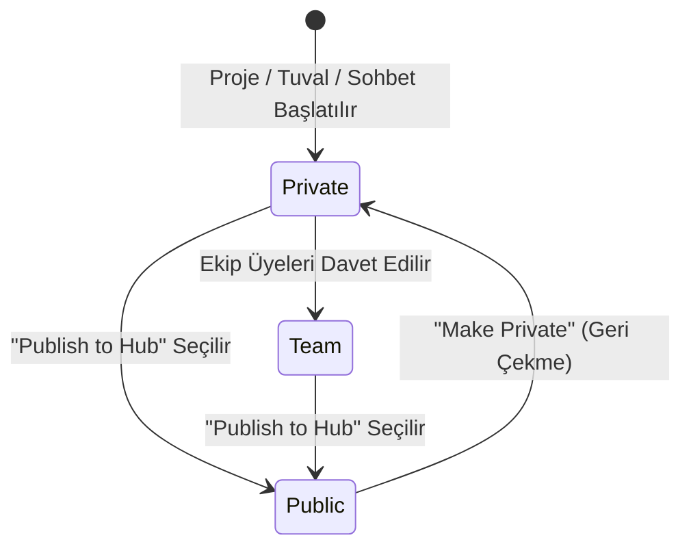

# Namines Hub — Eksiksiz Ürün, Mimari ve Entegrasyon Spesifikasyonu
## "GitHub for Database Architecture & Backend Lifecycle"

> **Doküman Durumu:** Onaylanmış Master Spesifikasyon  
> **Hedef:** Veritabanı ve sistem mimarisi için birebir **GitHub Deneyimi**.  
> **Kapsam:** Repolar, Şema + Dosya Görünümü, Issues, Pull Requests (ChangeRequests), Server-Side Branching, Fork/Star, Hub Vitrini ve Çift Yönlü GitHub Köprüsü.

---

## İÇİNDEKİLER

1. [Vizyon ve Problem Tanımı](#1-vizyon-ve-problem-tanımı)
2. [Mevcut Sistem Denetimi ve Ölçeklenebilirlik](#2-mevcut-sistem-denetimi-ve-ölçeklenebilirlik)
   - 2.1. Kaç Tablomuz Var? (Control Plane vs. Data Plane)
   - 2.2. Flow, Ground, Vault, Desk Şema Bağıntısı
   - 2.3. 3NF (Üçüncü Normal Form) Kurallarının Güvencesi
   - 2.4. 450 Tabloluk Devasa ERP Mimarilerinin İşlenmesi
3. [Kavramsal Model: Namines "Architecture Repository"](#3-kavramsal-model-namines-architecture-repository)
   - 3.1. Repo Nedir? (`owner/repo-name`)
   - 3.2. Pasif Uyku Modu ve Görünürlük (Private → Team → Public)
4. [GitHub Formunda Repo Görünümü (The Architecture IDE)](#4-github-formunda-repo-görünümü-the-architecture-ide)
   - 4.1. Repo Header ve Navigasyon
   - 4.2. Code Sekmesi (Canlı ERD Tuvali + Dosya Ağacı)
   - 4.3. Issues Sekmesi (Mimari Hata ve DBA Bulguları Takipçisi)
   - 4.4. Pull Requests Sekmesi (ChangeRequest Entegrasyonu)
   - 4.5. Discussions Sekmesi (Mimari Forum ve RFC'ler)
   - 4.6. Settings Sekmesi
5. [Namines Hub Keşif Vitrini (`/hub`)](#5-namines-hub-keşif-vitrini-hub)
6. [Çift Yönlü GitHub Entegrasyonu (Bi-Directional Bridge)](#6-çift-yönlü-github-entegrasyonu-bi-directional-bridge)
   - 6.1. GitHub'dan Şema İçe Aktarma (Import from GitHub)
   - 6.2. GitHub'a PR ve Gist Olarak Aktarma (Export to GitHub)
   - 6.3. Dinamik SVG README Rozeti (Badge)
7. [Teknik Veri Modeli (PostgreSQL / EF Core)](#7-teknik-veri-modeli-postgresql--ef-core)
8. [API Uç Noktaları Spesifikasyonu (`/api/repos` & `/api/hub`)](#8-api-uç-noktaları-spesifikasyonu-apirepos--apihub)
9. [Aşamalı Uygulama Planı (Faz 1 — Faz 4)](#9-aşamalı-uygulama-planı-faz-1--faz-4)

---

## 1. VİZYON VE PROBLEM TANIMI

Bugün yazılım dünyasında:
- **Kod** için GitHub / GitLab,
- **Docker İmajları** için Docker Hub,
- **AI Modelleri** için HuggingFace,
- **Paketler** için npm / NuGet / PyPI varken;

**Veritabanı ve Sistem Mimarileri için yaşayan, interaktif, doğrulanabilir bir Hub platformu YOKTUR.**

Bir geliştirici veya yazılım ekibi yeni bir projeye başlarken (FinTech defteri, çok kiracılı SaaS, e-ticaret, sağlık sistemi, AI bellek grafı) blog yazılarından, StackOverflow'dan veya rastgele GitHub depolarından **statik, test edilmemiş, hatalı SQL dump'ları** kopyalamak zorunda kalmaktadır.

**Namines Hub Çözümü:**  
Her projenin bir **Architecture Repository (`owner/repo-name`)** olduğu; içinde interaktif ERD tuvali, çoklu motora (Postgres, MySQL, SQLite, MSSQL, Oracle) derlenmiş DDL kodları, ORM modelleri, DBA sağlık denetimleri, Issue takipçisi ve Pull Request mekanizması barındıran; topluluğun tek tıkla kendi stüdyosuna fork edebildiği ve GitHub ile çift yönlü konuşabilen küresel bir mimari platformu.

---

## 2. MEVCUT SİSTEM DENETİMİ VE ÖLÇEKLENEBİLİRLİK

### 2.1. Kaç Tablomuz Var? (Control Plane vs. Data Plane)

Mimarimizde iki bağımsız veritabanı dünyası mevcuttur:

1. **Namines Kontrol Veritabanı (Control Plane DB - `AuthDbContext`):**
   - PostgreSQL üzerinde yaşayan **41 adet fiziksel tablo**.
   - 7 adet ASP.NET Identity tablosu (`AspNetUsers`, `AspNetRoles`, `AspNetUserRoles` vb.).
   - 34 adet Namines işletim tablosu (`CloudProjects`, `Branches`, `SchemaVersions`, `ChangeRequests`, `AutomationRules`, `GroundDatabases`, `VaultBackups`, `GatewayApiKeys`, `FeatureFlags`, `CrossDatabaseRelations` vb.).
   - Bir SaaS kontrol düzlemi için 41 tablo gereksiz şişkinlikten uzak, saf 3NF ve temiz bir yapıdır.

2. **Kullanıcının Tasarladığı Veritabanı (Data Plane / Tenant DB):**
   - Kullanıcının tuvalde tasarladığı veya dışarıdan introspect ettiği şemadır.
   - **Tablo sayısı sınırı yoktur.** 3 tabloluk bir prototip de olabilir, 450 tabloluk kurumsal bir ERP de.

### 2.2. Flow, Ground, Vault, Desk Şema Bağıntısı

Namines ekosistemindeki tüm modüller **kanonik `DatabaseSchema` (IR)** nesnesine göbekten bağlıdır:
- **Canvas:** Şemanın görsel düzenleyicisidir (tablolar, kolonlar, veri tipleri, foreign key ilişkileri).
- **Namines Flow:** Şema olaylarına (`TableCreated`, `TableDeleted`, `ColumnAdded`, `SchemaChanged`, `DbaHealthDropped`, `MigrationApproved`) ve tablo kimliklerine (`ScopeTableId`) bağlanır. Kural tetiklendiğinde Webhook, Slack, Discord veya Toast aksiyonu çalıştırır.
- **Ground:** Kullanıcının canlı veritabanını zero-persistence ile reverse-engineer eder; tuvaldeki şema ile canlı veritabanı arasındaki farkı (schema drift) tespit eder.
- **Vault:** Şemanın hedef motoruna (PostgreSQL, MySQL, SQLite, MSSQL) uygun olarak `pg_dump`/`mysqldump` motorlarıyla fiziksel yedekleme/geri yükleme yapar.
- **Desk:** Şemadaki tüm tabloları, foreign key'leri ve enum'ları okuyarak sıfır kodla çalışan bir CRUD yönetim paneli ve read-only SQL konsolu ayağa kaldırır.

### 2.3. 3NF (Üçüncü Normal Form) Kurallarının Güvencesi

Namines'te 3NF iki bağımsız katmanda zorunlu tutulur:
1. **AI Üretim Katmanı (`SchemaPromptBuilder.cs`):**  
   Modeller için *"Ensure tables are normalized (3NF). Use junction tables for M:N, eliminate redundant columns and transitive dependencies"* direktifi bağlayıcıdır. Tekrarlanan müşteri verileri sipariş tablosuna yazılmaz; foreign key ile normalize edilir.
2. **Deterministik Kural Motoru (`NslValidator.cs` & `FkCascadeAnalyzer.cs`):**  
   - **1NF:** Atomik olmayan kolon ihlalleri, tekrarlayan dizi yapıları, benzersiz Primary Key zorunluluğu.
   - **2NF:** Bileşik anahtarlara kısmi bağımlılıkların (partial dependencies) denetimi.
   - **3NF & BCNF:** Geçişli bağımlılıklar (transitive dependencies), döngüsel foreign key kilitleri (circular FK loops) ve kilitlenmeye yol açabilecek cascade zincirleri deterministik kural setiyle doğrulanır.

### 2.4. 450 Tabloluk Devasa ERP Mimarilerinin İşlenmesi

450 tabloluk bir ERP projesinde Namines'in mimari yaklaşımı şöyledir:
- **`SchemaScopePartitioner` (AST Modüler Parçalama):**  
  50-60 tablodan büyük şemalar AI üretiminde veya analizde otomatik olarak domain parçalarına (Finans, Stok/Depo, İK, Satış, CRM) bölünür. Her parça 9-12 tablo hedefiyle bağımsız üretilip AST düzeyinde birleştirilir.
- **Topolojik Sıralama (Topological Dependency Sorting):**  
  AST derleyicisi 450 tablonun hangisinin önce yaratılması gerektiğini (DDL bağımlılık ağacı) milisaniyeler içinde çözer. Döngüsel FK'leri otomatik ayıklayıp `ALTER TABLE ADD CONSTRAINT` aşamasına öteler.
- **Tuval Performansı (React Flow Virtualization):**  
  450 tablo aynı anda DOM'a basılmaz; yalnızca kullanıcının o an ekranda gördüğü (viewport) tablolar boyanır. Kullanıcı "Modül Filtresi" ile örneğin yalnızca *Muhasebe Modülü* tablolarını izole ederek çalışabilir.

---

## 3. KAVRAMSAL MODEL: NAMINES "ARCHITECTURE REPOSITORY"

### 3.1. Repo Nedir? (`owner/repo-name`)

GitHub'da bir repo nasıl kaynak kodun evi ise, Namines'te bir **Architecture Repo** veritabanı ve sistem mimarisinin evidir:
- **Kimlik:** `owner / repo-name` (Örnek: `acme / core-banking` veya `enes / multi-tenant-saas`).
- **Sahip:** Bireysel kullanıcı veya Organizasyon / Ekip (Team).
- **Varsayılan Dal:** `main`.
- **Desteklenen Motorlar:** PostgreSQL, MySQL, SQLite, MSSQL, MariaDB, Oracle.

### 3.2. Pasif Uyku Modu ve Görünürlük (Private → Team → Public)



1. **Private (Pasif / Uyku Modu - Varsayılan):**  
   Kullanıcı tuvalde yeni bir şema tasarladığında veya prompt yazdığında, arka planda otomatik olarak özel bir repo oluşturulur. Sıfır dış maliyetle uyku modundadır; yalnızca oluşturan kullanıcı erişebilir.
2. **Team (Ekip İçi Paylaşılan):**  
   Kullanıcı projeyi ekibiyle paylaştığında repo ekibe açılır. Ekip üyeleri bu repo üzerinde branch açabilir, Issue oluşturabilir, Pull Request gönderebilir ve inceleyebilir.
3. **Public (Namines Hub Vitrini):**  
   Kullanıcı "Publish to Hub" butonuna bastığında repo açık kaynak topluluk vitrinine çıkar. Tüm dünyadaki geliştiriciler repoyu inceleyebilir, yıldızlayabilir (`Star`), tek tıkla kendi stüdyolarına klonlayabilir (`Fork`) ve tartışmalara katılabilir.

---

## 4. GITHUB FORMUNDA REPO GÖRÜNÜMÜ (THE ARCHITECTURE IDE)

Rota: `/repos/[owner]/[repo]` (veya `/[owner]/[repo]`)

```
+--------------------------------------------------------------------------------------------------+
|  [Logo]  owner / repo-name  [Public]                   [Watch 12]  [Star 148]  [Fork 34]  [Open Studio] |
+--------------------------------------------------------------------------------------------------+
|  [Code]    [Issues (3)]    [Pull Requests (1)]    [Discussions]    [Settings]                    |
+--------------------------------------------------------------------------------------------------+
|  Branch: [ main v ]  |  42 Tables  |  PostgreSQL 17  |  3NF Verified (100%)  |  [Code / Export v]  |
+-----------------------------------------------------+--------------------------------------------+
|                                                     |  GENERATED ARTIFACTS                       |
|                                                     |  |-- schema.sql             (Compiled DDL) |
|              CANLI ERD TUVALI                       |  |-- DbContext.cs           (EF Core 8)    |
|                                                     |  |-- schema.prisma          (Prisma ORM)   |
|         (React Flow Tabanlı Görsel Diyagram)        |  |-- openapi.json           (REST Gateway) |
|         Tablolar, Kolonlar, Tipler, İlişkiler       |  |-- seed.sql               (Mock Data)    |
|                                                     |  |-- README.md              (AI Docs)      |
|                                                     |  +-- migrations/                           |
|                                                     |      |-- 001_init.sql                      |
+-----------------------------------------------------+--------------------------------------------+
```

### 4.1. Repo Header ve Navigasyon
- **Başlık Alanı:** Sahip avatarı, `owner / repo-name` bağlantısı, `Public` / `Private` / `Team` durum rozeti.
- **Aksiyon Düğmeleri:**
  - **`Watch`:** Değişiklik bildirimlerini alma.
  - **`Star ⭐`:** Repoyu favorilere ekleme ve popülerlik puanını artırma.
  - **`Fork 🍴`:** Reponun tam bir kopyasını tek tıkla kullanıcının kendi çalışma alanına çıkarma.
  - **`Open in Studio 🚀`:** Şemayı doğrudan interaktif tam ekran Namines Canvas editöründe açma.

### 4.2. Code Sekmesi (Canlı ERD Tuvali + Dosya Ağacı)
Geleneksel GitHub klasör listesi yerine, veritabanı mimarisine özel bölünmüş görünüm sunulur:
- **Sol / Merkez (Görsel Tuval):**  
  React Flow tabanlı etkileşimli ERD tuvali. Yakınlaştırma, kaydırma, tablo seçme, foreign key çizgilerini izleme, indeksleri ve kısıtları inceleme.
- **Sağ Panel (Üretilen Dosyalar Ağacı):**
  - `schema.sql`: Hedef motora göre derlenmiş tam DDL betiği.
  - `DbContext.cs` / `schema.prisma` / `drizzle.ts`: Seçili ORM modelleri.
  - `openapi.json`: Gateway REST API spesifikasyonu.
  - `seed.json` / `seed.sql`: Akıllı sentetik test verisi.
  - `README.md`: Yapay zekanın ürettiği kapsamlı mimari dokümantasyonu.
  - `migrations/`: Sürümden sürüme geçiş DDL betikleri.
  *Dosya tıklandığında tuval alanı Monaco tabanlı sözdizimi vurgulamalı kod editörüne dönüşür; "View Diagram" tıklandığında tuvale geri döner.*

### 4.3. Issues Sekmesi (Mimari Hata ve DBA Bulguları Takipçisi)
- **Kullanım Amacı:** Veritabanı tasarım kusurları, performans darboğazları, eksik indeksler, normalizasyon sorunları ve yeni tablo/kolon istekleri için issue takipçisi.
- **Otomatik DBA Issue Entegrasyonu:**  
  Tuvaldeki DBA linter bulguları tek tıkla *"Convert to Issue"* düğmesiyle issue haline getirilebilir (*ör. "Issue #4: Missing Index on orders.created_at causes sequential scan"*).
- **Özellikler:** Etiketler (`bug`, `dba-risk`, `performance`, `enhancement`, `breaking`), atanan kişiler, tartışma ve yorum zinciri, açık/kapalı durumu.

### 4.4. Pull Requests Sekmesi (ChangeRequest Entegrasyonu)
Mevcut `/review` ve `ChangeRequestController` altyapımızla birebir entegredir:
- **Akış:** `feature/branch-adı` → `main` dalına birleştirme isteği.
- **Görsel Şema Diff'i:** Eklenen tablolar (yeşil), silinen tablolar (kırmızı), değiştirilen kolon ve tipler (sarı).
- **Deterministik Risk Analizi:** Kural motorunun belirlediği risk seviyesi (`Safe`, `Risky`, `Breaking`).
- **Geri Alınabilirlik (Rollback):** Migrasyonun veri kaybı olmadan geri alınıp alınamayacağı.
- **Run Tests Doğrulaması:** Ephemeral gerçek Docker container'ında DDL'in çalışıp çalışmadığının kanıtı (`Verified against engine`).
- **İnceleme ve Onay:** Ekip üyelerinin "Approve" veya "Request Changes" kararları.
- **Merge Pull Request Butonu:** Onaylandığında 3-yollu AST birleştirme (`SchemaThreeWayMerger`) ile hedef dala güvenle yazılması.

### 4.5. Discussions Sekmesi (Mimari Forum ve RFC'ler)
- **Kullanım Amacı:** Şema mimarisi üzerine genel beyin fırtınaları, mimari tasarım önerileri (RFC - Request for Comments) ve soru-cevap.
- **Tablo Bağlamı:** Yorum yazılırken `@table:orders` etiketi kullanılarak yorumun şemadaki spesifik bir tabloya bağlanabilmesi.

### 4.6. Settings Sekmesi
- **Genel:** Repo adı, slug, açıklama, etiketler, hedef veritabanı motoru seçimi.
- **Görünürlük:** `Make Public` (Namines Hub'da yayınla) / `Make Private` (Ekip dışına kapat).
- **Ekip ve İzinler:** Ekip üyelerine rol atama (Admin, Editor, Viewer).
- **Tehlikeli Bölge (Danger Zone):** Depoyu arşivleme veya kalıcı olarak silme.

---

## 5. NAMINES HUB KEŞİF VİTRİNİ (`/hub`)

Tüm public repoların toplandığı, filtrelendiği ve keşfedildiği vitrin sayfası:
- **Hero Bölümü:** "Dünyanın Doğrulanmış Açık Kaynak Veritabanı Mimarileri Kataloğu".
- **Kategori Filtreleri:**
  - *FinTech & Payments* (Çift girişli defter, ödeme akışları, döviz hesapları).
  - *Multi-Tenant SaaS* (Organizasyon izolasyonu, abonelikler, tenant_id RLS).
  - *E-Commerce & Retail* (Katalog, sepet, sipariş, stok, kargo).
  - *AI Agents & Graph Memory* (Vektör embedding tabloları, sohbet hafızası, RAG).
  - *Healthcare & HIPAA* (Hasta kayıtları, randevu, audit logları).
  - *Gaming & Leaderboards* (Oyuncu profilleri, envanter, eşleşme).
- **Sıralama Seçenekleri:** Trending, Most Starred, Recently Updated, Table Count.
- **Repo Kartı Bileşeni:**
  - Repo adı ve sahibi (`owner / repo`).
  - Motor rozeti (PostgreSQL, MySQL vb.) ve tablo sayısı.
  - Yıldız (`Star`) ve `Fork` sayıları.
  - "Quick Preview" (Tuvali açmadan mini şema önizleme).
  - "Fork to Canvas" (Tek tıkla kendi stüdyona alma).

---

## 6. ÇİFT YÖNLÜ GITHUB ENTEGRASYONU (BI-DIRECTIONAL BRIDGE)

### 6.1. GitHub'dan Şema İçe Aktarma (Import from GitHub)
1. Kullanıcı `github.com/owner/repo` linkini verir.
2. `IGithubScanner` arka planda depoyu tarar:
   - Prisma şeması (`schema.prisma`)
   - EF Core C# DbContext sınıfları (`*.cs`)
   - SQL DDL / Migration dosyaları (`*.sql`)
3. Deterministik ayrıştırıcılar AST'ye çevirir ve anında yeni bir **Namines Architecture Repo** oluşturur.

### 6.2. GitHub'a PR ve Gist Olarak Aktarma (Export to GitHub)
1. **GitHub PR Olarak Açma:** Repodaki şema değişiklikleri tek tıkla kullanıcının GitHub reposuna bir PR (`namines/schema-update`) olarak gönderilir (`IGithubBotService`). PR açıklamasında görsel diff ve risk analizi yer alır.
2. **GitHub Gist Paylaşımı:** Tek tıkla şemanın SQL DDL'i public veya secret bir GitHub Gist'ine basılır.

### 6.3. Dinamik SVG README Rozeti (Badge)
Kullanıcılar GitHub repolarının `README.md` dosyasına rozet ekleyebilir:
```markdown
[](https://namines.com/repos/acme/core-ledger)
```
- **Çıktı:**  
  `[ Namines Hub | 38 Tables · PostgreSQL 17 · 3NF Verified ]`
- Tıklandığında doğrudan Namines Hub'daki interaktif tuval sayfasına gider.

---

## 7. TEKNİK VERİ MODELİ (POSTGRESQL / EF CORE)

Mevcut `AuthDbContext`'e eklenecek yeni tablolar:

```csharp
namespace Namines.Core.Models.Hub;

public enum RepoVisibility
{
    Private = 0,
    Team = 1,
    Public = 2
}

public enum IssueStatus
{
    Open = 0,
    Closed = 1
}

// 1. Ana Mimari Deposu (Repository)
public class ArchitectureRepo
{
    public Guid Id { get; set; } = Guid.NewGuid();
    public string OwnerId { get; set; } = string.Empty; // User ID veya Org ID
    public string OwnerName { get; set; } = string.Empty; // "enes" veya "acme-corp"
    public string Name { get; set; } = string.Empty; // "core-banking"
    public string Slug { get; set; } = string.Empty; // "enes/core-banking" (Benzersiz)
    public string Description { get; set; } = string.Empty;
    public RepoVisibility Visibility { get; set; } = RepoVisibility.Private;
    public string DefaultBranch { get; set; } = "main";
    public string TargetEngine { get; set; } = "PostgreSQL";
    
    // Şema ve İstatistikler
    public Guid? ActiveSchemaId { get; set; }
    public int TableCount { get; set; } = 0;
    public string[] Tags { get; set; } = Array.Empty<string>();
    public string Category { get; set; } = "General";
    
    // Metrikler
    public int StarCount { get; set; } = 0;
    public int ForkCount { get; set; } = 0;
    public int WatchCount { get; set; } = 0;
    
    // Çatallanma (Fork) Bağıntısı
    public Guid? ParentRepoId { get; set; }
    
    // GitHub Entegrasyonu
    public string? LinkedGithubRepoUrl { get; set; }
    
    public DateTime CreatedAt { get; set; } = DateTime.UtcNow;
    public DateTime UpdatedAt { get; set; } = DateTime.UtcNow;
}

// 2. Repo Issue Takipçisi
public class RepoIssue
{
    public Guid Id { get; set; } = Guid.NewGuid();
    public Guid RepoId { get; set; }
    public int IssueNumber { get; set; } // Repo bazında 1, 2, 3...
    public string Title { get; set; } = string.Empty;
    public string Body { get; set; } = string.Empty;
    public IssueStatus Status { get; set; } = IssueStatus.Open;
    public string AuthorUserId { get; set; } = string.Empty;
    public string AuthorName { get; set; } = string.Empty;
    public string? AssigneeUserId { get; set; }
    public string[] Labels { get; set; } = Array.Empty<string>(); // ["bug", "dba-risk"]
    public string? RelatedTable { get; set; } // Örn: "orders" tablosuyla ilişkili
    
    public DateTime CreatedAt { get; set; } = DateTime.UtcNow;
    public DateTime? ClosedAt { get; set; }
}

// 3. Issue Yorumları
public class RepoIssueComment
{
    public Guid Id { get; set; } = Guid.NewGuid();
    public Guid IssueId { get; set; }
    public string AuthorUserId { get; set; } = string.Empty;
    public string AuthorName { get; set; } = string.Empty;
    public string? AuthorAvatarUrl { get; set; }
    public string Content { get; set; } = string.Empty;
    public DateTime CreatedAt { get; set; } = DateTime.UtcNow;
}

// 4. Yıldızlama (Stars)
public class RepoStar
{
    public Guid RepoId { get; set; }
    public string UserId { get; set; } = string.Empty;
    public DateTime CreatedAt { get; set; } = DateTime.UtcNow;
}

// 5. Çatallanma (Forks)
public class RepoFork
{
    public Guid Id { get; set; } = Guid.NewGuid();
    public Guid OriginalRepoId { get; set; }
    public Guid ForkedRepoId { get; set; }
    public string UserId { get; set; } = string.Empty;
    public DateTime CreatedAt { get; set; } = DateTime.UtcNow;
}
```

---

## 8. API UÇ NOKTALARI SPESİFİKASYONU (`/api/repos` & `/api/hub`)

### Repos API (`/api/repos`)
- `POST /api/repos`: Yeni mimari deposu oluşturma.
- `GET /api/repos/{owner}/{name}`: Repo detaylarını getirme (şema, istatistikler, görünürlük).
- `PATCH /api/repos/{id}`: Repo ayarlarını güncelleme (görünürlük, açıklama, motor).
- `DELETE /api/repos/{id}`: Repoyu kalıcı olarak silme.
- `POST /api/repos/{id}/star`: Yıldız verme / geri alma (toggle).
- `POST /api/repos/{id}/fork`: Repoyu kullanıcının kendi hesabına çatallama.
- `GET /api/repos/{owner}/{name}/branches`: Repoya ait branch listesi.
- `GET /api/repos/{owner}/{name}/files`: Repoya ait üretilmiş dosya ağacı listesi (`schema.sql`, `DbContext.cs` vb.).
- `GET /api/repos/{owner}/{name}/files/{fileName}`: Belirli bir dosyanın içeriğini getirme.

### Issues API (`/api/repos/{owner}/{name}/issues`)
- `GET /api/repos/{owner}/{name}/issues`: Açık/kapalı issue listesi (etiket ve arama filtreli).
- `POST /api/repos/{owner}/{name}/issues`: Yeni issue açma.
- `GET /api/repos/{owner}/{name}/issues/{number}`: Issue detayı ve yorum akışı.
- `PATCH /api/repos/{owner}/{name}/issues/{number}`: Issue durumu güncelleme (`Open` / `Closed`).
- `POST /api/repos/{owner}/{name}/issues/{number}/comments`: Yorum ekleme.

### Pull Requests API (`/api/repos/{owner}/{name}/pulls`)
- Mevcut `ChangeRequestController` altyapısı bu uçla bağlanır:
  - `GET /api/repos/{owner}/{name}/pulls`: Bekleyen PR listesi.
  - `POST /api/repos/{owner}/{name}/pulls`: Yeni PR oluşturma (kaynak dal → hedef dal).
  - `GET /api/repos/{owner}/{name}/pulls/{number}`: PR diff'i, risk raporu, Docker test sonucu.
  - `POST /api/repos/{owner}/{name}/pulls/{number}/merge`: 3-way AST merge çalıştırma.

### Hub & Vitrin API (`/api/hub`)
- `GET /api/hub/explore`: Keşif vitrini (trending, most-starred, kategori filtreli public repolar).
- `GET /api/hub/categories`: Mevcut kategoriler ve repo sayıları.
- `GET /api/repos/badge/{owner}/{name}`: GitHub README için canlı dinamik SVG rozeti.
- `POST /api/hub/import-github`: Verilen GitHub reposunu tarayıp Namines Reposuna dönüştürme.
- `POST /api/repos/{id}/export-github`: Namines şemasını GitHub PR veya Gist olarak dışa aktarma.

---

## 9. AŞAMALI UYGULAMA PLANI (FAZ 1 — FAZ 4)

| Faz | Kapsam | Çıktılar & Doğrulama |
|---|---|---|
| **Faz 1** | **Backend Veri Modeli ve Çekirdek API** | `ArchitectureRepo`, `RepoIssue`, `RepoStar`, `RepoFork` modelleri, EF Core migrasyonu, `/api/repos` CRUD, Issue ve Fork uçları, xUnit testleri. |
| **Faz 2** | **GitHub Görünümlü Repo Sayfası (Frontend)** | `/repos/[owner]/[repo]` sayfası, Header, Code (Canvas + Dosya Ağacı), Issues, PR (ChangeRequest entegreli), Settings sekmeleri. |
| **Faz 3** | **Namines Hub Keşif Vitrini (`/hub`)** | Public repoların keşif vitrini, kategori filtreleri, trending kartlar, tek tıkla Fork to Canvas akışı. |
| **Faz 4** | **Çift Yönlü GitHub Entegrasyonu** | Repodan şema çekme (Import), GitHub'a PR/Gist yollama (Export), dinamik SVG README rozeti. |
