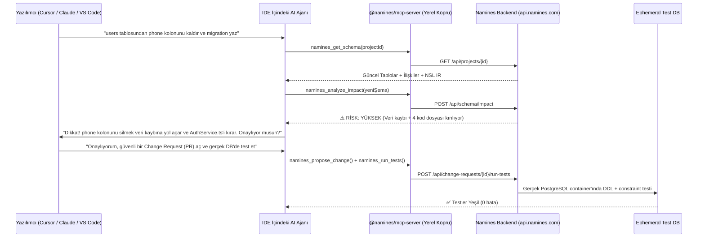
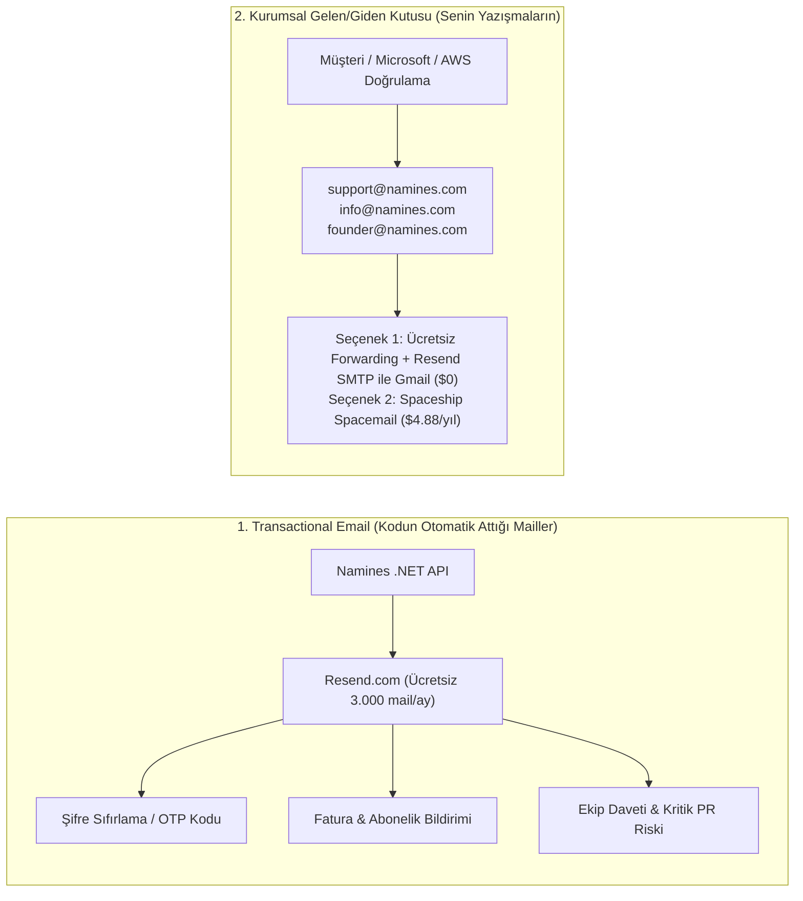
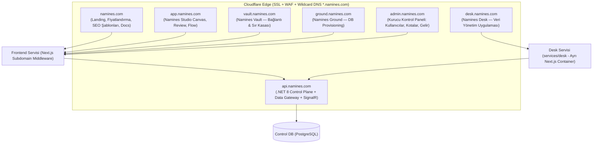
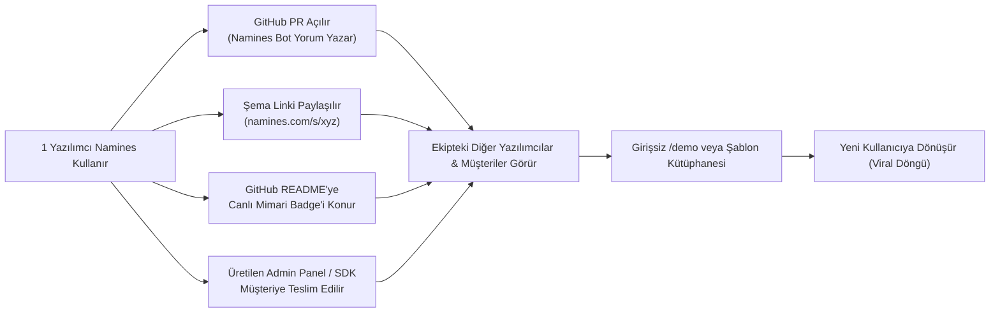
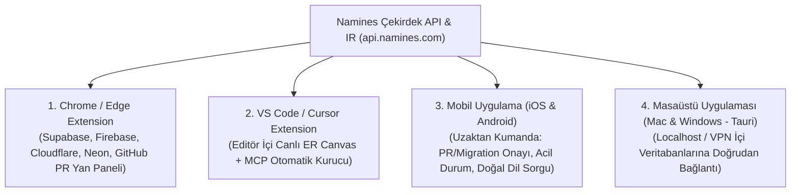
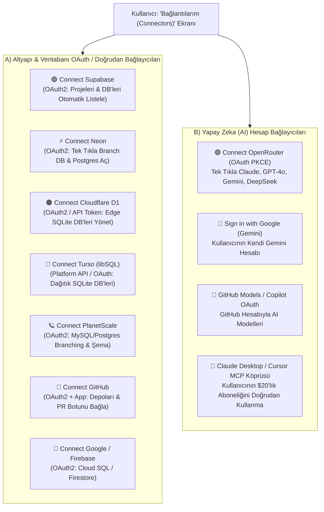

# 18 — Ekosistem, Ticari Altyapı, Dağıtık Mimari ve Büyüme (9 Ana Sütun Master Planı)

> **Tarih:** 2026-10-28 · **Sahip:** Enes Yel  
> **Amaç:** Namines'in çekirdek mühendisliği (Faz 0, Faz 1 ve Faz 2'nin G0–G56 adımları, 2084 backend + 199 frontend + 111 Desk testi) tamamlandıktan sonra; ürünün **canlıya çıkışı (Go-To-Market), ABD şirketi üzerinden ticarileşmesi, dağıtık subdomain mimarisi (`*.namines.com`), iletişim/kimlik katmanı (Mail/SMS/Auth), OAuth Connector sistemi, kendi reklamını yapan viral büyüme motorları ve çoklu platform (Extension, Mobil, Masaüstü) ekosistemi** için eksiksiz başvuru rehberi.

---

## İçindekiler

1. [Bölüm 1: MCP (Model Context Protocol) Mimarisi ve Çalışma Prensibi](#bölüm-1-mcp-model-context-protocol-mimarisi-ve-çalışma-prensibi)
2. [Bölüm 2: Anasayfadaki IDE & AI Bağlantıları Ne İşe Yarıyor? (`packages/mcp-server` & `namines-cli`)](#bölüm-2-anasayfadaki-ide--ai-bağlantıları-ne-i̇şe-yarıyor-packagesmcp-server--namines-cli)
3. [Bölüm 3: Stripe, Türkiye Ödeme Yöntemleri ve ABD Şirketinin (EIN) Stratejik Kaldıraçları](#bölüm-3-stripe-türkiye-ödeme-yöntemleri-ve-abd-şirketinin-ein-stratejik-kaldıraçları)
4. [Bölüm 4: Domain Seçimi ve Çift Katmanlı Kurumsal E-Posta (Mail) Mimarisi](#bölüm-4-domain-seçimi-ve-çift-katmanlı-kurumsal-e-posta-mail-mimarisi)
5. [Bölüm 5: Telefona SMS Sistemi, 2FA/Kritik Onay Akışı ve Authentication Mimarisi](#bölüm-5-telefona-sms-sistemi-2fakritik-onay-akışı-ve-authentication-mimarisi)
6. [Bölüm 6: Dağıtık Subdomain Mimarisi (`desk.`, `vault.`, `ground.`, `admin.`) ve Tek Oturum (SSO)](#bölüm-6-dağıtık-subdomain-mimarisi-desk-vault-ground-admin-ve-tek-oturum-sso)
7. [Bölüm 7: Kendi Kendinin Reklamını Yapan Sistemler (Product-Led Growth & Viral Loops)](#bölüm-7-kendi-kendinin-reklamını-yapan-sistemler-product-led-growth--viral-loops)
8. [Bölüm 8: Browser Extension, VS Code Yan Paneli, Mobil "Remote Control" ve Masaüstü (Mac/Win) Uygulaması](#bölüm-8-browser-extension-vs-code-yan-paneli-mobil-remote-control-ve-masaüstü-macwin-uygulaması)
9. [Bölüm 9: API Key Yapıştırma Yerine "Hesabını Bağla" (OAuth Connectors: Claude, OpenAI, Google, Supabase, Neon)](#bölüm-9-api-key-yapıştırma-yerine-hesabını-bağla-oauth-connectors-claude-openai-google-supabase-neon)
10. [Bölüm 10: Uygulama Sırası ve Eylem Yol Haritası](#bölüm-10-uygulama-sırası-ve-eylem-yol-haritası)

---

## Bölüm 1: MCP (Model Context Protocol) Mimarisi ve Çalışma Prensibi

### 1.1. Sorun: Yapay Zeka Kod Editörleri Veritabanına "Kör" Bakıyor
Bugün yazılımcılar kodlarının %70'ini **Cursor, Windsurf, VS Code (GitHub Copilot / Cline) veya Claude Desktop / Claude Code** içinde yazıyor. Ancak yazılımcı bu araçlara:
> *"Siparişler tablosundaki `price` kolonunu `total_amount` yap ve kullanıcı silindiğinde siparişleri de temizle"*

dediğinde, IDE içindeki yapay zeka şunları **bilmez**:
1. Canlı veritabanında o kolona bağlı hangi **View, Index, Trigger veya Foreign Key** var?
2. `ON DELETE CASCADE` koyarsa muhasebe/fatura kayıtları da **sessizce silinecek mi**?
3. Hedef veritabanı motoru (PostgreSQL, SQL Server, MySQL, MariaDB, Oracle, SQLite) bu değişikliği **tabloyu kilitlemeden (zero-downtime)** yapabilir mi?
4. Bu kolon değiştiğinde projenin içindeki hangi C#, TypeScript, Prisma veya Python dosyaları **kırılacak**?

### 1.2. Çözüm: Namines MCP Sunucusu (`packages/mcp-server/`)
**MCP (Model Context Protocol)**, Anthropic tarafından geliştirilen ve bugün tüm AI dünyasının (OpenAI, Google, Cursor, Windsurf, VS Code) kabul ettiği açık bir standarttır. Yapay zeka modellerinin dış sistemlere **güvenli ve kurallı araçlarla (tools)** bağlanmasını sağlar.

Bizim depomuzda [`packages/mcp-server/src/index.ts`](../../packages/mcp-server/src/index.ts) altında **tamamen yazılmış ve test edilmiş** bir MCP sunucumuz var.



### 1.3. MCP Sunucumuzun İçindeki 7 Araç (Tools) ve 1 Kaynak (Resource)
Kod tabanımızda (`packages/mcp-server/src/tools.ts`) aktif olan araçlar şunlardır:

| MCP Aracı | Ne Yapar? | Çağırdığı Namines Backend Ucu |
|---|---|---|
| `namines_get_schema` | Aktif projenin tüm tablolarını, kolon tiplerini, kısıtlarını ve ilişkilerini AI'ya verir. | `GET /api/projects/{id}` |
| `namines_analyze_impact` | AI bir değişiklik yapmadan önce eski ve yeni şemayı karşılaştırır; veri kaybı riskini (`Safe`, `Caution`, `Destructive`) ve kırılan noktaları döner. | `POST /api/schema/impact` |
| `namines_propose_change` | AI'nın yaptığı değişikliği doğrudan canlıya basmak yerine Namines'te **Change Request (Değişiklik İsteği)** olarak açar. `Safe` ise ve otomatik onay açıksa kendiliğinden onaylanır. | `POST /api/projects/{id}/change-requests` |
| `namines_compile_ddl` | Şemayı 6 veritabanı motorundan (PostgreSQL, MSSQL, MySQL, MariaDB, Oracle, SQLite) istenene hatasız derler. | `POST /api/schema/compile` |
| `namines_explain_risk` | `ImpactReport` çıktısını yönetici veya yazılımcı için insan dilinde özetler (AI uydurmaz, yalnızca deterministik bulguları açıklar). | `POST /api/schema/impact/explain` |
| `namines_run_tests` | Değişikliği gerçek bir izole Docker veritabanı container'ında çalıştırıp doğrular. | `POST /api/change-requests/{id}/run-tests` |
| `namines_eject` | Şemadan 19 farklı hedefe (TypeScript SDK, Prisma, Drizzle, EF Core, Django, Next.js Admin Panel vb.) anında kod üretir. | `POST /api/schema/eject` |
| **Resource:** `namines://schema/current` | AI'nın istediği an bağlam (context) olarak okuyabileceği salt-okunur canlı şema kaynağı. | `GET /api/projects/{id}` |

---

## Bölüm 2: Anasayfadaki IDE & AI Bağlantıları Ne İşe Yarıyor? (`packages/mcp-server` & `namines-cli`)

### 2.1. Anasayfadaki Vitrin (`IdeIntegrationShowcase.tsx`) Neyi Gösteriyor?
Anasayfada yer alan [`frontend/components/landing/IdeIntegrationShowcase.tsx`](../../frontend/components/landing/IdeIntegrationShowcase.tsx) bileşeni, kullanıcıya şu mesajı verir:
> *"Namines sadece tarayıcıda açıp diyagram çizdiğin bir site değildir; senin kullandığın kod editörünün (Cursor, Claude Code, Windsurf, VS Code) içine giren bir veritabanı güvenlik motorudur."*

Oradaki 4 sekme şunları yapar:
1. **Cursor (`~/.cursor/mcp.json`)**: Cursor kullanan yazılımcının tek tıkla kopyalayıp kendi Cursor ayarlarına yapıştıracağı JSON bloğu.
2. **Claude Code (`claude mcp add namines ...`)**: Terminalden Claude Code kullanan yazılımcının tek satırla Namines'i Claude'a bağladığı komut.
3. **Windsurf (`~/.codeium/windsurf/mcp_config.json`)**: Windsurf IDE bağlantısı.
4. **VS Code (`.vscode/mcp.json`)**: VS Code Copilot Agent modu bağlantısı.

### 2.2. Ayrıca Elimizde Bir de CLI Aracı Var (`packages/namines-cli/`)
Sadece yapay zeka değil, yazılımcının bizzat terminalden veya CI/CD (GitHub Actions / GitLab CI) boru hattından çalıştırabileceği [`packages/namines-cli/src/cli.ts`](../../packages/namines-cli/src/cli.ts) aracımız hazır:
- `namines pull` → Buluttaki şemayı yerel projeye (`schema.nsl.json`) indirir.
- `namines diff` → Yerelde yaptığın şema değişikliğinin risk raporunu terminalde renkli olarak gösterir.
- `namines propose --title "..."` → Terminalden çıkmadan inceleme (Change Request) açar.
- `namines compile --dialect postgres` → SQL çıktısını terminale veya dosyaya basar.
- `namines eject --target typescript-sdk --out ./src/db` → Projenin içine tipli SDK kodlarını indirir.
- `namines test --cr <id>` → Gerçek container testini terminalden tetikler.

### 2.3. Şu An Tek Eksik Ne?
Kodların %100'ü yazıldı ve GitHub Actions yayın iş akışı (`.github/workflows/publish-packages.yml`) hazırlandı. Tek eksik:
1. [npmjs.com](https://www.npmjs.com) üzerinde ücretsiz bir hesap açıp `@namines` organizasyonunu oluşturman,
2. Aldığın `NPM_TOKEN` değerini GitHub repo secrets'a koyman.
Bunu yaptığımız an dünyadaki herhangi bir yazılımcı `npx -y @namines/mcp-server` yazdığında saniyeler içinde senin sistemine bağlanacak.

---

## Bölüm 3: Stripe, Türkiye Ödeme Yöntemleri ve ABD Şirketinin (EIN) Stratejik Kaldıraçları

### 3.1. Sistemimizdeki Mevcut Ödeme Kodu
Backend'de [`StripeService.cs`](../../backend/Namines.Infrastructure/Services/StripeService.cs) ve [`PricingCatalog.cs`](../../backend/Namines.Core/Billing/PricingCatalog.cs) içinde tüm ödeme mimarisi kurulu:
- **Free ($0):** Günlük 25.000 token, 3 çoklu DB ilişkisi, 60 req/dk Gateway limiti.
- **Pro ($15/ay veya $150/yıl - %17 indirimli):** Günlük 200.000 token, 25 çoklu DB ilişkisi, 600 req/dk Gateway limiti, özel şemalar.
- **Team ($40/ay veya $400/yıl - 3 koltuk dahil):** Günlük 750.000 token, 100 çoklu DB ilişkisi, 3.000 req/dk Gateway limiti, ortak çalışma alanı, davet linkleri, RBAC.

### 3.2. ABD Şirketi (EIN) + Stripe US: Türkiye'den ve Dünyadan Ödeme Alma Gerçeği
ABD'de resmi bir şirket (LLC veya C-Corp) kurmuş ve **EIN (Employer Identification Number)** almış olman, seni Türkiye'deki ödeme kısıtlamalarının tamamından kurtarıyor:

1. **Stripe US Hesabı Açılışı:**
   - ABD şirketin, EIN belgen (IRS CP575 / 147C) ve ABD ticari banka hesabın (Mercury, Relay veya Wise Business USD hesabı) ile doğrudan **Stripe US** hesabı açabilirsin.
2. **Türkiye'deki Kullanıcılar Stripe US Üzerinden Ödeme Yapabilir mi?**
   - **KESİNLİKLE EVET.** Stripe'ın Türkiye'de desteklemediği şey *"Türkiye merkezli bir şirketin satıcı (merchant) hesabı açmasıdır"*. Ancak satıcı **ABD şirketi** olduğunda, Türkiye'deki bir müşteri (Garanti, İş Bankası, Yapı Kredi, Ziraat, Enpara, Papara vb. Visa/Mastercard/Troy uluslararası açık kartlarıyla) senin Stripe ekranından tıpkı ChatGPT, Netflix, Cursor veya Spotify aboneliği alır gibi **sorunsuz ödeme yapabilir**.
3. **Türkiye İçin Ekstra Yerel Seçenek Gerekir mi? (Ne Zaman, Neden?)**
   - **Bireysel yazılımcılar ve küresel SaaS için:** Tek başına **Stripe US** (veya vergi/muhasebe otomasyonu istersen **LemonSqueezy / Paddle / Polar.sh**) fazlasıyla yeterlidir. Stripe Checkout'ta **"Adaptive Pricing" (Yerel Para Birimi Gösterimi)** özelliğini açtığında, Türkiye'den giren kullanıcıya fiyatı otomatik olarak güncel kurdan **₺ (TRY)** olarak gösterir, müşteri TL öder, senin Amerika hesabına USD olarak yatar!
   - **Türkiye'deki kurumsal şirketlere (B2B) "e-Fatura + KDV + Taksit" ile satış yapmak istersen:** O zaman ikinci bir ödeme sağlayıcı olarak (`IPaymentProvider` arayüzümüzün arkasına) **İyzico** veya **PayTR** bağlayabiliriz. Ama ilk 1000 müşteriye kadar Stripe US + Adaptive Pricing en temiz ve sıfır bürokrasili yoldur.

### 3.3. ABD Şirketi (EIN) İle Alabileceğin Devasa Hibe, Kredi ve Platform Avantajları
Vergi numaralı bir ABD şirketin ve kurumsal domainin (`namines.com`) olduğunda, nakit para harcamadan **on binlerce dolarlık altyapı ve AI kredisini** resmi olarak alabilirsin:

| Program | Sağladığı Fayda / Kredi | Namines'te Nerede Kullanılır? | Başvuru Gereksinimi |
|---|---|---|---|
| **Microsoft for Startups Founders Hub** | **$5.000 → $150.000** Azure + **Azure OpenAI (GPT-4o)** kredisi + GitHub Enterprise ücretsiz | AI şema üretimi, sunucu barındırma, PostgreSQL (Azure Flexible Server) | Şirket domaini (`namines.com`) + LinkedIn profili + EIN |
| **Google for Startups Cloud Program** | **$2.000 → $100.000** Google Cloud + **Vertex AI (Gemini 2.5 Pro/Flash)** + Firebase kredisi | Gemini AI modelleri, Cloud Run, yedekleme | Kurumsal web sitesi + ABD şirket bilgileri |
| **AWS Activate Founders** | **$1.000 → $10.000+** AWS + **Amazon Bedrock (Claude 3.7 / 4 Sonnet)** kredisi | Claude modellerini **bedava krediyle** çalıştırmak, AWS SES (mail), S3 | AWS hesabı + şirket bilgileri |
| **Cloudflare for Startups** | **$5.000 – $250.000** Cloudflare Workers, R2, D1, Pro/Business DNS & WAF | Tüm `*.namines.com` subdomain güvenliği, DDoS koruması, CDN | Kurumsal domain + başvuru formu |
| **Neon / Supabase Startup Programları** | **$1.000 – $10.000** yönetilen PostgreSQL kredisi | **Namines Ground** ve **Server-Side Branching** veritabanlarını sıfır maliyetle açmak | Startup başvurusu |
| **Apple Developer Enterprise / Organization & Google Play** | Uygulama mağazalarında kişisel isim yerine **"Namines LLC / Inc."** görünmesi | 8. maddedeki Mobil ve Mac masaüstü uygulamalarının güvenilirliği | Ücretsiz **D-U-N-S Numarası** (EIN ile Dun & Bradstreet'ten ücretsiz alınır) |
| **Stripe Fee Waivers (Komisyon Muafiyeti)** | İlk **$20.000 – $50.000** ciroda **%0 Stripe komisyonu** | Mercury, FoundersHub veya Stripe Atlas partner perks üzerinden aktif edilir | ABD şirketi + Mercury/FoundersHub |

> [!TIP]
> **Özetle:** ABD şirketin sayesinde Microsoft, AWS ve Google'dan alacağın toplam **$10.000–$50.000 arası ücretsiz AI & Bulut kredisi**, Namines'in ilk 1-2 yıllık tüm sunucu ve yapay zeka (Claude, GPT, Gemini) maliyetini **sıfıra** indirebilir!

---

## Bölüm 4: Domain Seçimi, Kayıt Firması Fiyat Karşılaştırması ve Çift Katmanlı Kurumsal E-Posta Mimarisi

### 4.1. Domain Stratejisi ve Neden `.best` / `.xyz` Yerine Kesinlikle `namines.com` Alınmalı?
1. **Birincil Hedef:** **`namines.com`** (Alternatif geliştirici uzantıları: `namines.dev`, `namines.app`).
2. **Neden `.best`, `.top`, `.xyz` Gibi Ucuz Uzantılardan Uzak Durulmalı?**
   - **Spam Kara Listesi Riski:** Spam filtreleri (Gmail, Outlook, Spamhaus) `.best` ve `.xyz` uzantılarına çok düşük itibar puanı verir; şifre sıfırlama maillerin doğrudan Spam kutusuna düşer.
   - **ABD Startup Kredisi Reddi ($50.000+ Risk):** Microsoft Founders Hub, AWS Activate, Google Cloud ve Stripe inceleme ekipleri `.best` uzantılı başvuruları "geçici/düşük güvenilirlikli proje" sayıp reddedebilir.
   - **2. Yıl Yenileme Tuzağı:** `.best` veya `.tech` ilk yıl $2 görünür ama 2. yıl yenilemesi **$45–$65**'dır. Oysa `.com` hem ilk yıl hem her yıl **~$9–$10** sabit kalır.

### 4.2. En Ucuz ve En Güvenilir `.com` Satan Siteler Karşılaştırması (2026 Güncel)

| Kayıt Firması (Registrar) | İlk Yıl `.com` Fiyatı | Yıllık Yenileme Fiyatı | WHOIS Gizliliği | Ücretsiz Mail Yönlendirme | Sonuç ve Tavsiye |
|---|---|---|---|---|---|
| **🥇 Spaceship (`spaceship.com`)** | **~$8.88** *(promosyon koduyla ~$6.90)* | **~$9.98 – $10.18** | ✅ Ücretsiz | ✅ Ücretsiz (+ Spacemail yıllık $4.88) | **EN UYGUN SEÇENEK!** Hem ilk alımda hem yenilemede dünyadaki en ucuz ve modern arayüzlü yer (Namecheap'in yeni nesil markası). |
| **🥈 Cloudflare (`cloudflare.com`)** | **~$10.46** *(Maliyetine)* | **~$10.46** *(Sıfır kâr)* | ✅ Ücretsiz | ✅ Ücretsiz (Email Routing) | Sıfır komisyonla maliyetine satar; DNS ve Wildcard Subdomain (`*.namines.com`) yönetimi için en iyisidir. |
| **🥉 Porkbun (`porkbun.com`)** | **~$11.08** | **~$11.08** | ✅ Ücretsiz | ✅ Ücretsiz | Şeffaf fiyatlandırma, sürpriz yenileme ücreti yok. |
| **Namecheap** | ~$11.28 | ~$18.48 | ✅ Ücretsiz | ✅ Ücretsiz | İlk yıl uygun ama 2. yıl yenilemesi Spaceship'e göre pahalı ($18.48). |
| **GoDaddy** | ~$11.99 | ~$22.99+ | ❌ Ek ücretli | ❌ Ek ücretli | **Önerilmez** (Yenileme ve gizlilik ücretleri çok yüksek). |

> [!IMPORTANT]
> **En İyi Kurulum Formülü:** Domaini **Spaceship** üzerinden **~$8.88**'e satın al. İstersen doğrudan Spaceship'te kullan, istersen ücretsiz olarak **Cloudflare DNS**'e bağla.

### 4.3. "Ücretsiz Email Forwarding Yaparsam Mail Yollayamam Değil mi?" Sorusunun Net Cevabı ve 2 Çözümü

**Çok doğru yakaladın:** Tek başına *Email Forwarding (Yönlendirme)* sadece `info@namines.com` veya `founder@namines.com` adresine **gelen** mailleri senin Gmail kutuna düşürür; tek başına dışarıya `@namines.com` olarak mail **yollayamaz**.

**Ancak `@namines.com` adresinden dışarıya mail YOLLAMAK için elimizde biri %100 ÜCRETSİZ, diğeri yıllık $4.88 olan 2 harika yöntem var:**

#### Yöntem 1: %100 Ücretsiz "Gmail + Resend SMTP" Köprüsü ($0 / Ömür Boyu Bedava!)
Hiçbir mail kutusu parası ödemeden, kendi Gmail ekranından `founder@namines.com` ve `info@namines.com` olarak **hem mail alıp hem mail yollayabilirsin**:
1. **Gelen Mailler İçin:** Spaceship (veya Cloudflare) ücretsiz Email Forwarding açılır → `founder@namines.com` adresine gelen her mail senin Gmail'ine düşer.
2. **Mail Yollamak (Göndermek) İçin:** Uygulamamız için zaten ücretsiz açacağımız **Resend (`resend.com` — ayda 3.000 mail bedava)** hesabının verdiği SMTP bilgileri (`smtp.resend.com`, Port `465`, Kullanıcı: `resend`, Şifre: `re_...`) senin Gmail'inin **`Ayarlar → Hesaplar → Başka bir adresten posta gönder (Send mail as)`** kısmına 1 dakikada eklenir!
3. **Sonuç:** Gmail'de "Yeni E-posta" dediğinde gönderici olarak `founder@namines.com` veya `info@namines.com` seçersin; karşı tarafa %100 orijinal, DKIM/SPF imzalı kurumsal mail olarak gider!

#### Yöntem 2: Spaceship "Spacemail" (Yıllık Sadece ~$4.88 / Ayda 15 TL)
- *"Gmail ayarlarıyla hiç uğraşmayayım, Spaceship içinde hazır gelen-giden kutum olsun"* dersen, Spaceship'in kendi **Spacemail** paketi ilk 30 gün ücretsizdir, sonrasında **koca bir yıl için toplam $4.88**'dir. Aldığın an DNS ayarlarını kendi yapar, hem mail alır hem mail yollarsın.

### 4.4. E-Posta Mimarisinin İki Katmanı (Uygulama Mailleri vs. İnsan İletişimi)



---

## Bölüm 5: Telefona SMS Sistemi, 2FA/Kritik Onay Akışı ve Authentication Mimarisi

### 5.1. Kimlik Doğrulama (Authentication) Katmanları
Şu an [`AuthController.cs`](../../backend/Namines.API/Controllers/AuthController.cs) içinde E-posta/Şifre + JWT + Refresh Token + GitHub OAuth var. Bunu kurumsal SaaS seviyesine çıkarmak için ekleyeceğimiz yapı:

1. **Google OAuth ("Continue with Google"):** GitHub OAuth'un yanına eklenecek.
2. **E-Posta Doğrulama (6 Haneli OTP / Magic Link):** Kullanıcı kayıt olduğunda veya şifresini unuttuğunda Resend üzerinden 6 haneli doğrulama kodu (`849201`) gidecek.
3. **Passkey / Authenticator App (TOTP - Google Authenticator / 1Password):** Sıfır maliyetli ve en güvenli 2FA yöntemi.

### 5.2. Telefona SMS (Mesaj) Sistemi: Nerede Kullanmalı, Maliyet Tuzağından Nasıl Kaçmalı?

> [!WARNING]
> **Kritik Maliyet Uyarısı (SMS Pumping):**
> Eğer ücretsiz kayıt olan herkese zorunlu SMS doğrulaması koyarsan, kötü niyetli botlar sitene binlerce sahte numara girip SMS faturanı bir gecede $1.000'a çıkarabilir (buna *SMS Pumping Fraud* denir). Ayrıca uluslararası SMS fiyatları mesaj başına $0.01 ile $0.15 arasındadır.

**Bu yüzden SMS'i "Ücretsiz Kayıt"ta DEĞİL, "Yüksek Değerli Güvenlik ve Bildirim"de kullanacağız:**

1. **Kullanım Senaryosu 1 — Pro / Team Hesaplarda Telefon Doğrulama & 2FA:**
   - Kullanıcı Pro veya Team planına geçtiğinde veya **Namines Vault**'a (canlı veritabanı şifre kasası) erişirken telefonunu doğrular.
2. **Kullanım Senaryosu 2 — "Production Database Destructive Change" SMS/WhatsApp Onayı (Efsane Özellik!):**
   - Bir ekipte bir yazılımcı canlı veritabanında `Destructive` (veri silecek) bir migration'ı çalıştırmak istediğinde, takım liderinin (Owner/Admin) telefonuna SMS gelir:
     > *"[Namines Security] Production DB üzerinde 'users.balance' kolonu siliniyor. Onaylamak için 649120 kodunu girin veya reddetmek için: https://app.namines.com/r/89a"*
3. **Kullanım Senaryosu 3 — Namines Flow Acil Uyarıları:**
   - Namines Flow otomasyon motorumuza (`AutomationActionType`) `SmsAlert` ve `WhatsAppAlert` aksiyonu eklenir.

**Hangi SMS Sağlayıcısını Kullanacağız?**
- **Küresel + ABD Şirketi İçin:** **Twilio Verify** veya **AWS End User Messaging (SNS)** veya **Prelude.so**. (ABD şirketin ve EIN numaran olduğu için Twilio'da A2P 10DLC kaydını resmi olarak yapabilirsin ve global teslimat oranın %99 olur).
- **Sadece Türkiye Numaralarına Çok Ucuz SMS Atmak İstersen:** `ISmsService` içinde numara `+90` ile başlıyorsa **Netgsm / İletiMerkezi** (mesaj başı kuruşlar seviyesinde), diğer ülke kodlarıyla başlıyorsa **Twilio** kullanan **Hibrit Yönlendirici (Smart SMS Router)** yazarız!

---

## Bölüm 6: Dağıtık Subdomain Mimarisi (`desk.`, `vault.`, `ground.`, `admin.`) ve Tek Oturum (SSO)

### 6.1. Neden Subdomain Mimarisi?
Namines artık tek bir sayfa değil, **5 ayrı üründen oluşan bir veri platformu**:
1. **Namines Studio** (Görsel Şema, AI Mimari, İnceleme/Review, Flow)
2. **Namines Desk** (`services/desk/` — Canlı Veri Yönetim Paneli, Tablo/Satır CRUD, Doğal Dil Sorgu)
3. **Namines Vault** (`backend/Namines.Vault/` — AES-256-GCM Sır ve Veritabanı Bağlantı Kasası)
4. **Namines Ground** (`backend/Namines.Ground/` — Tek Tıkla Veritabanı Ayağa Kaldırma: Neon / Supabase / Local)
5. **Namines Gateway & API** (`backend/Namines.API/` — Otomatik REST/RPC/SQL Uçları)

Tek bir `namines.com` domaini aldığında, **hiçbir ekstra domain ücreti ödemeden** Cloudflare DNS üzerinden aşağıdaki dağıtık mimariyi kuruyoruz:



### 6.2. Teknik Uygulama: Hem Dağıtık Hem Tek Noktadan Yönetilebilir Nasıl Olacak?

Bu mimarinin iki harika esnekliği var:

#### 1) Ayrı Servis Olanlar Doğrudan Ayrı Container'a Gider (`desk.namines.com` & `api.namines.com`)
- `services/desk` zaten depomuzda tamamen bağımsız bir Next.js uygulaması. Reverse Proxy (Caddy / Nginx / Cloudflare Tunnel / Coolify) seviyesinde `desk.namines.com` doğrudan `services/desk:3002` container'ına yönlendirilir.
- `api.namines.com` doğrudan `.NET 8 API:5000` container'ına yönlendirilir.

#### 2) Ana Frontend İçindeki Modüller Next.js `middleware.ts` (Hostname Routing) İle Ayrılır
- `vault.namines.com` adresine gelen bir istek, Next.js `middleware.ts` dosyasında `host === 'vault.namines.com'` olarak yakalanır ve URL adres çubuğunda `vault.namines.com` kalmaya devam ederken arka planda `/vault` sayfasını (`frontend/app/vault/page.tsx`) render eder!
- Aynı şekilde `ground.namines.com` → `/ground` sayfasını, `admin.namines.com` → `/admin` (kurucu panelini) gösterir.
- İleride `vault` veya `ground` çok büyürse, tıpkı `desk` gibi kendi ayrı container'ına taşınır; **kullanıcının bildiği URL (`vault.namines.com`) hiç değişmez!**

#### 3) Subdomain'ler Arası Kesintisiz Oturum (Cross-Subdomain SSO)
Kullanıcı `app.namines.com`'da giriş yaptıktan sonra üst menüdeki **"Uygulama Değiştirici (App Switcher - 9 Nokta İkonu)"** menüsünden `desk.namines.com` veya `vault.namines.com`'a tıkladığında **tekrar giriş yapmamalıdır**:
- **Yöntem A (Wildcard Cookie):** Oturum çerezi `Domain=.namines.com; Secure; HttpOnly; SameSite=Lax` olarak ayarlanır. Tüm `*.namines.com` alt alan adları kullanıcıyı anında tanır.
- **Yöntem B (Mevcut SSO Handover - Zaten Kodlandı!):** Desk v2'de kodladığımız `POST /api/auth/sso-handover` mekanizması zaten çalışıyor!

#### 4) `admin.namines.com` (Senin Kurucu / God-Mode Panelin)
Senin için özel bir `admin.namines.com` ekranı açacağız (yalnızca `.env`'deki `DevAccount` / `IsSystemAdmin` yetkisi + 2FA ile girilebilen):
- Toplam kayıtlı kullanıcı, aktif Pro/Team abonelikleri, MRR (Aylık Tekrarlayan Gelir),
- Günlük harcanan toplam AI token miktarı (Groq / DeepSeek / OpenAI maliyetin),
- Hangi kullanıcının ne kadar kota tükettiği, gerektiğinde bir kullanıcıya manuel Pro tanımlama veya kota sıfırlama,
- Sistem sağlık durumu (PostgreSQL, Docker, Gateway gecikmeleri).

---

## Bölüm 7: Kendi Kendinin Reklamını Yapan Sistemler (Product-Led Growth & Viral Loops)

Reklam ajanslarına veya Google/Meta reklamlarına binlerce dolar gömmek yerine, **kullanan her yazılımcının farkında olmadan 5 yeni yazılımcıyı sisteme çektiği** 7 organik büyüme motoru:



### 7.1. Motor 1: GitHub PR Botu (En Yüksek Dönüşümlü B2B Viral Kanal)
- **Nasıl Çalışır:** Bir projede sadece 1 yazılımcı Namines GitHub App'ini kurar. O günden itibaren o depoda kim veritabanını etkileyen bir Pull Request açarsa, **Namines Bot** PR'ın altına çok şık bir tablo ve diyagramla yorum yazar:
  > 🛡️ **Namines Schema Impact Report**  
  > **Risk Seviyesi:** 🟡 CAUTION (1 Kolon Tipi Değişiyor, 2 Dosya Etkileniyor)  
  > **Motor Doğrulaması:** ✅ PostgreSQL 16 (Gerçek Container Testi Geçti - 1.2s)  
  > 👉 **[Canlı Görsel Farkı (Diff) Namines Studio'da İncele →]**
- **Neden Viral?** PR'ı inceleyen diğer 5 ekip arkadaşı ve takım lideri bu raporu görür, linke tıklar ve Namines ile tanışır. (Kodumuzda `GitHubBotService` hazır!).

### 7.2. Motor 2: İnteraktif Şema Paylaşım Linkleri (`/s/[slug]`) + "Fork in Namines"
- Yazılımcılar X'te (Twitter), Reddit'te (`r/PostgreSQL`, `r/webdev`, `r/node`), Discord'da veya teknik bloglarında *"Arkadaşlar e-ticaret sitem için şöyle bir veritabanı kurdum, sizce nasıl?"* diye ekran görüntüsü paylaşır.
- Ekran görüntüsü yerine `namines.com/s/e-ticaret-v2` linkini paylaştıklarında:
  1. Linkin sosyal medya önizlemesi (OpenGraph resmi) otomatik olarak şemanın tablo sayısını, motorunu ve önizlemesini gösterir (G49'da `opengraph-image.tsx` ile kodlandı!).
  2. Linke tıklayan kişi şemayı yakınlaştırıp gezebilir, sağ üstte **"⚡ Bu Şemayı Klonla & AI ile Düzenle (Ücretsiz)"** butonu parlar.

### 7.3. Motor 3: GitHub `README.md` İçin Canlı Mimari Rozeti (Dynamic SVG Badge)
- Açık kaynak proje sahiplerine şu Markdown kodunu veririz:
  ```markdown
  [](https://namines.com/s/prj_12345)
  ```
- Bu rozet GitHub reposunun en tepesinde `Database | 24 Tables · PostgreSQL · Verified by Namines` şeklinde canlı durur. Her tıklayan doğrudan senin sitene gelir.

### 7.4. Motor 4: Programatik SEO — "100+ Ünlü Uygulamanın Veritabanı Mimarisi" (`/templates` & `/blueprints`)
- Google'da her ay yüz binlerce yazılımcı ve öğrenci şunları aratır:
  - *"Multi-tenant SaaS database schema PostgreSQL"*
  - *"Uber / Airbnb / Shopify / Stripe / Discord database design ERD"*
  - *"Hospital management system SQL schema"*
- Bizim sistemimizde zaten 20 şablon (384 tablo) var. Bunu programatik SEO sayfalarına (`/schemas/airbnb-clone-postgresql`, `/schemas/multi-tenant-saas-sqlserver`) dönüştürüp her birinin:
  - Canlı ER diyagramını,
  - 6 motordaki (PostgreSQL, MySQL, MSSQL, Oracle, MariaDB, SQLite) hazır SQL DDL kodunu,
  - Prisma ve EF Core modellerini
  **indekslenebilir (SSR) sayfalar** olarak açtığımızda, Google'dan her gün **sıfır reklam bütçesiyle** binlerce organik yazılımcı trafiği çekeriz.

### 7.5. Motor 5: Ücretsiz "Production Migration Risk Checker" (Mıknatıs Araç)
- Anasayfadan veya `namines.com/linter` adresinden üye olmadan girilebilen bir kutu:
  > *"Canlı veritabanında çalıştırmaktan korktuğun `ALTER TABLE` veya SQL dosyasını buraya yapıştır; tabloyu kilitleyip kilitlemeyeceğini ve veri kaybı riskini 2 saniyede öğren."*
- Bizim deterministik linter ve `SchemaImpactAnalyzer` motorumuz bunu **sıfır AI maliyetiyle (0 token)** yapar! Sonucu gösterdikten sonra: *"Bunu gerçek bir Docker PostgreSQL container'ında test etmek ve PR botunu bağlamak için ücretsiz giriş yap"* deriz.

### 7.6. Motor 6: "Powered by Namines" Rozetleri (Üretilen Çıktılarda)
- Kullanıcı Namines'ten otomatik Next.js Admin Panel, Dokümantasyon (`README.md`) veya PDF mimari raporu indirdiğinde, Free planda en altta zarif bir **"Generated & Protected by Namines"** imzası ve linki yer alır.

### 7.7. Motor 7: Token Ödüllü Davet Sistemi (Referral Program)
- Nakit para dağıtmak yerine: *"Arkadaşını davet et, o ilk şemasını oluşturduğunda ikinize de **+100.000 NAI Pro Token** (veya 1 hafta Pro denemesi) hediye edelim."*
- Groq/DeepSeek altyapımızla 100.000 token'ın sana gerçek maliyeti **~$0.03 (3 sent)** bile değildir ama kullanıcı gözünde büyük bir ödüldür!

---

## Bölüm 8: Browser Extension, VS Code Yan Paneli, Mobil "Remote Control" ve Masaüstü (Mac/Win) Uygulaması

Bu 4 platform, Namines'i "sadece bir web sekmesi" olmaktan çıkarıp yazılımcının **her an elinin altındaki işletim sistemine** dönüştürür:



### 8.1. Tarayıcı Eklentisi (Chrome / Brave / Edge Side-Panel Extension)
Kullanıcı zaten gün boyu **Supabase Dashboard, Firebase Console, Cloudflare D1, Neon Console, AWS RDS veya GitHub PR** sayfalarında vakit geçiriyor.
- **Ne Yapar?**
  1. **Supabase / Neon / Cloudflare / Firebase Köprüsü:** Kullanıcı `supabase.com/dashboard/project/...` sayfasındayken tarayıcının sağ kenarında **Namines Side Panel** açılır. Tek tıkla mevcut Supabase şemasını Namines'e çeker, Namines'in 6 motorlu derleyicisi ve AI'sı ile yeni tabloları/RLS kurallarını tasarlayıp doğrudan açık olan Supabase projesine uygular!
  2. **GitHub PR Görselleştirici:** Kullanıcı GitHub'da bir Pull Request incelerken (içinde `.sql`, `schema.prisma` veya EF Core migration dosyası varsa), Namines eklentisi o PR sayfasının içine **"🎨 Görsel Şema Farkını (ER Diff) Göster"** butonu ekler. Kod satırlarına bakmak yerine hangi tablonun nereye bağlandığını görsel olarak inceler!
  3. **Herhangi Bir Web Sitesinden Şema Çıkarma:** Kullanıcı bir API dokümantasyonuna (Stripe API, Shopify API, Swagger/OpenAPI sayfası) girdiğinde eklentiye basar: *"Bu sayfadaki veri yapısından Namines veritabanı şeması çıkar"* der.

### 8.2. VS Code / Cursor / Windsurf Görsel Eklentisi
- MCP sunucumuz arka planda AI ile konuşuyor; ancak yazılımcı gözüyle de şemayı görmek ister.
- VS Code Marketplace ve OpenVSX'e koyacağımız hafif bir eklenti şunları yapar:
  1. **Tek Tıkla MCP Kurulumu:** Kullanıcının JSON dosyası düzenlemesine gerek kalmaz; eklentiyi kurduğu an MCP'yi otomatik bağlar.
  2. **Yan Panelde Canlı Mini-Canvas:** Kod yazarken yan sekmede (`WebviewPanel`) projenin ER diyagramını gösterir; kodda bir model dosyasına tıkladığında diyagramda o tabloya odaklanır.

### 8.3. Mobil Uygulama (iOS & Android): "Database Mission Control & Uzaktan Kumanda"
Dediğin gibi mobilde kimse küçük ekranda sıfırdan 40 tabloluk diyagram çizmez. Peki mobil uygulama ne yapmalı? **Yöneticinin, Takım Liderinin ve Kurucunun "Cep Kumandası" (Remote Control) olmalı!**

| Mobil Özellik | Senaryo (Gerçek Hayatta Nasıl Kullanılır?) | Backend'de Karşılığı Var mı? |
|---|---|---|
| **1. Biyometrik Migration & PR Onay Kumandası (Push Notification + FaceID)** | Akşam dışarıdasın. Ekibindeki yazılımcı canlıya bir veritabanı değişikliği göndermek için Change Request açtı. Telefonuna bildirim gelir: *"🔴 Ahmet `orders` tablosunda değişiklik istiyor. Risk: CAUTION. Testler: Yeşil."* Uygulamayı açarsın, görsel özeti okursun, **FaceID / Parmak İzi** ile **"Approve & Merge"** tuşuna basarsın! | ✅ `ChangeRequestsController` + `Approve`/`Reject` + `AuditLog` tamamen hazır! |
| **2. Cep Desk & Doğal Dil Sorgu ("Veritabanınla Konuş")** | Yoldayken telefonunu çıkarıp sesli veya yazılı sorarsın: *"Bugün kaç yeni sipariş geldi ve toplam ciro ne kadar?"* Namines senin canlı veritabanına salt-okunur güvenli sorgu atar, cevabı telefonda grafik/tablo olarak gösterir. | ✅ Gateway `/query/nl` ucu ve Whisper sesli giriş hazır! |
| **3. Namines Flow Kumandası (Acil Durum Şalteri)** | Otomasyon kurallarını (Flow) telefondan tek tuşla açıp kapatmak, son çalışan otomasyon loglarını görmek ve "Şimdi Çalıştır (Trigger)" butonuna basmak. | ✅ `AutomationController` (6 uç) hazır! |
| **4. Canlı Veritabanı Sağlık & Kota Radarı** | Bağlı veritabanlarının ayakta olup olmadığını, yapılan son yazma işlemlerini (Gateway Audit Log) ve ekip aktivitelerini canlı izlemek. | ✅ `GatewayAuditLog` hazır! |

### 8.4. Masaüstü Uygulaması (Mac & Windows — Tauri v2 ile)
Neden web sitesi varken masaüstü uygulaması çıkarılır? **İki devasa teknik ve ticari sebep:**
1. **`localhost` ve Şirket İçi (VPN / Intranet) Veritabanlarına Doğrudan Erişim:**
   - Web tarayıcısındaki `app.namines.com`, güvenlik kuralları gereği kullanıcının kendi bilgisayarındaki `localhost:5432` (PostgreSQL), `localhost:3306` (MySQL), yerel `.sqlite` dosyası veya şirket VPN'i arkasındaki veritabanına doğrudan bağlanamaz.
   - Ancak **Mac (`.dmg`) ve Windows (`.exe` / `.msix`) Masaüstü Uygulaması** kullanıcının kendi bilgisayarında çalıştığı için `localhost`'taki tüm veritabanlarına ve yerel Docker'a **buluta hiçbir şifre göndermeden, sıfır gecikmeyle** bağlanır!
2. **Nasıl Yapılır? (PWA Değil, Gerçek Native Uygulama — Tauri v2):**
   - **PWA'dan Farkı:** PWA sadece tarayıcı çubuğu gizlenmiş bir web sekmesidir, yerel TCP soketlerine (`localhost:5432`) veya yerel dosya sistemine erişemez.
   - **Electron'dan Farkı:** Electron her uygulamanın içine 200 MB'lık Google Chrome gömer. **Tauri v2** ise işletim sisteminin yerleşik WebView motorunu (Windows WebView2 / macOS WebKit) + arka planda **Rust** çekirdeğini kullanır.
   - Mevcut Next.js (`frontend/` ve `services/desk/`) arayüzümüzü **sıfırdan kodlamadan** `src-tauri/` yapılandırmasıyla sararız; sadece **~8–12 MB** boyutunda gerçek `.exe` / `.msi` (Windows) ve `.dmg` / `.app` (macOS) kurulum paketleri üretir.

---

## Bölüm 9: API Key Yapıştırma Yerine "Hesabını Bağla" (OAuth Connectors: Claude, OpenAI, Google, Supabase, Neon, Cloudflare D1, Turso, PlanetScale)

### 9.1. Sorun: "Git API Key Al, Kopyala, Yapıştır" Dönemi Bitti
Normal bir kullanıcıya *"Ayarlara gir, OpenAI/Anthropic/Supabase konsoluna git, API key üret, kopyala, buraya yapıştır"* dediğinde kullanıcıların %80'i üşenir veya korkar. Bunun yerine **"Connect Account (Hesabını Bağla)"** butonuna basıp OAuth penceresinden tek tıkla **"İzin Ver (Authorize)"** demesi gerekir.

Bunu **iki ayrı kategoride** (Altyapı Bağlayıcıları ve Yapay Zeka Bağlayıcıları) kurguluyoruz:



### 9.2. Tüm Sağlayıcılar İçin "OAuth / Bağlantı Anahtarı Nasıl Alınır?" Adım Adım Rehberi

Aşağıdaki tablo, Namines kurucusu olarak senin bu platformlardan OAuth `Client ID` / `Client Secret` alırken **nereye gireceğini, senden ne isteyeceklerini ve nasıl bağlanacağını** tek tek gösterir:

| Sağlayıcı | Bağlantı Türü | Nereden Alınır? (Adım Adım) | Senden İstenen Bilgiler | Onay Süresi |
|---|---|---|---|---|
| **1. Supabase** | Resmi OAuth2 (`api.supabase.com/v1/oauth/authorize`) | `Supabase Dashboard` → `Organization Settings` → `OAuth Apps` → **Add Application** | Uygulama adı (`Namines`), Website URL, Callback URL (`https://api.namines.com/api/oauth/supabase/callback`) | **Anında (0 dk)** |
| **2. Neon** | Resmi OAuth2 + Management API (`console.neon.tech`) | `Neon Console` → `Account/Org Settings` → `OAuth Applications` / `API Keys` (Ground için `NEON_API_KEY` + kullanıcı bağlantısı için OAuth Redirect URI) | App Name, Redirect URI (`https://api.namines.com/api/oauth/neon/callback`) | **Anında / Konsoldan** |
| **3. Cloudflare D1** | Cloudflare OAuth2 / Scoped Token Şablonu | `Cloudflare Dashboard` → `My Profile` → `API Tokens` → **Create Custom Token Template** (veya Cloudflare OAuth Partner). Kullanıcıya tek tıkla "D1:Edit" yetkili token oluşturma ekranı açar. | Account ID + D1 Database Read/Write izni | **Anında (0 dk)** |
| **4. Turso (libSQL)** | Turso Platform API / OAuth | `Turso Dashboard` / `turso auth api-tokens mint` veya `api.turso.tech/v1/organizations/{org}/databases`. Kullanıcı tek tıkla Turso organizasyonunu bağlar, SQLite/libSQL derleyicimiz doğrudan şemayı basar. | Organization Slug + Platform Token | **Anında (0 dk)** |
| **5. PlanetScale** | Resmi OAuth2 (`api.planetscale.com/v1/oauth`) | `PlanetScale Settings` → `OAuth Applications` → **New OAuth App**. Kullanıcının veritabanlarını ve branch'lerini (`read_databases`, `write_deploy_requests`) yönetir. | App Name, Callback URL (`https://api.namines.com/api/oauth/planetscale/callback`) | **Anında (0 dk)** |
| **6. GitHub (Auth + Bot)** | GitHub OAuth App + GitHub App | `GitHub Settings` → `Developer settings` → `GitHub Apps` → **New GitHub App** (Ayrıntılı rehber: [`docs/github/F2-GITHUB-APP-KURULUMU.md`](../github/F2-GITHUB-APP-KURULUMU.md)) | Homepage URL, Callback URL, Webhook URL (`https://api.namines.com/api/github/webhook`), PR Read/Write izni | **Anında (0 dk)** |
| **7. OpenRouter (Claude, GPT-4o, DeepSeek)** | **OAuth PKCE** (`openrouter.ai/auth`) | **Hiçbir başvuru veya Client ID bile gerekmez!** Doğrudan kullanıcıyı `https://openrouter.ai/auth?callback_url=https://app.namines.com/auth/openrouter/callback&code_challenge=...` adresine yönlendiriyoruz. | Sadece senin domainin (`callback_url`). Kullanıcı "Approve" dediği an `code` döner, arka uçta API anahtarına çevrilir. | **0 Saniye (Kayıtsız)** |
| **8. Google & Gemini** | Google OAuth 2.0 (`console.cloud.google.com`) | `Google Cloud Console` → `APIs & Services` → `Credentials` → **Create OAuth Client ID (Web Application)** + `OAuth Consent Screen` | App Name, Support Email (`support@namines...`), Privacy URL (`/privacy`), Terms URL (`/terms`), Authorized Redirect URI | Giriş (`email/profile`) **Anında** |

### 9.3. B) Yapay Zeka (Claude, OpenAI, Google) Hesaplarını Bağlama Gerçeği ve 4 Çözüm Yolu

Burada teknik ve yasal gerçeği net bilmemiz gerekiyor:
- **Neden doğrudan `claude.ai` veya `chatgpt.com` ($20'lık bireysel web aboneliği) için "Login with Claude" butonu yok?**
  - Çünkü Anthropic ve OpenAI, kullanıcıların aylık $20 ödediği sınırsız web sohbet aboneliklerini üçüncü parti web sitelerinin arka planda API gibi kullanmasına izin vermiyor (bunu yapan gayriresmi tersine-mühendislik araçlarını da hesap kapatmayla cezalandırıyorlar).
- **PEKİ BUNU YASAL, RESMİ VE KULLANICIYA HİÇ API KEY YAPIŞTIRTMADAN NASIL ÇÖZÜYORUZ?**

İşte dünyadaki en modern 4 yöntem (hepsini birlikte sunacağız):

#### 1. Yöntem: OpenRouter OAuth PKCE ("Tek Tıkla Tüm AI Modellerini Bağla")
- OpenRouter, **Claude 3.7 / 4 Sonnet, OpenAI GPT-4o / o3, Google Gemini 2.5 Pro, DeepSeek R1** dahil tüm modelleri tek çatı altında sunan ve **resmi OAuth PKCE ("Connect with OpenRouter")** destekleyen tek büyük platformdur.
- Kullanıcı Namines'te **"Connect AI Account"** butonuna basar → açılan pencerede **"Onayla"** der (API key kopyalamaz!) → Namines otomatik olarak o kullanıcıya özel kısıtlı bir OAuth token alır ve kullanıcı istediği Claude/OpenAI modelini kendi hesabından kullanır!

#### 2. Yöntem: Google OAuth & GitHub OAuth İle Doğrudan AI Bağlantısı
- **Google:** Kullanıcı **"Sign in with Google"** yaptığında (OAuth scope ile) kendi Google Cloud / Gemini kotasını doğrudan bağlayabilir.
- **GitHub Models:** Kullanıcı zaten GitHub OAuth ile Namines'e giriş yapıyor. Aldığımız GitHub OAuth jetonu ile **GitHub Models (`models.inference.ai.azure.com`)** üzerinden GPT-4o, Claude ve Llama modellerini kullanıcının kendi GitHub hesabı üzerinden çalıştırabiliriz!

#### 3. Yöntem: Claude / ChatGPT Plus ($20) Aboneliği Olanlar İçin "Ters Köprü" (MCP + Claude Skill)
- Kullanıcının cebinde zaten $20'lık **Claude Pro** veya **ChatGPT Plus** veya **Cursor Pro** aboneliği varsa:
  - Bizim web sitemizden Claude'a bağlanmak yerine, **Claude Desktop / Claude.ai Integrations (Remote MCP) / ChatGPT Connectors** içerisinden `https://api.namines.com/mcp` adresine **OAuth ile tek tıkla bağlanır!**
  - **Bunun mucizevi sonucu:** Kullanıcı kendi Claude.ai veya ChatGPT ekranında konuşur, şemayı ve veritabanını Namines yönetir ve **AI token parasını %100 kullanıcının kendi Claude/ChatGPT aboneliği öder (sana maliyeti $0 olur)!**
  - *(Not: Bunun için mevcut yerel `@namines/mcp-server` paketimize ek olarak backend'imize bir de **Remote SSE/HTTP MCP + OAuth2 endpoint'i (`/api/mcp/sse`)** ekleyebiliriz; böylece kullanıcı hiçbir şey indirmeden doğrudan Claude.ai web sitesinden veya mobil uygulamasından "Add Integration -> Namines" diyerek hesabını bağlar!)*

#### 4. Yöntem: Namines Native AI (Sıfır Ayar — Kutusundan Çıktığı Gibi Çalışan NAI Modelleri)
- Hiçbir hesap bağlamak istemeyen kullanıcı için ise zaten G51'de kurduğumuz **NAI-Fast, NAI-Balanced, NAI-Pro** modellerimiz (arka planda senin ABD şirketinle aldığın ücretsiz startup kredileri ve Groq/DeepSeek üzerinden) tek tıkla, sıfır kurulumla çalışır.

---

## Bölüm 10: Uygulama Sırası ve Eylem Yol Haritası

Bu 9 dev başlığı birbirini kilitlemeden, en hızlı gelir ve büyüme getirecek sırayla **4 Fazda** devreye alabiliriz:

### Faz A — Ticari Açılış, Domain, Mail ve Ödeme (1–3 Gün)
1. **Domain Alımı:** Cloudflare üzerinden `namines.com` (veya seçtiğin domain) alınır.
2. **ABD Şirketi + Stripe US:** Stripe US hesabında 4 fiyat (`Pro Monthly $15`, `Pro Yearly $150`, `Team Monthly $40`, `Team Yearly $400`) oluşturulur ve `.env`'ye girilir.
3. **Kurumsal Mail + Resend Entegrasyonu:**
   - Cloudflare Email Routing ile `info@`, `support@`, `billing@namines.com` açılır.
   - `Resend.com` bağlanır; backend'e `ResendEmailService` + E-posta doğrulama (OTP) + Şifre sıfırlama + Fatura/Davet mailleri eklenir.
4. **Startup Kredisi Başvuruları:** Kurumsal domain ve mail (`founder@namines.com`) hazır olduğu gün Microsoft Founders Hub, AWS Activate ve Google Cloud for Startups başvuruları yapılır.

### Faz B — Dağıtık Subdomain (`*.namines.com`) & Auth/SMS Paketi (3–5 Gün)
1. **Subdomain Routing & SSO:**
   - `app.namines.com`, `api.namines.com`, `desk.namines.com`, `vault.namines.com`, `ground.namines.com` ve `admin.namines.com` yönlendirmeleri ve `.namines.com` ortak oturum (SSO Cookie) yapısı kurulur.
2. **`admin.namines.com` Kurucu Paneli:** Kullanıcıları, abonelikleri, harcanan token'ları ve sistem sağlığını tek ekrandan yöneteceğin admin paneli yazılır.
3. **Google OAuth + SMS Güvenlik Katmanı:**
   - "Google ile Giriş Yap" eklenir.
   - Twilio / Netgsm hibrit `ISmsService` yazılarak Vault açılışı ve "Production Destructive Migration" SMS/2FA onay sistemi devreye alınır.

### Faz C — OAuth Connectors ("Hesabını Bağla") & Remote MCP (4–6 Gün)
1. **Connections Merkezi (`/settings/connections`):**
   - Kullanıcıların API key yapıştırmadan tek tıkla **Supabase, Neon, GitHub, Google ve OpenRouter** hesaplarını bağladığı OAuth2 Connector altyapısı kurulur.
2. **Remote MCP Sunucusu (`https://api.namines.com/mcp`):**
   - Kullanıcıların hiçbir paket kurmadan doğrudan Claude.ai ve ChatGPT içerisinden OAuth ile Namines hesaplarını bağlaması sağlanır.
3. **npm Yayını:** `@namines/mcp-server` ve `namines` CLI paketleri npm'e yayınlanır.

### Faz D — Viral Büyüme Motorları & Çoklu Platform (Extension / Mobil / Masaüstü)
1. **Viral Motorlar:**
   - GitHub App canlıya alınır (PR'lara otomatik Namines Bot yorumları başlar).
   - Dinamik GitHub README rozeti (`/api/badge/{id}.svg`) ve SEO şema galerisi (`/schemas/...`) açılır.
2. **Chrome / Edge Side-Panel Extension:** Supabase, Cloudflare, Neon ve GitHub PR sayfalarında yan panelde çalışan Namines eklentisi yazılır.
3. **Masaüstü Uygulaması (Mac & Windows):** Tauri v2 ile yerel veritabanlarına (`localhost`) doğrudan bağlanan masaüstü sürümü paketlenir.
4. **Mobil "Remote Control" Uygulaması:** Bildirimle gelen veritabanı değişikliklerini FaceID ile onaylayan ve doğal dille veritabanı sorgulayan mobil kumanda uygulaması çıkarılır.
