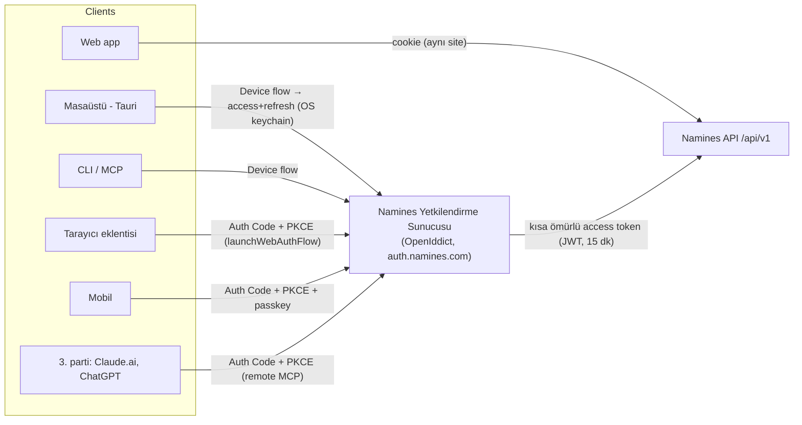

# 02 — Ortak temel: üç platformun da önce ihtiyaç duyduğu backend

> Masaüstü, eklenti ve mobil **aynı** kimlik, cihaz, bildirim ve API
> temeline oturur. Bunu her platformda ayrı ayrı çözmek üç kat iş ve üç
> kat güvenlik açığı demek. Bu belge o temelin planı.

---

## 1. Bugün ne var, ne yok (kodda ölçüldü, 2026-10-30)

| Yetenek | Durum | Not |
|---|---|---|
| E-posta/parola girişi, JWT + cookie | ✅ Var | `AuthController`; cookie web için, Bearer Desk için |
| GitHub/Google OAuth ile giriş | ✅ Var | Denetimde `aud`/`email_verified`/`state` düzeltildi |
| TOTP MFA | ✅ Var | `mfa/setup/enable/disable` |
| **OAuth 2.1 yetkilendirme sunucusu** (Namines'in kendisi token veren) | ❌ Yok | Eklenti, masaüstü ve 3. parti uygulamalar için şart |
| **Refresh token + rotasyon** | ❌ Yok | Uzun ömürlü istemciler (mobil/masaüstü) için şart |
| **Device Authorization Grant** (RFC 8628) | ❌ Yok | CLI ve masaüstü girişi için ideal |
| **Passkey / WebAuthn** | ❌ Yok | Mobil güvenlik ayağının temel taşı |
| **Cihaz kaydı + push** (APNs/FCM) | ❌ Yok | Mobil onay akışı için şart |
| Sürümlü genel API (`/api/v1`) | ❌ Yok | Yayınlanmış istemciler (mağaza sürümleri) eski API'yi kırmamalı |
| TS SDK | 🟡 Kısmi | Eject hedefi `sdk.typescript` kullanıcı şemaları için; Namines'in kendi API'si için SDK yok |
| SignalR gerçek zamanlı | ✅ Var | CanvasHub; denetimde yetki düzeltildi |
| Denetim kaydı | ✅ Var | `ChangeRequestAuditLog`, `GatewayAuditLog` |

## 2. Kimlik mimarisi (hedef)



**Kararlar ve gerekçeleri:**

- **Sunucu: OpenIddict** (.NET, ASP.NET Identity ile doğal entegre, açık
  kaynak, ücretsiz). Alternatif Duende IdentityServer ticari lisans istiyor.
  Keycloak/Auth0 ayrı bir sistem ve ayrı kullanıcı tablosu demek; mevcut
  Identity kullanıcılarını taşımak gereksiz risk.
- **Akış başına istemci türü:**
  - Web, mevcut cookie oturumunda kalır (değiştirmeye gerek yok).
  - Masaüstü ve CLI, **device flow** kullanır: "tarayıcıda şu kodu onayla". Gömülü WebView'da parola toplamak yok (oltalamaya açık ve RFC 8252'ye aykırı).
  - Eklenti, **Authorization Code + PKCE** kullanır (`chrome.identity.launchWebAuthFlow`).
  - Mobil, **Authorization Code + PKCE** (sistem tarayıcısı / ASWebAuthenticationSession) kullanır; mobilde **passkey** birincil yöntemdir.
  - Remote MCP, Claude.ai/ChatGPT gibi 3. parti istemcilere **Auth Code + PKCE** ve dinamik istemci kaydıyla bağlanır (MCP yetkilendirme spesifikasyonu bunu bekliyor).
- **Token'lar:**
  - Access token 15 dakika geçerli.
  - Refresh token **rotasyonlu**. Eski refresh token tekrar kullanılırsa bütün aile iptal edilir (çalınma tespiti).
  - Refresh token istemci tarafında OS keychain'de (masaüstü/mobil) veya `chrome.storage.session`'da (eklenti) tutulur, düz dosyada asla.
- **Scope'lar (dar başlar):** `profile`, `projects:read`, `projects:write`,
  `review:approve` (Safe/Risky), `review:approve:high` (Breaking/Destructive),
  `db:control` (duraklat/kapat/dondur), `desk:read`, `desk:sql`,
  `connectors:manage`, `security:admin`. Eklenti `review:approve`
  alabilir, ama `review:approve:high` ve `db:control` **almaz**: bunlar
  yalnızca mobilde, donanım imzasıyla verilir ([05](05-MOBIL.md)).
- **Mevcut kurallarla tutarlılık:** Denetimde kurulan kural (API anahtarı,
  oluşturan Owner olmaktan çıkınca ölür) refresh token'lara da uygulanır.
  Üye çıkarıldığında o kullanıcının o organizasyon için verilmiş bütün token
  aileleri iptal edilir.

## 3. Cihaz kaydı ve güven seviyesi

Her masaüstü, mobil ve eklenti kurulumu bir **cihaz** kaydıdır:

| Alan | Açıklama |
|---|---|
| `DeviceId` | Sunucu üretir |
| `Kind` | desktop / mobile / extension / cli |
| `PublicKey` | Mobilde Secure Enclave/StrongBox'ta üretilmiş P-256 anahtarın açık kısmı (bkz. [05](05-MOBIL.md)) |
| `Attestation` | App Attest (iOS) / Play Integrity (Android) sonucu; varsa |
| `PushToken` | APNs/FCM; yalnızca mobil |
| `TrustLevel` | `basic` (token), `bound` (anahtar kayıtlı), `attested` (donanım kanıtlı) |
| `LastSeenAt`, `RevokedAt` | Kullanıcı "cihazlarım" ekranından tek tıkla iptal eder |

Kritik işlemler (Destructive onayı, Vault geri yükleme, API anahtarı
oluşturma) en az `bound` güven seviyesindeki bir cihazdan **imzalı onay**
ister. Ayrıntı [05](05-MOBIL.md) §4'te.

## 4. Bildirim servisi

- **Tek bir `NotificationService`** olacak: kanallar web (SignalR), mobil push (APNs/FCM), e-posta ve eklenti rozeti.
- **Push yükünde hassas veri olmaz.** Yük yalnızca `{type, id}` taşır ve uygulama ayrıntıyı açılınca API'den çeker. Tablo adı ve SQL push sağlayıcısından (Apple/Google) geçmez.
- **Olay kaynağı:** zaten var olan `IModuleEventBus` (denetimde "kayıtlı ama kullanılmıyor" bulundu). Bu servis onun ilk gerçek tüketicisi olur.

## 5. Sürümlü genel API ve SDK

- `/api/v1/...` dış istemcilere sabit bir sözleşme olarak açılır, mevcut iç `/api/...` uçları aynen kalır. Mağazadaki eski mobil sürümler en az **6 ay** desteklenir.
- **OpenAPI** (Swashbuckle zaten var) → **`@namines/sdk`** TS paketi üretilir. Masaüstü, eklenti ve mobil (React Native) **aynı SDK'yı** kullanır.
- **Hata sözleşmesi:** var olan ProblemDetails (`code`, `type`, `message`). Örneğin `FEATURE_DISABLED` (503) denetimde eklendi; SDK bunu tip olarak döndürür.

## 6. Depo düzeni (monorepo önerisi)

```
apps/
  web/            ← bugünkü frontend/ (taşınması isteğe bağlı, şimdilik yerinde kalabilir)
  desktop/        ← Tauri v2 (src-tauri + ince UI kabuğu)
  extension/      ← WXT (MV3), Chrome/Edge/Brave/Firefox
  mobile/         ← Expo (React Native)
packages/
  sdk/            ← OpenAPI'den üretilen @namines/sdk
  ui/             ← paylaşılan React bileşenleri + Polaris token'ları
  ir/             ← ir.json tipleri (backend'in kanonik IR'ı ile senkron)
backend/          ← olduğu gibi
services/desk/    ← olduğu gibi
```

- **Paket yöneticisi:** npm workspaces (bugün npm kullanılıyor; pnpm'e geçiş ayrı bir karar).
- **CI:** her `apps/*` için ayrı job açılır; değişmeyen uygulamanın job'ı yol filtresiyle atlanır.

## 7. Sürüm mühendisliği

| Platform | İmza / dağıtım | Güncelleme |
|---|---|---|
| macOS | Apple Developer ID + **notarization** (yıllık $99) | Tauri updater (imzalı) |
| Windows | Authenticode: **Azure Trusted Signing** (aylık ~$10, EV sertifikadan ucuz ve SmartScreen itibarı hızlı) | Tauri updater; MSI/NSIS |
| Linux | AppImage + .deb, isteğe bağlı Flathub | Tauri updater / paket deposu |
| Chrome/Edge | Chrome Web Store ($5 tek sefer), Edge Add-ons (ücretsiz) | Mağaza |
| Firefox | AMO (ücretsiz, imzalama zorunlu) | Mağaza |
| iOS | App Store (Developer Program yıllık $99) | Mağaza + EAS Update (yalnızca JS; güvenlik çekirdeği native) |
| Android | Play Console ($25 tek sefer) | Mağaza + EAS Update |

> Fiyatlar 2026 itibarıyla bilinen değerler; satın almadan önce doğrula.

## 8. Önkoşul iş listesi (sıralı)

1. `namines.com` + `auth.`, `api.`, `app.` alt alan adları (18-planındaki Faz A).
2. OpenIddict kurulumu, cookie oturumu korunur. İstemci kayıtları: `web`, `desktop`, `extension`, `mobile`, `cli`, `mcp-remote`.
3. Refresh token rotasyonu + aile iptali + "cihazlarım" ekranı.
4. Device flow (CLI'da hemen kullanılır: `namines login`).
5. `/api/v1` iskeleti + OpenAPI → `@namines/sdk` üretim hattı (CI'da).
6. Passkey (WebAuthn): web'de kayıt ve giriş (Fido2NetLib). Mobil ondan sonra gelir.
7. `NotificationService` + cihaz tablosu + push gönderici (APNs HTTP/2, FCM v1).

**Tahmini efor:** 1 geliştirici + AI ajanlarla 4-6 hafta. Kabul kriterleri:
- her akış için entegrasyon testi;
- refresh token çalınma senaryosu (yeniden kullanım → aile iptali) testi;
- üye çıkarılınca token iptali testi.
