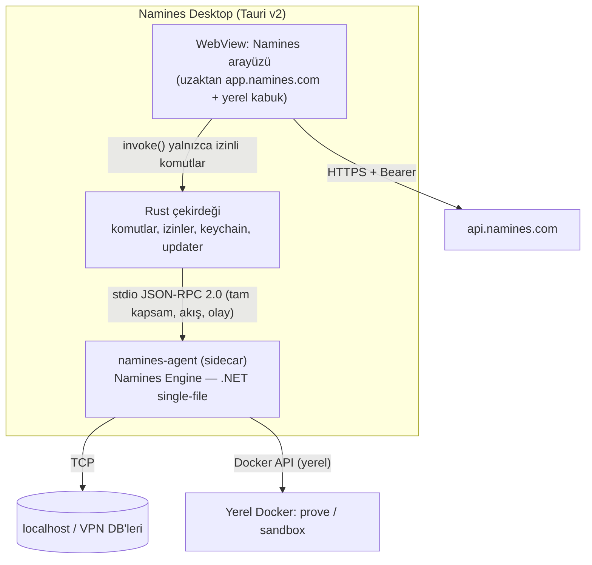

# 03 — Masaüstü uygulaması: Namines Desktop (Tauri v2)

> **Tek iş:** Web'in ulaşamadığı veritabanlarına güvenli erişim (localhost,
> yerel Docker, VPN/intranet, `.sqlite` dosyası) ve "canlıya göndermeden
> önce yerelde kanıtla" akışı. Web'in bir kopyası değildir.

---

## 1. Neden Tauri v2 (ve neden Electron değil)

| Ölçüt | Tauri v2 | Electron | PWA |
|---|---|---|---|
| Paket boyutu | ~10-15 MB (+ sidecar, bkz. §3) | 120-200 MB | 0 |
| Yerel TCP (`localhost:5432`) | ✅ Rust tarafında | ✅ Node tarafında | ❌ |
| Yetki modeli | **Capability/permission** sistemi, varsayılan kapalı | Node API'leri varsayılan açık, sertleştirmek ayrı iş | Tarayıcı sandbox'ı |
| OS keychain, deep link, updater, tek örnek | Resmi eklentiler | Paketler | Kısmi |
| Bellek | Sistem WebView'i (WebView2 / WKWebView) | Gömülü Chromium | Tarayıcı |

**Kabul edilen bedel:** Sistem WebView'leri farklı motorlar
(Windows: Chromium tabanlı WebView2, macOS: WebKit, Linux: WebKitGTK).
Monaco, React Flow ve canvas WebKit'te ayrıca test edilmeli. WebKit, bugünkü
Playwright e2e matrisine eklenir.

## 2. Mimari

### 2.1 Arayüz nereden yüklenir? (kritik karar)

Bugünkü `frontend/` bir Next.js 16 uygulaması. Bu uygulama şunları kullanıyor:
- `/api` ve `/hubs` rewrite'ları,
- dinamik kullanıcı rotaları (`/hub/[owner]/[slug]`),
- sunucu tarafı metadata.

`output: 'export'` ile statik pakete çevirmek bunları kırar.

**Öneri:**

- **v1:** Arayüz **uzaktan** (`https://app.namines.com`) yüklenir.
  - Tauri v2 capability'lerindeki `remote.urls` yalnızca bu origin'e izin verir. Başka hiçbir origin `invoke()` çağıramaz.
  - Yerel işlemler (yerel bağlantılar, yerel kanıt, dosya açma) için uzak arayüz `window.__TAURI__` varlığını algılar ve ilgili düğmeleri gösterir.
  - **Kazanç:** web'deki her düzeltme masaüstüne anında yansır, iki kod tabanı oluşmaz.
- **v2:** Çevrimdışı mod gerekirse yalnızca yerel ekranlardan (bağlantılar, SQL konsolu, şema tarayıcı) oluşan **ayrı bir SPA paketi** yazılır (Vite + aynı `packages/ui`). Tüm Next.js uygulamasını statik dışa aktarmaya çalışılmaz.

**Güvenlik notu:** Uzak içerik `invoke()` çağırabildiği için uzak origin'deki bir XSS, yerel ajana erişim demektir. Bu yüzden:
1. Masaüstüne açılan komutlar **dar** tutulur (§4).
2. Tehlikeli her komut (yerel DB'ye yazma, dosya yazma) Rust tarafında **yerel bir onay penceresi** açar. Bu pencere uzak içerikten bağımsızdır, onu web sayfası çizemez.
3. `app.namines.com` için katı CSP, denetimde başlayan XSS temizliğinin devamı olarak.

### 2.2 Yerel ajan: `namines-agent` (MCP değil)

> **Güncellendi (2026-10-30):** İlk taslakta masaüstü, mevcut MCP sunucusunun
> istemcisi olacaktı. Ürün sahibinin doğru tespiti: MCP bugün 211 API ucunun
> yalnızca 13'ünü kapsıyor (~%6). Ayrıca MCP, dil modeli araçları için
> tasarlanmış bir protokol: metin sonuç, akış yok, araç sayısı az olmalı.
> Karar ve gerekçe: **[10 — Namines Engine](10-MOTOR-VE-MCP-MIMARISI.md)**.

Yeni bir Rust veritabanı katmanı yazılmaz. Mevcut .NET çekirdeği (DDL
üretimi, diff, risk, introspection, Docker kanıtı) **Namines Engine**
kütüphanesine toplanır. Masaüstü bu motoru `namines-agent` sidecar'ı
üzerinden kullanır:
- **Kapsam:** Engine'in kayıt defterindeki **tüm** işlemler (yerel + bulut).
- **Taşıma:** stdio JSON-RPC 2.0; büyük sonuçlarda akış (`$/progress`), iptal (`$/cancelRequest`) ve olay aboneliği.
- **Ortak mantık:** IDE'lerin kullandığı `namines-mcp` aynı motorun **profilli** bir yüzeyidir. Mantık bir kez yazılır, iyileştirme iki yere birden gelir, ama masaüstü MCP'nin kısıtlarını taşımaz.

**Bedel:**
- .NET single-file + trimming ile ikili 35-60 MB olur. NativeAOT denenebilir ama EF/reflection kullanımı yüzünden riskli.
- Toplam kurulum ~50-70 MB. Electron'un altında kalır, "8 MB Tauri" vaadinin üstüne çıkar. Kabul edilebilir.

## 3. Özellikler (öncelik sırasıyla)

### v1 — "Yerel bağlantı" (MVP, 4-6 hafta)

1. **Giriş:** Device flow (bkz. [02](02-ORTAK-TEMEL.md) §2). Tarayıcıda "kodu onayla" adımı. Token OS keychain'de saklanır (`tauri-plugin-keyring` veya Stronghold).
2. **Yerel bağlantılar:**
   - `localhost`/VPN DB bağlantı dizeleri **yalnızca cihazda**, keychain'de durur. Buluta hiçbir zaman parola gitmez.
   - Buluttaki projeye "yerel bağlantı: var" etiketiyle eşlenir. Etiket sunucuda tutulur, dize tutulmaz.
3. **Şema çek ve karşılaştır:** Yerel DB'nin şeması çekilir, buluttaki branch ile diff'i ve risk raporu gösterilir.
4. **Yerelde kanıtla:** Bekleyen Change Request'in DDL'i yerel Docker'da (sidecar `prove`) çalıştırılır. Sonuç CR'a "yerelde kanıtlandı" kaydı olarak eklenir; bulut ham çıktıyı değil yalnızca özeti alır.
5. **Yerel SQL konsolu:** Varsayılan salt-okunur. Yazma için Rust tarafında yerel onay penceresi açılır.
6. **`.sqlite` dosyası aç:** Dosya ilişkilendirme (double-click) ve tek örnek (`single-instance`) desteği.
7. **Deep link:** `namines://` ile web'den "masaüstünde aç" bağlantıları.

### v2 — "Köprü" (Bridge) (3-4 hafta)

Masaüstü, kullanıcının **açık izniyle** buluttaki web arayüzüne yerel DB'yi geçici olarak açar:
- Tünel giden WebSocket ile kurulur, gelen port açılmaz. Supabase CLI / ngrok mantığı, ama uçtan uca kullanıcıya bağlı.
- **Oturum başına izin:** "Bu oturum 1 saat boyunca, yalnızca okuma, yalnızca X veritabanı."
- Her sorgu iki yerde denetim kaydına yazılır: yerel log ve buluttaki Gateway audit log.
- **Varsayılanı kapalı.** Organizasyon politikasıyla tamamen kapatılabilir.

### v3 — Çevrimdışı + tepsi (2-3 hafta)

- Tepside (system tray) bekleyen onay, başarısız yedek ve şema sapması (drift) uyarıları.
- Çevrimdışı mod: ayrı SPA ile yerel ekranlar (§2.1 v2).

## 4. İzin (capability) tasarımı

Masaüstü komutları **beyaz liste** ile açılır. Her komut ayrı bir izin dosyasında tanımlanır:

| Komut | Uzak origin çağırabilir mi | Yerel onay penceresi |
|---|---|---|
| `local_connections_list` (yalnızca ad/motor, dize değil) | ✅ | — |
| `local_schema_pull(connId)` | ✅ | İlk kullanımda |
| `local_query_readonly(connId, sql)` | ✅ | — (sidecar salt-okunur oturum açar) |
| `local_query_write(connId, sql)` | ✅ | **Her seferinde** |
| `local_prove(crId)` | ✅ | İlk kullanımda (Docker erişimi) |
| `local_connection_add/remove` | ❌ yalnızca yerel ayar ekranı | — |
| `bridge_start` | ❌ yalnızca yerel ekran | **Her seferinde** |
| dosya sistemi, shell | ❌ hiç açılmaz | — |

## 5. Güvenlik kontrol listesi

- [ ] Bağlantı dizeleri yalnızca OS keychain'de. Log'a ve hata mesajına yazılmaz (denetimdeki `DbConnectionFailure` sınıflandırması sidecar'da da kullanılır).
- [ ] Sidecar yalnızca uygulamanın kendi süreç ağacından ve stdio üzerinden konuşur, ağ portu açmaz.
- [ ] Updater imzalı (Tauri updater anahtarı); güncelleme manifesti yalnızca HTTPS.
- [ ] macOS notarization, Windows Authenticode (bkz. [02](02-ORTAK-TEMEL.md) §7).
- [ ] Remote origin capability yalnızca `https://app.namines.com`. Staging için ayrı derleme yapılır.
- [ ] Köprü kapalıyken buluttan yerel ağa hiçbir yol yok (testle kanıtlanır).

## 6. Dağıtım ve fiyat

- **İndirme:** `namines.com/download`, GitHub Releases, isteğe bağlı `winget` ve Homebrew cask.
- **Fiyatlama:** v1 bütün planlarda ücretsiz; masaüstü bir dağıtım kanalı. Köprü ve çoklu yerel bağlantı Pro/Team özelliği olabilir.

## 7. Riskler

| Risk | Etki | Azaltma |
|---|---|---|
| WebKit (macOS) uyumsuzluğu | Canvas/Monaco bozulur | e2e matrisine WebKit; v1'de macOS beta etiketi |
| Uzak XSS → yerel komut | Yüksek | Dar komutlar + yerel onay penceresi + CSP |
| Sidecar boyutu | Orta | Trimming; NativeAOT denemesi ayrı iş |
| Yerel Docker yok | `prove` çalışmaz | Bulut sandbox'a düşer (mevcut akış) |
| İmza maliyeti/süreci | Gecikme | İlk sürüm öncesi Apple/Azure hesapları açılır |

## 8. Kabul kriterleri (v1 "bitti" demek için)

1. Temiz bir macOS ve Windows makinede: kur → giriş yap → `localhost:5432` bağla → şema çek → buluttaki branch ile diff → yerelde `prove` geçti.
2. Bağlantı parolası ağ trafiğinde ve bulut veritabanında **hiç** görünmüyor (mitmproxy ile kanıtlanır).
3. `local_query_write` yerel onay penceresi olmadan çalışmıyor (testle).
4. İmzalı güncelleme bir önceki sürümden sorunsuz geliyor.
