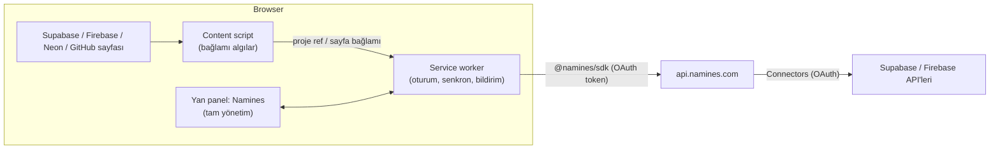

# 04 — Tarayıcı eklentisi: Namines Companion

> **Hedef (ürün sahibi, 2026-10-30):** Eklenti iki iş yapar:
> 1. Supabase, Firebase ve diğer konsollardan şemayı, tabloları, veritabanını
>    ve veriyi **otomatik** çeker.
> 2. Namines'i her an, sekme değiştirmeden **tam olarak** yönetmeyi sağlar.
>
> **Konumlandırma:** Supabase/Firebase'in **önüne geçmek değil, onlarla
> entegre çalışmak**. Kullanıcı Supabase'de kalır; Namines o ekranın
> yanında onun güvenlik, inceleme ve tasarım katmanı olur.
> Supabase'in yaptığını (barındırma, auth, storage) Namines tekrar yapmaz.

---

## 1. Ürün tanımı

**Önemli ilke:** Veriyi eklenti sayfadan kazımaz. Veri **sağlayıcının resmi
API'sinden, Namines bağlayıcısı üzerinden** gelir ([06](06-ENTEGRASYON-MIMARISI.md), [09](09-OAUTH-KATALOGU.md)).
Sayfa yalnızca **bağlam** verir: hangi proje, hangi tablo açık, hangi PR.
Bunun üç gerekçesi var:
- konsol arayüzü değişse bile veri akışı bozulmaz;
- kullanıcının oturum çerezlerine veya sayfadaki gizli değerlere dokunulmaz;
- mağaza incelemesinden geçer.

## 2. Otomatik çekme: "aç, bağlan, gör"

### 2.1 Akış

1. Kullanıcı `supabase.com/dashboard/project/<ref>` açar.
2. Content script `<ref>`'i algılar → service worker'a bildirir.
3. **Hesap henüz bağlı değilse**, panelde tek düğme gösterilir: "Supabase hesabını Namines'e bağla" (OAuth, [09](09-OAUTH-KATALOGU.md) C1). Bir kez yapılır.
4. **Bağlıysa** otomatik olarak:
   - **Şema:** bütün tablolar, sütunlar, ilişkiler, index'ler, enum'lar ve eklentiler IR'a çekilir. Namines'te bu projeye eşlenmiş bir proje yoksa "Namines projesi oluştur ve eşle" önerilir. Eşleme tek tıktır ve kalıcıdır.
   - **Güvenlik:** RLS durumu ve politikalar çekilir. Sorunlar panelde hemen gösterilir: "RLS kapalı 3 tablo", "`anon`'a açık 1 tablo".
   - **Fark (drift):** Namines'teki şema ile canlı şema farklıysa "Canlıda Namines'te olmayan 2 değişiklik var" uyarısı ve diff gösterilir.
   - **Veri:** tablo satırları **istek üzerine, sayfalı** olarak gösterilir. Namines'e kopyalanmaz (§2.3).
5. Kullanıcı Supabase'de tablo değiştirirse panel yeniden senkronize olur:
   - sayfa olayı algılanırsa (Table Editor kaydı), hemen;
   - algılanamazsa periyodik şema karması (hash) kontrolüyle (varsayılan 60 sn, yalnızca panel açıkken).

### 2.2 Firebase

- `console.firebase.google.com/project/<id>/firestore/...` algılanır.
- Google bağlantısıyla ([09](09-OAUTH-KATALOGU.md) C2):
  - **Firestore:** koleksiyonlar listelenir. Seçilen koleksiyon için şema çıkarımı yapılır (örnekleme, tip dağılımı, referans → ilişki önerisi; [07](07-ENTEGRASYON-KATALOGU.md) §3a). Panelde ER diyagramı gösterilir. Firestore'da bu görünüm yok; bu ürünün büyük farkı.
  - **Security Rules:** mevcut kurallar çekilir, çıkarılan şemayla karşılaştırılır ("`users` koleksiyonunda tip doğrulaması yok").
  - **Data Connect:** Postgres şeması IR'a doğrudan alınır.
  - **Veri:** belgeler istek üzerine, sayfalı gösterilir.

### 2.3 Veri politikası (entegrasyonun güven sözü)

| Kural | Neden |
|---|---|
| Satırlar ve belgeler varsayılan olarak **Namines'te saklanmaz**. Panel isteğe göre sağlayıcıdan okuyup gösterir | "Verim nereye gidiyor?" sorusunun cevabı: hiçbir yere |
| Okuma, sağlayıcının **en dar** yetkisiyle yapılır. Supabase'de **`service_role` anahtarı kullanılmaz**; Management API'nin salt-okuma SQL'i ile `SET TRANSACTION READ ONLY` uygulanır (doğrula) | RLS'i atlayan anahtar dolaşıma girmez |
| PII sütunları varsayılan maskeli gösterilir (mevcut `PiiMasker`) | Ekran paylaşımı ve omuz üstü sızma |
| Kopya (snapshot) yalnızca açık eylemle alınır: "Vault'a yedekle" veya "Desk'e içe aktar" | Kullanıcı kararı |
| Her okuma Gateway audit log'a yazılır | Denetlenebilirlik |

## 3. Namines'i eklentiden tam yönetme

Yan panel, **Namines'in kendisi**dir; ayrı bir mini uygulama değildir:
- web uygulamasının aynı bileşenleri (`packages/ui`) ve aynı SDK kullanılır;
- panel genişliğine göre yerleşim tek sütuna iner.

Panelden yapılabilenler:

| Alan | Eklentiden | Not |
|---|---|---|
| Projeler, branch'ler | Listele, oluştur, geçiş yap | — |
| Şema | Görüntüle (mini canvas), tablo/sütun düzenle, AI ile değişiklik iste | Büyük düzenlemede "tam ekranda aç" ile web sekmesine geçilir |
| Change Request | Aç, incele, yorumla, test çalıştır, **Safe/Risky onayla** | **Breaking/Destructive onayı mobil imza ister** ([05](05-MOBIL.md)) |
| Desk | Satır görüntüle/düzenle, salt-okuma SQL | Yazma ve ham SQL, mevcut sunucu yetki kurallarıyla |
| Vault | Yedek al, listele; geri yükleme **talebi** | Geri yükleme onayı mobilde |
| Ground | Durum, kota, duraklat/başlat | — |
| Flow | Kuralları aç/kapat, son çalışmalar | — |
| Hub | Ara, fork | — |
| Bildirimler | Gerçek zamanlı (SignalR), simge rozeti | Service worker uykudayken `chrome.alarms` ile hafif yoklama |

**Neden en riskli onaylar eklentide değil?**
- Tarayıcı, ikinci bir güven alanı değil. Eklentiyi ele geçiren bir saldırgan aynı tarayıcıdaki web oturumunu da ele geçirmiş olur.
- Breaking ve Destructive için ikinci anahtar telefondur. Organizasyon bu kuralı politika ile gevşetebilir ama varsayılan budur.

## 4. Desteklenen siteler (öncelik)

| Öncelik | Site | Bağlam algılama | Otomatik çekilen |
|---|---|---|---|
| v1 | Supabase Dashboard | project ref, açık tablo, SQL Editor seçimi | Şema, RLS, drift, veri (istekle) |
| v1 | Firebase Console | project id, koleksiyon | Firestore çıkarımı, Rules, Data Connect |
| v1 | GitHub PR | owner/repo/PR no | Şema farkı + risk (PR botuyla aynı motor) |
| v2 | Neon Console | project/branch | Şema, branch eşlemesi |
| v2 | PlanetScale | db/branch/deploy request | Deploy request ↔ CR |
| v2 | Cloudflare (D1) | account/db | Şema |
| v2 | Vercel | proje | Bağlı DB'ler, env eşlemesi |
| v3 | GitLab MR, Bitbucket PR, Turso, MongoDB Atlas | — | — |
| Her yerde | Herhangi bir sayfa | Kullanıcı seçimi (`activeTab`) | "Seçimden şema" (JSON/OpenAPI/tablo) |

## 5. Teknik temel

| Konu | Karar |
|---|---|
| Manifest | MV3 |
| Çatı | WXT (Chrome, Edge, Brave, Firefox tek kod tabanı) |
| UI | Side Panel API / Firefox `sidebar_action`; React + `packages/ui` |
| Kimlik | `launchWebAuthFlow` + PKCE → Namines yetkilendirme sunucusu ([02](02-ORTAK-TEMEL.md)) |
| Token | Access token `storage.session`'da, refresh token `storage.local`'da (rotasyonlu) |
| Gerçek zamanlı | Panel açıkken SignalR; kapalıyken `chrome.alarms` (MV3 service worker kalıcı değil) |
| Uzak kod | Yok. Site seçicileri **veri** olarak güncellenebilir |

### İzinler

- **Kurulumda:** `sidePanel`, `storage`, `identity`, `alarms`, `contextMenus`, `https://*.namines.com/*`.
- **İsteğe bağlı** (site ilk açıldığında sorulur):
  - `https://supabase.com/dashboard/*`
  - `https://console.firebase.google.com/*`
  - `https://github.com/*`
  - `https://console.neon.tech/*`
  - `https://app.planetscale.com/*`
  - `https://dash.cloudflare.com/*`
  - `https://vercel.com/*`
- **Hiçbir zaman:** `<all_urls>`, `cookies`, `webRequest`.

## 6. Güvenlik kontrol listesi

- [ ] Content script yalnızca URL'den ve görünür DOM'dan **bağlam** okur. API anahtarlarını, `service_role`'ü ve bağlantı dizelerini okumaz. Sahte gizli değer içeren test sayfasıyla otomatik kanıtlanır.
- [ ] Mesajlar zod ile doğrulanır; gönderen sekme ve origin kontrol edilir.
- [ ] Panel CSP: `script-src 'self'`; `eval` yok.
- [ ] Çıkışta token'lar silinir, sunucu tarafında token ailesi iptal edilir.
- [ ] Organizasyon politikası: "eklenti erişimi kapalı" veya "yalnızca okuma".
- [ ] Eklentinin token'ı `review:approve:high` scope'unu **taşımaz**.

## 7. Kırılganlık yönetimi

- Veri API'den geldiği için konsol değişince yalnızca **bağlam algılama** ve **düğme yerleşimi** bozulabilir.
- Seçici kayıt dosyası (JSON) uzaktan güncellenebilir. Bulunamazsa panel URL'den bağlam alır, yine çalışır.
- Her hedef site için haftalık Playwright sentetik testi yapılır.

## 8. Efor

| Sürüm | İçerik | Efor (1 geliştirici + ajanlar) | Bağımlılık |
|---|---|---|---|
| v1 | Kimlik, tam panel (projeler, şema, CR, Desk, bildirimler), Supabase otomatik çekme, Firebase Firestore çıkarımı, GitHub PR farkı | 6-8 hafta | [02](02-ORTAK-TEMEL.md), Supabase + Google bağlayıcıları |
| v2 | Neon, PlanetScale, D1, Vercel; Data Connect | 3-4 hafta | İlgili bağlayıcılar |
| v3 | GitLab/Bitbucket, Turso, Atlas, Safari | 3 hafta | — |

## 9. Başarı ölçütleri

- Eklentiyle bağlanan Supabase/Firebase proje sayısı.
- Panelden açılan CR oranı.
- Günlük panel açılışı / kurulum (kullanıcı gerçekten "tam zamanlı" kullanıyor mu?).
- Supabase/Firebase kullanıcılarında Namines'e bağlanma süresi (hedef: sayfa açılışından ilk şemaya < 30 sn).
