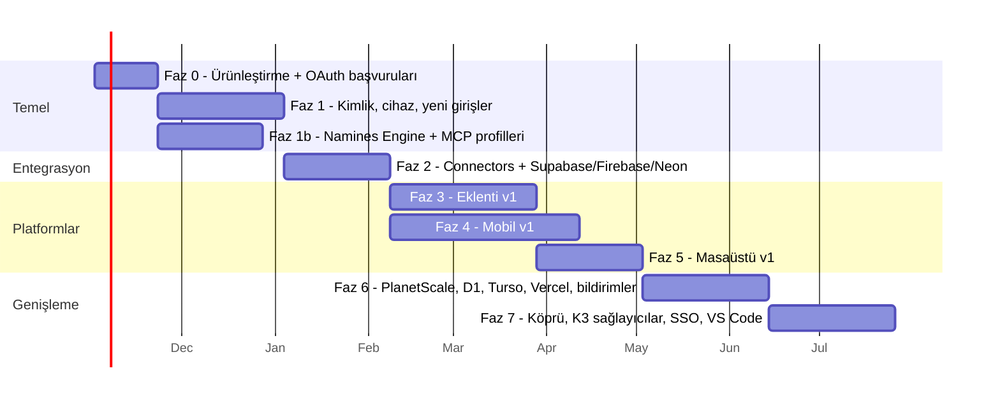

# 08 — Yol haritası, kapılar ve senden beklenen kararlar

> Varsayım: 1 geliştirici (kurucu) + AI ajanları. 2 geliştirici olursa
> paralel izler (aşağıda ⇄ ile işaretli) gerçekten paralel ilerler ve
> toplam süre ~%40 kısalır. Süreler takvim değil **efor**; her faz
> kapısından (gate) geçmeden sonraki faza geçilmez.

---

## Genel sıra

> Tarihler örnek: 2 Kasım 2026 başlangıç varsayımıyla. Gerçek takvim
> kapılardan geçişe göre kayar.

---

## Faz 0 — Ürünleştirme ve altyapı (≈3 hafta)

Platform yokken yapılacaklar. Yapılmazsa üç platform bozuk bir temele kurulur.

- `namines.com` + alt alan adları + kurumsal e-posta (18-plan Faz A).
- `main` için branch koruması: CI'daki 4 job zorunlu status check olur.
- Üretim gözlemlenebilirliği:
  - PostHog olayları gerçekten çağrılır;
  - hata takibi (Sentry veya muadili);
  - uptime izleme.
- Konumlandırma: landing ve README "güvenli DB değişikliği" mesajına göre yeniden yazılır (27-LIFECYCLE-PIVOT ile hizalı).
- Kural olarak yazılır: [01](01-PROJE-DEGERLENDIRMESI.md) §5'teki 6 madde, `AGENTS.md`'ye eklenir.
- Ekim denetiminin davranış değişiklikleri kullanıcılara duyurulur.
- **OAuth başvuruları paralel başlatılır** ([09](09-OAUTH-KATALOGU.md) §6). Uzun sürenler önce: Google hassas scope doğrulaması, Microsoft publisher verification, Apple Developer Program, Neon partner, PlanetScale OAuth erişimi, Vercel Marketplace.

**Kapı 0:**
- `namines.com` canlı;
- CI zorunlu;
- son 7 günde üretim hata oranı ölçülüyor;
- landing yeni mesajla yayında;
- OAuth başvurularının hepsi gönderilmiş.

## Faz 1 — Kimlik, cihaz ve yeni giriş sağlayıcıları (≈6 hafta) — [02](02-ORTAK-TEMEL.md), [09](09-OAUTH-KATALOGU.md)

- OpenIddict, refresh rotasyonu, device flow (`namines login` CLI'da hemen kullanılır).
- `/api/v1` + OpenAPI → `@namines/sdk`.
- Passkey (web), cihaz tablosu, `NotificationService`, push gönderici.
- Giriş: Microsoft, Apple, LinkedIn, GitLab. GitHub/Google external handler mimarisine taşınır. Hesap birleştirme kuralları ([09](09-OAUTH-KATALOGU.md) §4).

**Kapı 1:**
- CLI device flow ile giriş yapıyor;
- refresh token çalınma testi geçiyor;
- üye çıkarılınca token iptal testi geçiyor;
- SDK CI'da yayınlanıyor;
- 6 giriş sağlayıcısı prod'da çalışıyor;
- hesap birleştirme ele geçirme testleri geçiyor.

## Faz 1b — Namines Engine + MCP profilleri (≈5 hafta, Faz 1 ile ⇄) — [10](10-MOTOR-VE-MCP-MIMARISI.md)

- `Namines.Engine` + işlem kayıt defteri. Mevcut 13 MCP aracı davranış değişmeden taşınır.
- `namines-mcp` toolset ve profiller; yerel toolset'ler hemen, bulut toolset'leri Faz 1 bitince (~45 araç).
- `namines-agent` JSON-RPC host (akış, iptal, olaylar).

**Kapı 1b:** [10](10-MOTOR-VE-MCP-MIMARISI.md) §7'deki kriterler 1-4.

## Faz 2 — Connectors + Supabase + Firebase + Neon (≈5 hafta) — [06](06-ENTEGRASYON-MIMARISI.md), [07](07-ENTEGRASYON-KATALOGU.md)

- `Namines.Connectors`, "Bağlantılarım" ekranı, uygunluk kiti.
- Supabase: keşif, introspect, RLS risk kuralları, istek üzerine veri okuma, uygula.
- **Firebase** (eklenti v1 için öne alındı): Firestore çıkarımı, Rules okuma, Data Connect şeması, istek üzerine belge okuma.
- ⇄ Neon: keşif, branch başına CR + gerçek veriyle "Run Tests".
- Mobil kontrol eylemleri için `Control` yeteneği: Neon suspend/resume, Supabase pause, Ground stop.
- Genel Postgres/MySQL bağlantısı çerçeveye taşınır. Cloudflare token yolu eklenir.

**Kapı 2:**
- Gerçek bir Supabase projesi bağlanıp RLS uyarısı üretiyor;
- gerçek bir Firestore projesinden ER diyagramı çıkıyor;
- Neon'da CR → branch → test → merge akışı uçtan uca çalışıyor;
- gece duman testleri yeşil.

## Faz 3 — Tarayıcı eklentisi v1 (≈7 hafta) — [04](04-TARAYICI-EKLENTISI.md)

- Supabase ve Firebase'den otomatik şema/veri çekme ve drift uyarısı.
- Eklentiden tam Namines yönetimi: projeler, şema, CR, Desk, Vault, Ground, Flow, bildirimler.
- GitHub PR görsel farkı, seçimden şema.
- Chrome, Edge ve Firefox mağazaları.

**Kapı 3:**
- Üç mağazada yayında;
- Supabase sayfası açılışından ilk şemaya < 30 sn;
- PR farkı → kayıt dönüşümü ölçülüyor;
- seçici kırılma alarmı çalışıyor.

## Faz 4 — Mobil v1 (≈9 hafta, Faz 3 ile ⇄) — [05](05-MOBIL.md)

- Expo (development build) + kendi güvenlik native modülü (Secure Enclave / StrongBox imza).
- Pano, kontrol eylemleri (duraklat/başlat, salt-okuma, kill, dondur), talimat → plan → onay.
- İmzalı onay, iki kişi kuralı, alarmlar, cihaz yönetimi, Apple ile giriş.
- TestFlight / Play iç test → mağaza.

**Kapı 4:** [05](05-MOBIL.md) §8'deki 5 kabul kriterinin hepsi otomatik testle kanıtlı; dış bir güvenlik incelemesi (en azından bir pentest firmasından mobil + onay API'si için sınırlı kapsamlı test) yapılmış.

## Faz 5 — Masaüstü v1 (≈5 hafta) — [03](03-MASAUSTU-TAURI.md)

- Tauri kabuğu, `namines-agent` sidecar (Faz 1b'de hazır), yerel bağlantılar, yerelde kanıt, yerel SQL konsolu, Namines'in tamamına erişim.
- macOS notarization, Windows imza, updater.

**Kapı 5:** [03](03-MASAUSTU-TAURI.md) §8'deki 4 kriter; parola ağ trafiğinde görünmüyor (mitmproxy kanıtı).

## Faz 6 — K2 sağlayıcılar ve bildirimler (≈6 hafta)

- PlanetScale (deploy request eşlemesi), Cloudflare D1, Turso, Vercel (env eşleme + Marketplace).
- Slack, Teams, Discord bildirimleri; Jira/Linear CR bağlama.
- Eklenti v2 panelleri bu sağlayıcılar için.

## Faz 7 — Genişleme (≈6 hafta)

- Masaüstü köprüsü (Bridge).
- MongoDB Atlas, AWS RDS (IAM + köprü), GCP, Azure, Heroku, DigitalOcean.
- Kurumsal SSO (SAML/OIDC), GitLab/Bitbucket botları.
- VS Code / Cursor eklentisi (18-plan §8.2): tek tık MCP kurulumu + mini canvas.
- Remote MCP + OAuth (Claude.ai / ChatGPT'den "Namines'i bağla"); Engine ve yetkilendirme sunucusu hazır olduğu için küçük iş.

---

## Bilinçli olarak sonraya bırakılanlar

| Fikir | Neden şimdi değil |
|---|---|
| Mobilde şema tasarımı | Etkileşim modeli baştan tasarım ister; kamaya hizmet etmiyor (MOBIL-HEDEFI) |
| Safari eklentisi | Xcode dönüşümü + ayrı mağaza; talep ölçülünce |
| Tüm Next.js uygulamasını masaüstünde çevrimdışı paketlemek | Rewrite/dinamik rota yapısı; ayrı SPA daha ucuz |
| Kendi passkey kasası | Platform kasaları zaten iyi; kendi kasamız yeni bir saldırı yüzeyi |
| Electron | Tauri'nin güvenlik modeli ve boyutu daha uygun |

## Risk kaydı

| Risk | Olasılık | Etki | Azaltma |
|---|---|---|---|
| Tek geliştiricide odak dağılması (yine) | Yüksek | Yüksek | Faz kapıları; aynı anda en fazla 1 platform + 1 bağlayıcı |
| Sağlayıcı OAuth programı onay vermez / gecikir | Orta | Orta | Her sağlayıcıda token yolu v1, OAuth v2 |
| Mağaza reddi (eklenti, mobil) | Orta | Orta | En dar izin; gizlilik politikası; tek amaç tanımı |
| Mobil imza akışında kriptografi hatası | Düşük | **Çok yüksek** | Standart kütüphaneler; dış inceleme (Kapı 4) |
| WebKit uyumsuzluğu (masaüstü macOS) | Orta | Orta | e2e matrisi; macOS beta |
| İmza ve mağaza hesap maliyetleri / ABD şirketi süreci | Düşük | Düşük | Faz 0'da hesaplar açılır |

---

## Senden beklenen kararlar

Her kararın varsayılanı (karar verilmezse ne olacağı) yanında.

| # | Karar | Önerim | Varsayılan |
|---|---|---|---|
| K-1 | Faz 0'ı (ürünleştirme) yeni platformlardan önce yapmayı kabul ediyor musun? | Evet | Evet |
| K-2 | Yetkilendirme sunucusu: OpenIddict mi, harici (Auth0/Keycloak) mı? | OpenIddict | OpenIddict |
| K-3 | Mobil teknoloji: Expo (development build + kendi güvenlik modülü). Gerekçe [05](05-MOBIL.md) §1 | Expo | Expo |
| K-4 | Masaüstü arayüzü v1'de uzaktan mı yüklensin (`app.namines.com`)? | Evet | Evet |
| K-5 | Destructive değişiklikte mobil imza + iki kişi kuralı **varsayılan açık** mı olsun (Team planında)? | Evet | Kapalı, organizasyon açar |
| K-6 | İlk platform: eklenti mi, mobil mi? | Eklenti (büyüme), mobil ⇄ paralel | Eklenti |
| K-7 | Firebase önceliği: Firestore çıkarımı mı, Data Connect mi önce? | Firestore (kitle büyük) | Firestore |
| K-8 | Masaüstü ve eklenti fiyatlaması: ücretsiz dağıtım kanalı mı? | Evet; köprü Pro | Ücretsiz |
| K-9 | Monorepo'ya `apps/` düzeni (web yerinde kalabilir) | Evet | Evet |
| K-10 | Dış güvenlik incelemesi bütçesi (mobil v1 öncesi) | Evet, sınırlı kapsam | Hayır (risk kabul) |
| K-11 | Masaüstü/IDE: "tek motor, üç yüzey" ([10](10-MOTOR-VE-MCP-MIMARISI.md)), iki ayrı MCP yerine | Evet | Evet |
| K-12 | Eklentide Safe/Risky onayına izin, Breaking/Destructive mobilde | Evet | Evet |
| K-13 | Eklentide okunan satırlar varsayılan olarak Namines'te saklanmasın (yalnızca açık "yedekle/içe aktar" ile) | Evet | Evet |
| K-14 | Mobil kontrol eylemleri ("kapat/duraklat") için imza zorunlu | Evet | Evet |
| K-15 | Giriş sağlayıcıları: Facebook/X eklenmesin | Evet | Eklenmez |
