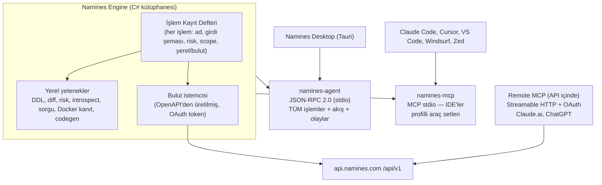

# 10 — Namines Engine: masaüstü, IDE MCP ve Remote MCP için tek motor

> **Soru (ürün sahibi, 2026-10-30):** MCP bugün her şeye erişim vermiyor.
> Masaüstünü doğrudan MCP'ye bağlarsak kısıtlı kalır. MCP'yi çok
> kapsamlı mı yapalım, yoksa biri masaüstü biri IDE için iki MCP mi?
>
> **Kısa cevap:** İkisi de değil, ikisinin iyi tarafı. **Tek bir motor
> (Namines Engine)** ve üzerinde **üç ince yüzey**:
> 1. masaüstü için tam kapsamlı yerel ajan (`namines-agent`, MCP değil);
> 2. IDE'ler için kapsamlı ama profilli MCP (`namines-mcp`);
> 3. Claude.ai/ChatGPT için sunucuda Remote MCP.
>
> Her işlem **bir kez** yazılır, üç yüzeye de açılır.

---

## 1. Ölçüm: bugün MCP ne kadarını kapsıyor?

| | Sayı |
|---|---|
| API controller | 43 |
| HTTP uç noktası | **211** |
| MCP aracı | **13** |

Bugünkü 13 araç:
- şema: `analyze_impact`, `generate_ddl`, `generate_prisma`, `generate_artifact`, `list_artifact_targets`;
- değişiklik: `open_change_request`, `prove_migration`, `pull_schema`;
- Desk: `desk_browse_table`, `desk_execute_query`;
- Flow: `flow_match_rules`;
- Hub: `hub_search_blueprints`, `hub_get_blueprint`.

Vault, Ground, Gateway anahtarları, CR inceleme/onay, Flow yönetimi,
takım, bağlayıcılar ve güvenlik **yok**. Masaüstünü bu yüzeye bağlamak
ürünün yaklaşık **%6'sını** masaüstüne taşımak olurdu. Endişe doğru.

## 2. Neden masaüstü MCP konuşmamalı?

MCP, **bir dil modelinin araç çağırması** için tasarlanmış bir protokol. Masaüstü uygulamasının ihtiyaçları farklı:

| İhtiyaç | MCP (LLM aracı) | Masaüstü arayüzü |
|---|---|---|
| Sonuç biçimi | Metin/JSON içerik bloğu, modelin okuyacağı kadar | Tipli veri: 100 bin satırlık tablo, ER grafiği |
| Akış (streaming) | Sınırlı | Satırlar parça parça gelmeli, iptal edilebilmeli |
| Olaylar | Bildirim var ama UI aboneliği için değil | "Şema değişti", "sorgu bitti", "köprü bağlandı" abonelikleri |
| Araç sayısı | **Az olmalı.** Modelin bağlamı yüzlerce araçla dolar ve seçim kalitesi düşer | Sınırsız: arayüz her işlevi çağırabilmeli |
| Onay modeli | Model çağırır, insan istemcide onaylar | Kullanıcı zaten insan; yerel onay penceresi |

Bu yüzden "masaüstü için ikinci bir MCP" de yanlış soyutlama olur: MCP'nin kısıtlarını (araç sayısı, metin sonuç) masaüstüne taşır.

## 3. Mimari



### 3.1 İşlem Kayıt Defteri (Operation Registry)

Her yetenek bir kez, **meta veriyle** tanımlanır:

```csharp
[NaminesOperation(
    Name = "vault.backup.create",
    Toolset = "vault",
    Risk = OperationRisk.Write,          // Read | Write | Destructive | Control
    Scope = "vault:write",
    Location = OperationLocation.Cloud)] // Local | Cloud | Hybrid
public sealed record CreateBackup(string ProjectId, string? Label) : IOperation<BackupResult>;
```

- **Yüzeyler bu kayıttan otomatik üretilir:**
  - `namines-agent` her işlemi bir JSON-RPC metodu olarak açar;
  - `namines-mcp` işlemleri profillerine göre MCP aracı olarak açar;
  - Remote MCP aynı listeyi sunucu tarafında açar.
- **Girdi şeması tek kaynaktan gelir:** C# record → JSON Schema. MCP araç şeması ve masaüstünün TS tipleri bundan üretilir. Bugün `NaminesTools.cs`'de el yazısı açıklamalar ve parametre adları kayıyordu (denetimde `base_schema_json` ↔ `baseSchemaJson` uyuşmazlığı ve var olmayan `migration.golang-migrate` hedefi bulundu); tek kaynak bu sınıf hatayı kaldırır.
- **Risk ve scope meta verisi** her yüzeyde aynı kuralları uygular (§5).

### 3.2 `namines-agent`: masaüstünün tam kapsamlı ajanı

- **Taşıma:** stdio üzerinden JSON-RPC 2.0. Tauri sidecar olarak başlatır, ağ portu açmaz ([03](03-MASAUSTU-TAURI.md) §2).
- **Kapsam:** kayıt defterindeki **tüm** işlemler (hedef: API'nin dış kullanıma uygun ~150+ ucunun tamamı + yerel yetenekler).
- **Akış ve iptal:**
  - `desk.query` sonuçları parça parça (`$/progress`) gelir;
  - iptal için `$/cancelRequest` (LSP'deki desen);
  - olaylar: `events.subscribe("schema.changed" | "bridge.status" | "query.finished")`.
- **Kimlik:** device flow ile alınan token ([02](02-ORTAK-TEMEL.md)). Token'ı agent değil Tauri tutar (OS keychain); her çağrıda agent'a geçirir. Agent diske yazmaz.
- **Dağıtım:** .NET single-file, Windows/macOS/Linux için ayrı ikili.

### 3.3 `namines-mcp`: IDE'ler için kapsamlı ama profilli

MCP'yi kapsamlı yapmak gerekiyor, ama **bütün araçları birden açmak** modelin araç seçimini bozar. Çözüm: **araç setleri (toolsets) + profiller**.

| Toolset | Örnek araçlar | Varsayılan profilde |
|---|---|---|
| `schema` | pull, diff, analyze_impact, generate_ddl/prisma/artifact, lint | ✅ |
| `review` | open/list/get CR, run_tests, comment, **request_approval** (onay vermez, link üretir) | ✅ |
| `desk` | browse_table, query_readonly, explain | ✅ |
| `local` | yerel bağlantıları listele, yerel introspect, yerel prove | ✅ |
| `vault` | list/create backup, restore **talebi** | ➖ |
| `ground` | status, provision, pause/resume **talebi** | ➖ |
| `flow` | list/toggle rules, run history | ➖ |
| `connectors` | Supabase/Firebase/Neon keşif, introspect | ➖ |
| `hub` | search/get/fork blueprint | ➖ |
| `security` | API anahtarları, denetim kaydı araması | ➖ |

**Profiller:**
- `readonly`: yalnızca okuma.
- `developer` (varsayılan): yukarıdaki ✅'ler.
- `full`: hepsi.
- `custom`: `--toolsets schema,review,vault` ile seçilir.

Konfigürasyonda tek satırdır. Mevcut `.mcp.json` / `.cursor/mcp.json` dosyalarına `"args": ["--profile", "developer"]` eklenir.

**Hedef:** v1'de 13 araçtan **~45** araca (10 toolset). Varsayılan profilde ~20.

### 3.4 Remote MCP

- **Neden:** Claude.ai, ChatGPT ve mobil asistanlar yerel stdio MCP çalıştıramıyor. Bu istemciler için MCP'nin sunucuda (HTTP) çalışması gerekiyor.
- **Nerede:** API içinde `/mcp` ucu, Streamable HTTP taşıması. Kimlik [02](02-ORTAK-TEMEL.md)'deki yetkilendirme sunucusundan gelir: Auth Code + PKCE + dinamik istemci kaydı.
- **Kapsam:** yalnızca **bulut** işlemleri. Yerel işlemler (yerel DB, yerel Docker) burada yok. Kullanıcının yerel DB'si gerekiyorsa masaüstü köprüsü ([03](03-MASAUSTU-TAURI.md) §3 v2) devreye girer.
- **Kazanç:** Kullanıcının kendi Claude/ChatGPT aboneliği AI maliyetini öder (18-plan §9.3 Yöntem 3).

## 4. "İki MCP" önerisiyle karşılaştırma

| | Tek kapsamlı MCP | İki ayrı MCP (masaüstü + IDE) | **Önerilen: tek motor, üç yüzey** |
|---|---|---|---|
| Masaüstü tüm işlevlere erişir | ✅ ama MCP kısıtlarıyla (metin sonuç, akış yok) | ✅ aynı kısıtlarla | ✅ **tipli, akışlı, olaylı** |
| IDE'de modelin araç seçimi | ❌ çok araç → kalite düşer | ✅ | ✅ profillerle |
| Kod tekrarı | Yok | **İki kod tabanı, kayma riski** | Yok (kayıt defteri) |
| Claude.ai / ChatGPT | ❌ (stdio) | ❌ | ✅ Remote MCP |
| Bakım | Orta | Yüksek | Düşük-orta |

Senin "iki MCP" önerisindeki doğru içgörü şu: masaüstü ile IDE'nin ihtiyaçları farklı. Bu öneri o farkı **taşıma ve sunum katmanında** karşılıyor; mantığı iki kez yazmıyor.

## 5. Güvenlik kuralları (bütün yüzeylerde aynı)

| İşlem riski | Agent (masaüstü) | MCP (IDE) | Remote MCP |
|---|---|---|---|
| `Read` | Çalışır | Çalışır | Çalışır |
| `Write` (Desk satırı, yedek al) | Yerel onay penceresi (ilk kullanım) | MCP istemcisinin onayı + `destructiveHint=false` | İstemci onayı |
| `Destructive` (DDL, geri yükleme, silme) | **CR açılır**, onay web/mobilde | **CR açılır**, araç onay bağlantısı döner, **asla doğrudan çalışmaz** | Aynı |
| `Control` (pause, kill, dondur) | Mobil imza ister ([05](05-MOBIL.md)) | Yalnızca **talep** oluşturur | Yalnızca talep |

- MCP araç açıklamaları ve `annotations` (`readOnlyHint`, `destructiveHint`) kayıt defterindeki risk değerinden üretilir. Denetimdeki "açıklama 'Safely' diyordu ama her şeyi çalıştırıyordu" (C-2) sorunu yapısal olarak kapanır.
- MCP'nin `McpConnectionGuard`'ı (denetimde güçlendirildi) agent'ta da aynı kodla kullanılır.
- **Prompt injection'a karşı:** DB'den okunan içerik (satırlar, yorumlar) araç sonucunda **veri** olarak işaretlenir. Engine hiçbir zaman okuduğu içerikten talimat çıkarmaz.

## 6. Uygulama planı

| Adım | İçerik | Efor |
|---|---|---|
| 1 | `Namines.Engine` projesi: kayıt defteri, işlem arayüzü, JSON Schema üretimi; mevcut 13 MCP aracını işleme taşı (davranış aynı, testler aynı) | 1.5 hafta |
| 2 | OpenAPI'den C# bulut istemcisi ([02](02-ORTAK-TEMEL.md) `/api/v1` ile) | 1 hafta |
| 3 | `namines-mcp`: toolset + profil; 13 → ~45 araç (review, vault, ground, flow, connectors, security) | 2-3 hafta |
| 4 | `namines-agent`: JSON-RPC host, akış, iptal, olaylar; TS tip üretimi | 2 hafta |
| 5 | Remote MCP (`/mcp`, Streamable HTTP, OAuth) | 1.5 hafta |
| 6 | Uygunluk testleri: her işlem üç yüzeyde aynı sonucu ve aynı risk davranışını veriyor | sürekli |

**Bağımlılık:** adım 2, 3 (bulut toolset'leri) ve 5 için [02](02-ORTAK-TEMEL.md) Faz 1. Adım 1 ve yerel toolset'ler hemen başlayabilir.

## 7. Kabul kriterleri

1. Kayıt defterindeki her işlem `namines-agent`'ta metot, `namines-mcp`'de (profiline göre) araç olarak görünüyor ve isim/şema farkı yok (otomatik test).
2. `Destructive` riskli hiçbir işlem MCP veya Remote MCP üzerinden **doğrudan** çalışmıyor; CR ve onay bağlantısı dönüyor (test).
3. `developer` profili ≤ 25 araç; `full` ≥ 45 araç.
4. Masaüstünde 100 bin satırlık sorgu akışla geliyor ve iptal edilebiliyor.
5. Claude.ai'den Remote MCP ile OAuth bağlantısı kurulup `schema.pull` çalışıyor.
